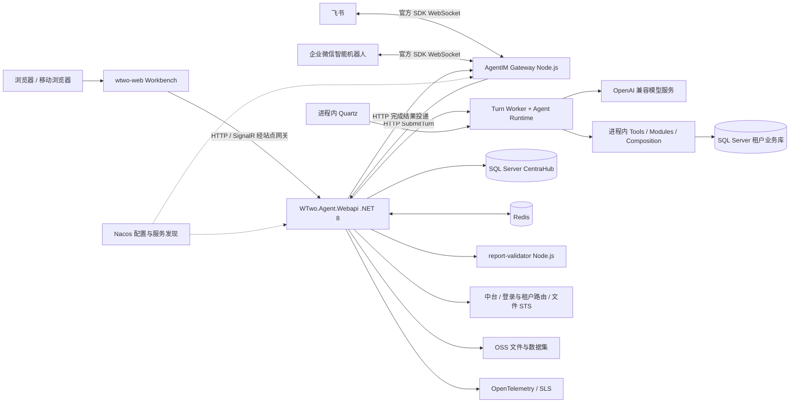

# AIRA / WTwo Workbench 技术框架总览

提取日期：2026-10-29。对象：当前本地工作区，不代表生产版本。文中“已实现”指存在可追踪的源码路径，没有以线上联调证明；“复刻建议”是根据实现整理的重建顺序。

## 1. 项目是什么

AIRA 是面向教育机构业务的 AI 工作台。它把自然语言会话、业务操作、结构化产物、文件和监控任务放进同一个 Web 工作空间。模型负责理解需求、选择工具和生成说明；业务模块负责查数、权限、计算口径和写入约束；工作台负责展示、用户确认以及界面操作。

可以用下面这段介绍项目：

> 前端用 Vue 3、TypeScript、Pinia 和 Vite 构建工作台，HTTP 负责业务接口与历史查询，SignalR 负责实时聊天和双向界面操作。后端基于 .NET 8 和 Microsoft Agent Framework，使用 OpenAI 兼容 ChatClient 接模型，以持久化 Turn 队列统一网页、IM 和定时任务入口。飞书、企业微信由独立 Node.js 网关维护官方 SDK 长连接。Agent 的提示词、版本和 Skill 以 SQL Server 中心库为正本，运行时物化为文件并按需加载。多租户业务能力主要通过进程内 .NET 模块调用，FreeSql 管理 SQL Server 租户库，Redis 用于缓存、实例协调和跨实例推送，Nacos 管理环境配置，OSS 保存文件，Quartz 负责进程内定时调度。

这不是单纯的聊天页面，也不能仅用一个 system prompt 重建全部功能。要重建的是“身份与租户 → 会话任务 → 模型工具循环 → 业务能力 → 产物与交付”的完整契约。

## 2. 运行拓扑

图中的 .NET Modules 是类库，通常随 Agent 进程一起运行。它们不是每个模块一个 HTTP 微服务。仓库还有 Academic、User、Share、Report、Evaluation 等独立宿主；工作台完整业务依赖其网关入口及老系统能力，但基础聊天不要求模型逐个调用这些宿主。

证据：`wtwo-server/WTwo.Agent.Web/WTwo.Agent.Service/WTwo.Agent.Service.csproj:18`（项目引用）；`wtwo-server/WTwo.Agent.Web/WTwo.Agent.Webapi/Program.cs:105`、`:315`、`:326`、`:349`（数据库及模块注册）；`wtwo-server/README.md:40`（部署层概览，细节需与源码交叉核对）。

## 3. 模块责任

| 层 | 主要目录 | 实际责任 |
|---|---|---|
| Workbench 产品界面 | `wtwo-web/src/workbench/` | 桌面窗口、专业模式、移动布局、聊天、App 与产物、状态持久化 |
| HTTP / Hub 入口 | `WTwo.Agent.Webapi/Controllers`、`WTwo.Agent.Service/Workbench/Hubs` | 参数、身份、会话归属、入队、实时协议 |
| Agent 引擎 | `WTwo.Agent.Service/Framework` | Agent 装配、模型装饰器、上下文、工具循环、Turn、历史和可观测 |
| 工作台适配 | `WTwo.Agent.Service/Workbench` | App manifest、Op RPC、工作对象、推送、IM 交付 |
| AI 产品能力 | `WTwo.Agent.Service/Capabilities` | 指标、监控、线索评分/话术、家校、学员运营、提醒等 |
| 工具适配层 | `WTwo.Agent.Service/Tools` | 将业务能力包装为模型可调用函数，补充权限和参数约束 |
| 业务模块 | `WTwo.Modules` | 各域 Application/Domain/Infrastructure、跨域只读 Operations、跨模块动作 Composition |
| IM 网关 | `WTwo.AgentIM.Web/WTwo.AgentIM.GateWay` | 平台连接、消息标准化、附件处理、回发与重连 |
| 公共基础层 | `WTwo.Bus.Common`、`WTwo.Common` | 用户权限、租户库、HTTP、OSS、MQ、日志、调度 |

以上后端相对路径均在 `wtwo-server/` 内。

## 4. 核心技术与选型效果

| 技术 | 在本项目中解决什么问题 | 不能据此推断什么 |
|---|---|---|
| Vue 3 / Pinia / TypeScript | 多窗口和会话状态、组件化工作台、类型化协议 | 不能把所有 App 都当成专业模式兼容 |
| SignalR | 流式文本、工具步骤、会话事件、浏览器操作回执 | 不承担持久任务队列；刷新恢复靠数据库历史 |
| Microsoft.Agents.AI 1.15.0 / MEAI 10.6.0 | Agent、AIFunction、上下文提供器和模型调用抽象 | 没有证据表明主流程采用 LangGraph 或固定 DAG |
| OpenAI 兼容客户端 | 使用 Endpoint、ApiKey、Deployment 选择模型 | 不代表只能用 OpenAI 官方，也不代表任意兼容服务能力一致 |
| FreeSql | 多数据库访问和实体映射 | 主业务库实际为 SQL Server，不能照旧说明写成 MySQL |
| Redis / FreeRedis | 缓存、实例心跳、取消广播、推送 relay、浏览器 RPC 状态 | 当前跨实例 SignalR 并非官方 StackExchange.Redis backplane |
| Nacos SDK | 远端配置合并、服务注册/发现 | 本地配置不含完整远端值；热更新不等于所有 singleton 即时重建 |
| Quartz 3.13.1 | 进程内任务触发、中心库元数据、分布式锁 | 不应把旧 ScheduleMaster HTTP 回调当主执行架构 |
| Node.js 22 / canvas / ECharts / ExcelJS | 图表、表格文件及部分云文档 CLI | 运行时不需要模型自行 npm install |
| DuckDB.NET / OpenXML | 文件和数据集处理能力 | 并非向量库，不等于已部署 RAG |
| OpenTelemetry / 阿里云 SLS | 模型/工具/Turn 追踪、诊断 | 日志内容采集配置需要独立检查 |

完整包版本见[依赖版本附录](./附录-依赖版本清单.md)。这里列的是源码声明版本，锁文件和运行镜像决定最终版本。

## 5. 三条最重要的执行链

### 5.1 浏览器发一条消息

1. 前端取得机构和用户身份，建立常驻 SignalR 连接，注册 App manifest。
2. Hub 校验会话归属，把消息变成 Turn，写入中心库并绑定入口实例。
3. Worker 按环境、实例归属和租约条件领取任务，建立后台租户/用户上下文。
4. 根据数据库启用实例和版本装配 Agent。系统提示词、历史、Skill 目录、工作记忆、当前 UI 上下文共同构成输入。
5. 模型提出工具调用；代码处理参数、权限、审批、业务执行、结果裁剪和保存。
6. 流式事件带会话标识回到前端。前端过滤后台会话事件，避免串话和意外开窗。
7. 最终结果、工具过程、产物版本入库。重连或刷新后通过历史重放和 Turn 状态恢复。

详细方法与事件契约见第 01、03、04 章。

### 5.2 飞书或企业微信发一条消息

平台 SDK → Node adapter → 标准消息 → AgentGateway.SubmitTurn → 解析机器人/IM 用户绑定 → 同一 Turn 引擎 → ImMessageDeliveryClient → 网关发送接口 → 平台 SDK。

IM 与浏览器共享任务引擎，但交互能力不完全相同。当前 IM 不提供 Workbench 同款审批卡和选择题；详情和绑定边界见第 02 章。

### 5.3 定时监控或提醒

Quartz → MonitorScheduleTask / ReminderScheduleTask → 构造用户/机构上下文或指标输入 → schedule 渠道 Turn → 模型分析/提醒结果 → 监控或提醒交付服务 → IM/工作台。

元数据在 CentraHub 的 `tScheduleTask/tScheduleExecutionLog/tScheduleLock`，调度引擎在 Agent 进程内。旧 ScheduleMaster 客户端仍为迁移等功能存在，不能据此判断新任务仍交给旧服务执行。证据：`Program.cs:945`、`WTwo.Common/WTwo.Schedule/Extensions/ScheduleServiceCollectionExtensions.cs:12`。

## 6. 服务调用矩阵

| 调用方 → 被调用方 | 协议 | 目的 | 配置/实现依据 |
|---|---|---|---|
| 浏览器 → Agent | HTTP + SignalR | 会话、业务、产物、实时事件 | Hub `/agent/workbench-hub`；网关入口另有 `/api` 前缀，见第 01 章 |
| IM Gateway → Agent | HTTP | SubmitTurn、绑定/权限相关查询 | 第 02 章中的网关配置与 adapter |
| Agent → IM Gateway | HTTP | 回复文本/附件及机器人管理 | `Workbench/Push/ImMessageDeliveryClient.cs`、`ImBotProvisionService.cs` |
| Agent → 模型供应商 | HTTPS OpenAI 兼容接口 | Chat completion / function calling / vision | `AppSettings:OpenAI` 和 Agent 数据库版本 |
| Agent → 业务模块 | .NET DI 直接调用 | 查数和确定性业务动作 | Service/Webapi 的 ProjectReference、Program 注册 |
| Agent → 公共网关 | HTTP | 按机构取得数据库信息、机构资料 | `ExternalHttpService.GetConnectionStringAsync`，`AppSettings:PublicGateUrl` |
| Agent → 中台文件服务 → OSS | HTTP + OSS SDK | STS、文件登记、对象上传 | `AppSettings:ZtServerUrl`、`OssUpload` |
| Agent → report-validator | HTTP POST `/validate` | 验证报表 DOM 和图表能否渲染 | `AppSettings:ReportValidatorUrl` |
| Agent → 微信消息服务 | MQ/公共 HTTP | 家校通知等业务消息 | `MQConfig`、`AppSettings:WXServerUrl`，不同于企微 AI bot |
| 外部 AI 助手 → Agent MCP | Streamable HTTP + OAuth | 使用已有业务工具 | `/agent/mcp`、`AppSettings:AgentOAuth` |

## 7. 不能照搬旧文档的地方

- Agent 实例来自数据库注册表，通常按首次使用构建；但 `Program.cs:594` 启动时会立即构建默认 `gclaw`，它必须已启用且配置完整。不能按旧说明硬写成 Program 固定注册七个 Agent，也不能只准备 `gclaw-workbench`。
- Skill Markdown 是本地参考快照；数据库的全局提示词、Agent 版本和 Skill 发布修订会改变实际行为。
- 租户业务库为 SQL Server；ADB/MySQL 是另一条数据连接。
- Workbench 切换会话时保持连接，后端校验归属并退出旧会话组。不能依赖“只加组不退组”补历史。
- `WTwo.Modules` 并非全部功能已实现；例如 Mall/Marketing 仍有骨架，Composition 也有待实现入口。
- 模型失败切换主要针对限流，不是任何错误都无损切换。
- 当前代码有外部平台绑定、管理鉴权和网关访问边界上的实现限制，复刻时须按第 02、05、06 章逐项处理。
- 仓库不能证明生产 Nacos、数据库正本、平台权限、Ingress 路由和实际镜像状态，本次未访问这些系统。
