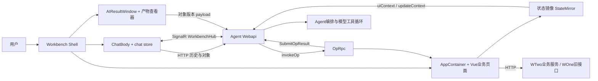
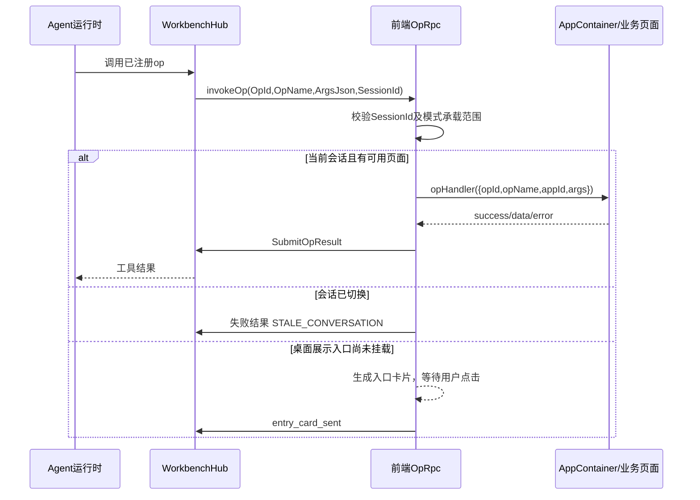

# Workbench 前端与交互协议

提取日期：2026-10-29。本文依据当前工作区源码，描述已有实现，不代表线上部署和业务数据已经验证。代码路径以 `D:/code/Wtwo-project` 为根；行号用于定位本次快照，后续修改可能移动。所有鉴权样例均使用占位符。

## 1. 架构定位

Workbench 是一个独立 HTML 入口的 Vue 应用，内部包含桌面窗口系统、AIRA 对话、结构化成果查看器和业务 App。它复用了 WTwo 前端的用户状态、网络封装、业务页面及部分 WOne 接口；不是一套只连接模型接口的聊天页面。

核心边界如下：

- 浏览器负责界面、草稿、会话视图、产物版本选择、用户确认和 App operation 执行。
- Agent 后端负责身份和租户判断、持久化会话与 Turn、调用模型、工具执行及恢复暂停的工作。
- HTTP 读取历史和业务数据，SignalR 接收流式文本、工具进度、交互卡片，并承载前端 operation RPC。
- 模型通过后端暴露的工具描述理解前端能力。前端上传 App manifest，后端不需要猜测页面按钮。
- 浏览器只上报状态镜像中允许提供的字段，不把整个 DOM、所有 Pinia 状态或页面截图自动发给模型。



源码依据：`wtwo-web/src/workbench/main.ts:27`、`api/workbench.ts:104`、`store/opRpc.ts:264`、`store/chat.ts:118`（以下未重复前缀的路径均位于 `wtwo-web/src/workbench/`）。

## 2. 技术栈与构建

下表是 `wtwo-web/package.json` 的版本约束，不是声称当前安装或部署的精确版本；复现精确依赖应同时使用原锁文件。

| 能力 | 依赖与版本约束 | 在本项目中的作用 |
|---|---|---|
| UI 框架 | `vue ^3.5.18` | 单文件组件、Composition API、异步组件、Teleport |
| 状态管理 | `pinia ^2.1.7` | 连接、聊天、窗口、App、对象、模式、校区等共享状态 |
| 构建 | `vite ^5.1.4`、`@vitejs/plugin-vue ^5.0.4` | 多 HTML 入口、动态 import、按构建目标输出 |
| 类型 | `typescript ^5.3.3`、`vue-tsc ^1.8.27` | TS 类型；正式 build 脚本实际执行 `tsc` |
| 组件 | `element-plus ^2.11.2`、`@element-plus/icons-vue ^2.3.1` | 表单、弹层、表格、图标；项目使用 `wtwo` 命名空间 |
| 实时通信 | `@microsoft/signalr ^10.0.0` | Hub RPC、事件、自动重连、WebSocket/LongPolling |
| 图表 | `echarts ^5.5.1` | 报表与产物图表；渲染器使用 canvas |
| 文本 | `markdown-it ^12.3.2`、`highlight.js ^11.0.0`、`mermaid ^10.6.1` | Markdown 及代码/图示生态，具体启用范围由渲染组件控制 |
| 样式 | `sass ^1.80.6`、`unocss ^0.58.5` | SCSS 主题与工具样式 |
| 工具 | `dayjs ^1.11.10`、`decimal.js ^10.4.3`、`html2canvas ^1.4.1` | 日期、金额运算、图片导出等 |
| 检查 | `playwright ^1.50.0`、`@playwright/test ^1.55.0`、`@google/design.md ^0.4.0` | 浏览器检查、工作台设计规则检查 |
| 观测 | `@sentry/vue ^10.5.0`、`@sentry/vite-plugin ^4.1.0` | 已声明的观测依赖；依赖存在不等于所有环境均启用插件 |
| 额外上传依赖 | CDN Axios `0.18.0`、内部 `xgjzt` OSS SDK `1.1.8` | 首次上传时加载，并非全部由 npm 供应 |

`vue-router ^4.3.0` 与 `@microsoft/fetch-event-source ^2.0.1` 在整个前端包中存在，但当前 Workbench 主启动和聊天通道分别是独立入口与 SignalR，不应因此写成“Workbench 用 Vue Router 页面路由和 SSE 聊天”。

入口和构建事实：

1. `workbench.html` 加载 `src/workbench/main.ts`；主挂载点为 `#workbench-app`。
2. `vite.config.ts:13` 定义 `index`、`workbench`、`aira-collect` 三个目标；`base` 为 `/wtwo`，开发端口为 `3011`，使用基础 HTTPS 插件。
3. `scripts/build-target.mjs:5` 中 `aira` 是 `workbench + aira-collect` 的组合；不是第四套独立源码。
4. `npm run build:workbench` 先检查 App manifest、原生对话框，再运行 `tsc` 和对应 Vite 构建；`npm run build` 构建全部目标。
5. 业务 App 用动态 import 按需下载。`main.ts:261` 开发态 HMR 会重新注册 manifest 并上报后端，同时保留已挂载实例。

```powershell
Set-Location <源码目录>/wtwo-web
npm ci
npm run dev
# 浏览器打开开发服务的 /wtwo/workbench.html

# 发布工作台单入口
npm run build:workbench
# 发布 AIRA 工作台与场景收集两个入口
npm run build:aira
```

上述为复现命令，本文提取过程没有安装依赖、构建应用或连接真实后端。

## 3. 页面启动、登录和环境路由

### 3.1 主启动顺序

`main.ts:74` 的 `bootstrap()` 顺序为：

1. 若显式启用 demo，先动态加载离线 mock，使后续 `whoami` 使用模拟响应。
2. 请求 `whoami()`，填充用户、机构配置、校区、年份等全局状态，并为非开发环境设置日志用户信息。
3. 从 cookie 读取 `WTwo-AuthToken`，填充 `useLoginInfo()` 的 `WTwo_CompanyID/WTwo_AuthToken`。真实模式缺少 token 时进入登录页面，不继续挂载可操作桌面。
4. `probeWorkbenchAccess()` 请求 Agent 权限探测接口，资格不足时展示说明页。
5. 本地注册 `workbenchAppModules`，挂载 Workbench，移除启动骨架。
6. HTTP 加载会话列表/最近会话，与 Hub 建连并行。建连慢不会阻塞历史文本先显示，但实时入组失败会单独显示错误。
7. Hub 连接完成后调用 `RegisterAppManifests` 上报能力；重连后重复上报。

`main.ts:51` 监听 `workbench:auth-expired`：卸载工作台并挂载 `WorkbenchLoginPage`，成功后整页刷新重新走启动过程。工作台业务仍调用 WOne 接口，因此登录链路涉及旧 WOne 会话和新 `WTwo-AuthToken`，只实现新 token 不足以复刻所有业务页。

### 3.2 同一 HTML 的特殊入口

`main.ts:229` 根据 query `view` 分支：

| 参数 | 内容 | 是否启动主工作台 Hub |
|---|---|---|
| 默认 | Workbench | 是 |
| `view=report` | 独立报表页面 | 否 |
| `view=im-bind` | IM 账号绑定页 | 否 |
| `view=im-bind-result` | IM 绑定结果 | 否 |
| `view=oauth-consent` | 外部 MCP OAuth 同意页 | 否 |

### 3.3 HTTP 环境与鉴权

`wtwo-web/src/store/index.ts:4` 按 hostname 计算 `apiUrl`：本地返回空字符串，已识别测试域名指向测试 WTwo 网关，其他域名指向生产 WTwo 网关；`agentBaseUrl = apiUrl + '/api'`。复刻时必须把此硬编码映射换成自己的环境，不能只改 `.env` 后假定所有接口切换成功。

Agent HTTP 典型请求：

```http
POST /api/agent/Chat/GetHistoryChatList
Content-Type: application/json
WTwo-CompanyID: <租户ID>
WTwo-AuthToken: <当前用户会话令牌>

{"take":20,"skip":0,"states":["running","awaitingApproval"]}
```

请求一般带 `credentials: 'include'`。`api/workbench.ts:453` 按 `ErrorCode === 200` 判断业务成功，再从 `Data` 读取结果，将后端 PascalCase 字段映射成前端 camelCase。不要把 HTTP 200 与业务成功混为一谈。

当前 Vite 代理的有效配置将 `/api/agent` 转发到测试网关并启用 `ws:true`；指向本地 `5000` 并删除 `/api` 的规则只是注释。要本地联调 Agent，须实际切换代理并确认后端路由前缀。`/api/course`、`/api/report`、`/api/evaluation` 有单独代理，普通 `/api` 仍服务旧业务。前端依赖的新旧接口不能全部重写到 Agent。

## 4. Shell、业务 App 与模式

### 4.1 核心目录和职责

| 路径 | 职责 |
|---|---|
| `pages/Workbench.vue` | 桌面/专业布局入口，整合导航、桌面和共享控件 |
| `pages/components/DesktopCanvas.vue:16` | 遍历窗口，使用 Teleport 将同一 AppContainer 移到右侧内容区域 |
| `pages/components/ProfessionalWorkspace.vue` | 会话、聊天、可调宽度右栏、手机会话抽屉 |
| `pages/components/AppContainer.vue:131` | 加载组件、注入 AppContext、注册运行实例、保护关闭生命周期 |
| `store/window.ts:15` | 窗口几何尺寸、z-order、最小化/最大化/全屏/关闭和挂载状态 |
| `store/appRegistry.ts:34` | manifest、异步 loader、按 instanceId 存储 AppHost |
| `store/workbenchMode.ts:35` | 用户模式偏好、有效模式、每会话预览选择、栏宽 |
| `store/stateMirror.ts:54` | 可被 Agent 读取的窗口/组件状态镜像 |
| `store/chat.ts:101` | 会话、消息、草稿、交互状态与流式事件 |
| `store/object.ts:49` | 工作对象及版本、成果窗口、实时成果提示 |
| `capabilities/artifactRegistry.ts:18` | previewType 到 Viewer 的映射 |

### 4.2 桌面、专业、手机的真实边界

| 项目 | 桌面模式 `normal` | 宽屏专业模式 | 手机/窄窗口 |
|---|---|---|---|
| 主布局 | 桌面、Dock、多窗口、AIRA 独立窗口或侧栏 | 左会话、中聊天、按需右侧内容 | 有效模式强制 professional；左会话抽屉、成果覆盖面板 |
| 产物 | 点击成果卡片后开窗 | 当前会话实时成果可自动打开右侧预览 | 新成果提供入口，不自动盖住对话 |
| 业务 App | 完整 App 多窗口 | 只允许显式注册的业务单页 | 复用已适配的单页，不自动承诺所有旧 App 已适配 |
| 模式偏好 | 保存在 localStorage | 同左 | 不覆盖用户原桌面偏好，横屏手机仍使用紧凑布局 |
| 草稿与实例 | 切换模式共享 | Teleport 保持组件实例 | 返回对话仅收起预览，保留内容与未提交编辑 |

手机判断是 `window.innerWidth < 768` 或匹配 Android Mobile/iPhone/iPod 的 UA，见 `store/workbenchMode.ts:10`。模式存储键为 `wtwo.workbench.mode.v1`。会话栏初始宽度 260；各会话预览与面板开关分别存储。

窗口系统并非无限开窗：`store/window.ts:10` 设置单 App 最多 5 个窗口，产物窗口上限为 8；产物超限的处理应复用现有窗口逻辑。所有关闭入口须走 `registerCloseGuard/closeWindow`，不能直接删 DOM 丢弃编辑。

`MODE_SUPPORT.md` 中有多期说明，较早段落曾写草稿全局共享；本次源码 `store/chat.ts:236` 已有 `draftsByConversation`，文字、附件、技能按会话保存在当前页面内，刷新后恢复未被保证。说明现状时以代码和较新条目为准。

### 4.3 实际注册的业务 App

`pages/apps/index.ts:17` 注册 8 个业务模块：

| App ID | 页面范围 | 当前最终对 Agent 暴露的 operation |
|---|---|---|
| `gclaw.lead-workbench` | 招生营销、意向客户、沟通、意向课程、海报、优惠券等页面 | `lead.query`、`lead.add` |
| `gclaw.fee-workbench` | 学员信息管理、订单、收费相关业务 | `student.openDetail` |
| `gclaw.academic-workbench` | 课程、班级、排课、补课、学管师带生 | 空数组 |
| `gclaw.report-workbench` | 经营总览、招生、来源、电子推荐卡、收费、课消、业绩、班级、考勤、停课、未分班报表 | 空数组 |
| `gclaw.ai-settings` | AIRA 配置及经营监控相关页面 | `metric.showMetric`、`monitor.showReport` |
| `gclaw.monitor-report` | 监控运行 Markdown 简报 | 空数组，仅内部展示窗口 |
| `gclaw.student-operation` | AI 名单、经营机会、学员详情、沟通质量、粘性、教学服务、家长满意度 | `studentOperation.query` |
| `gclaw.onboarding` | 认识 AIRA、体验任务、教程 | 空数组 |

注意 manifest 文件末尾会覆盖早期定义：`lead-workbench/manifest.ts:650` 重新设置 `manifest.ops`，`student-operation/manifest.ts:317` 同样重设；`business-suite/manifest.ts` 文件末尾过滤收费能力并清空教务/报表能力；`monitor-report/manifest.ts` 文件末尾清空 ops。旧 op 可能仍被页面执行器兼容，但不等于当前向模型注册。公开 UI 工具数量不能仅用全文搜索 `name:` 得出。

### 4.4 App 扩展协议

`pages/types/app.ts:2` 的 AppHost 提供 `bootstrap/mount/unmount/opHandler`，可选组件聚焦和窗口事件。当前 Vue 页面由 `AppContainer.vue:207` 异步加载，待子组件 setup 注册 `opHandler` 后再创建 host 并放入 registry；不能把 loader 返回的 Vue 组件直接当 AppHost 调用。

AppContext 注入：`windowId/instanceId/userId/appId/launchArgs/presentation/professionalPageId`，以及 `emitState`、`emitEvent`、`callOp`、`shell`、`registerOpHandler`、`registerFocusComponent`、`registerCloseGuard`。

新增能力的最小 manifest 结构：

```ts
const manifest = {
  appId: 'example.student', name: '学员资料', version: '1.0.0',
  defaultWindow: { title: '学员资料', singleton: true, width: 900, height: 700 },
  professional: { pages: [{ id: 'student-detail', title: '学员详情' }] },
  ops: [{
    name: 'example.openStudent', summary: '打开指定学员资料',
    sideEffect: 'uiAction', professionalPageId: 'student-detail',
    inputSchema: { type: 'object', properties: { studentId: { type: 'string' } }, required: ['studentId'] },
    outputSchema: { type: 'object' }
  }]
}
```

这是说明性最小样例，不是仓库现有 App。`runtime/appManifest.ts:89` 校验 appId/name/version/defaultWindow、op 名称唯一、输入输出 schema；`openModal` 必须声明 `affectsWindows:['new']`；`commitWrite/externalWrite` 必须 `requiresUserConfirm:true`；可见界面操作必须声明有效的专业模式页。仅修改 manifest 不会自动生成业务后端实现。

## 5. SignalR 完整链路

### 5.1 连接身份与重连

连接 URL：`${agentBaseUrl}/agent/workbench-hub?conversationId=<id>&companyId=<tenant>`。浏览器 WebSocket 无法使用普通自定义 header，故同时配置 `accessTokenFactory`；SignalR 使用 `access_token` query 发送令牌，LongPolling 使用配置的 `WTwo-CompanyID/WTwo-AuthToken` headers。请求启用 cookie，传输允许 WebSocket 和 LongPolling，保活 15 秒。

自动重连等待为 0、2、5、10、30、60 秒，之后保持 60 秒间隔。重连后先 `SwitchConversation`，再重新上报 App manifest 和校准 Turn 状态。`connect()` 自身会断开已有连接，因此普通切换会话必须调用 `switchConversation()`，不能调用 `connect()`。

证据：`store/connection.ts:29`、`:47`、`:69`、`:96`、`:264`。

连接状态：`disconnected → connecting → connected → reconnecting`。初次启动失败与自动重连不是同一个过程；调用方须允许显式重试。历史读取状态与实时入组状态分别管理，历史已显示不意味着 Hub 已就绪。

### 5.2 客户端调用的关键 Hub 方法

| 方法 | 参数结构 | 结果与作用 |
|---|---|---|
| `SwitchConversation` | `conversationId` | 在原连接上切换订阅的会话 |
| `RegisterAppManifests` | manifest 数组 | 上报本页已加载 App 的能力说明 |
| `SendChatMessage` | 下方消息 DTO | 入队并通过后续事件确认 Turn |
| `GetConversationTurnStatus` | `conversationId` | `hasActiveTurn` 校准本地 typing |
| `SubmitChatChoice` | `{conversationId,answers:[...]}` | 提交同批问题答案并恢复暂停 Turn |
| `SubmitToolApproval` | `{conversationId,answers:[{approvalId,approved}]}` | 提交审批决定并恢复暂停 Turn |
| `StopChatMessage` | `conversationId,turnId` | 停止特定轮次，不能只清空前端 loading |
| `SubmitOpResult` | `{OpId,Ok,Data,ErrorMessage,ComponentReferences}` | 回传界面操作结果 |
| `updateContext` | ContextBundle | 应答后端的状态快照请求 |

消息 DTO 的示例：

```json
{
  "message": "查看这个学员的续费情况",
  "conversationId": "<uuid>",
  "agentKey": "gclaw-workbench",
  "attachments": [{"type":"image","url":"https://<asset-host>/<file>","filename":"课堂.png","mimeType":"image/png"}],
  "selectedSkills": [{"source":"system","skillKey":"<技能稳定key>"}],
  "uiContext": {"activeWindow":{"appId":"gclaw.fee-workbench","windowId":"<window-id>","instanceId":"<instance-id>","title":"学员详情","fields":[]}}
}
```

`agentKey` 可省略，默认由后端采用 `gclaw-workbench`；开发调试可用 `VITE_DEBUG_AGENT_KEY`。Skill 传递的是 `source` 与 `skillId/skillKey`，不是把输入框显示名称当作稳定身份。`ChatBody.vue:1694` 从 `fetchQuickSkills(agentName)` 取得快捷技能；可选助手由 `api/imBinding.ts` 中接口提供，不是纯前端写死一组助手。

依据：`store/chat.ts:1334`、`:1384`、`:1451`、`:1555`、`:1652`。

### 5.3 服务端推送与位置参数

客户端以以下名字注册事件。多数 chat 事件最后一个位置参数是 `conversationId`；已有自描述 payload 的事件可从 payload 取。复刻时应直接对齐服务端常量和 DTO，不靠大小写猜测协议。

| 客户端事件 | 参数 | 处理 |
|---|---|---|
| `streamChatToken` | `(token, conversationId)` | 更新会话执行标记；仅当前会话追加 Markdown |
| `chatTurnAccepted` | `({turnId,resumed,conversationId}, conversationId?)` | 关联乐观占位与真实 Turn；恢复时复用原气泡 |
| `chatTurnCompleted` | `({success,cancelled,error,turnId,quickReplies}, conversationId)` | 拒绝过期 Turn 事件；结束工具状态并整理最终内容 |
| `toolCallStart` | `(opName,callId,displayName,conversationId)` | 以 callId 维护工具块 |
| `toolCallEnd` | `(callId,success,summary,conversationId)` | 更新工具结果 |
| `chatActionCard` | `({text,action:{label,appId,opName,args,...}},conversationId)` | 展示用户可点击操作入口 |
| `chatChoiceRequested` | `({batchId,questions},conversationId)` 或单题 | 加入当前 Turn 的过程 |
| `chatChoiceSubmitted` | `({batchId,questions,conversationId},conversationId?)` | 更新已回答状态 |
| `chatChoiceSubmitFailed` | `({error},conversationId)` | 清理提交状态，调用失败路径回滚 |
| `chatApprovalRequested` | `({batchId,approvals},conversationId)` 或单卡 | 加入待审批过程 |
| `chatApprovalSubmitted` / `chatApprovalSubmitFailed` | `(payload,conversationId)` | 清理提交状态 |
| `chatTurnPaused` | `({turnId,batchId},conversationId)` | 停止 typing，将工具标为 waiting |
| `ObjectCreated` / `VersionCreated` | 含 conversationId/objectId/versionId 的 payload | 拉取该会话成果，依据模式决定是否展示 |
| `ObjectsByConversation` | `{conversationId,objects}` | 替换该会话成果元数据 |
| `invokeOp` | `{OpId,OpName,ArgsJson,SessionId,...}` | 进入前端 operation 分发 |
| `getContextSnapshot` | `(sessionId,{tokenBudget})` | 构造状态镜像并调用 updateContext |
| `pushStateDelta` | `{windowId,fields}` | 写入指定窗口状态镜像 |

证据：`store/chat.ts:948`、`:990`、`:1115`、`:1133`、`:1157`、`:1191`、`:1219`、`:1242`、`:1279`；`store/object.ts:220`；`api/workbench.ts:122`。

### 5.4 会话隔离、历史和 Turn 状态

必须同时实现三层身份：

1. 连接身份用于实际通信，连接不随普通会话切换重建。
2. `conversationId` 用于会话数据与界面归属。`runtime/interactionRuntime.ts:48` 对缺失 ID 返回 `missing`，不允许默认归到当前会话。
3. `turnId` 用于同一会话内部多轮完成/取消事件的先后判断，防止旧轮完成把新轮 loading 清掉。

`InteractionSessionState` 保存 `typing/stopping/activeTurnId/pendingAgentMessageId/stoppingTurnId`。`reduceInteractionSession()` 统一处理开始、接受、暂停、停止、完成，而不是多个 handler 各改一组不一致的布尔值。

后台会话簿记可以在当前会话过滤之前更新，例如 loading、完成绿点；消息追加、弹出成果、工具卡等可见副作用只能作用于当前会话。服务端会话组还需要鉴权，前端过滤不构成数据访问授权。当前后端契约是切换时离开旧组，历史完整性依靠落库和读取；前端仍要防御已在途或异步完成的旧事件，不能依赖“永远订阅所有会话”。

`loadMessages()` 同时启动入组与 HTTP 读取。历史按完整 Turn 归组，每轮只生成一个 Agent 气泡；`histBubbleByMessageId` 将多个数据库 messageId 映射到气泡，从而把产物版本准确附到其来源消息。每次请求携带本地递增 requestId，切换到新会话后旧响应不能覆盖新结果。

实时与历史共同的展示规则：

- 进行时按时间顺序展示旁白、工具、选择题、审批及结构化成果。
- 成功完成后，过程内容归入一个 `steps` 折叠区，最终文本保留在外；历史 `assistant_final` 明确指出最终内容。
- 失败/取消没有成功最终正文，过程保留供复核。
- 审批和选择题是同一 Turn 暂停点，不另造一个完整的新对话气泡。
- 工具状态为 `pending/running/success/error/interrupted/waiting`；等待用户不能显示成执行失败。
- 历史恢复中的运行工具重新登记索引，迟到的结束事件仍可正确完成它们。

依据：`store/chat.ts:720`、`:841`、`:1034`、`store/chatHistory.ts`、`store/chatReplay.ts`、`runtime/interactionRuntime.ts:70`。

## 6. 模型如何操作前端

### 6.1 operation RPC



`store/opRpc.ts:264` 兼容 camelCase/PascalCase 请求；`ArgsJson` 解析为对象；`SessionId` 对应会话，缺失直接丢弃，非当前会话回传失败，避免后端一直等。准备/等待异步组件后会再次检查会话，必要时关闭刚创建的无效窗口。

路由顺序为专业页面、显式目标窗口、当前兼容窗口、其他可见兼容窗口、注册实例。专业模式只打开 `professional.pages` 中声明的页面；完整 `shell.openWindow` 会返回 `PROFESSIONAL_PAGE_REQUIRED` 和可选页面信息，不复用隐藏的桌面窗口。

桌面模式下 `shell.openWindow` 以及尚无实例的展示类 operation，会生成入口卡片并返回 `entry_card_sent`，用户点击后才执行开窗。这不代表业务已经写入。操作的 `sideEffect` 用于展示策略，真实权限和写入确认仍应由后端与业务接口保证。

`SubmitOpResult` 将 `data` JSON 序列化为字符串；超过 800,000 字符时返回截断提示和预览，不能把截断结果当完整业务数据。当前代码同时输出 PascalCase/camelCase 键以兼容不同 Hub 序列化配置。见 `store/opRpc.ts:685`。

### 6.2 状态镜像与上下文

业务 App 使用 `emitState`、`shell.updateField`、`shell.defineComponent` 声明可观察字段和可定位组件。字段携带 `label/pii/hot` 元数据；发消息时 `buildUiContext()` 调用 `buildContextBundle(1200,scope)`，仅发送当前活动窗口中 hot 且非 pii 的可用字段，并附带已准备好的组件说明。

这让“这个学生”“当前名单”能基于明确的 ID、筛选条件、组件身份解释。`presentation` 与会话决定哪些窗口进入上下文；不能在专业模式把隐藏的其他 App 当前选中项混入用户请求。

组件引用支持 `componentId`、`instanceId`、`locator.byKey` 与 `highlight`，App 可注册 `focusComponent` 实现点击聊天引用后定位行或字段。证据：`pages/types/app.ts:155`、`store/stateMirror.ts:159`、`store/chat.ts:118`。

## 7. 成果、版本、动态报表和文件

工作对象不等于普通聊天字符串。`api/workbench.ts` 定义对象元数据和 `ConversationArtifact`；关联核心是 `conversationId → objectId → versionId`，版本包含 `previewType/status/messageId/createTime`。列表只拉元数据，点击时通过 `GetWorkbenchObjectVersionPayload` 按需取完整 payload。

`store/object.ts:149` 的 `openVersionWindow()` 将引用传给内置 `workbench-airesult`，同对象已有窗口时切换版本并激活它；不会因为每个新版本都额外创建一个窗口。当前会话、足迹历史、聊天成果卡使用同一查看器链路。

已注册的 previewType：

| 类型 | 查看器/能力 |
|---|---|
| `stat_cards/table/chart` | 指标卡、表格、图表 |
| `plan/list_edit/plan_edit` | 计划与可编辑列表/计划 |
| `follow_class_options/student_care_detail` | 跟班方案与学员关怀 |
| `renewal_speech/renewal_decline_analysis` | 续费话术与续费下降分析 |
| `report/component_report` | 报告与组件化报告 |
| `report_page` | 带数据来源与查询定义的报表 |
| `generated_page` | 共用报表渲染器的业务预览，允许限定的确认按钮 |
| `excel/file` | 文件交付和结构化预览 |
| 未识别类型 | GenericViewer |

`schedule_plan/single_form/makeup_schedule` 等类型已经被注册表标记退出，不应在复刻时从旧文档重新作为默认协议。应用动作白名单目前为 `schedule.applyPlan`、`operations.assignStudentManagers`、`operations.confirmFollowupDraft`，见 `capabilities/artifactRegistry.ts:37`。

### 7.1 报表不是直接执行模型 JavaScript

`reports/contract.ts:1` 的报表对象为：

```ts
{
  schemaVersion: 1, rendererVersion: 1, title: string,
  mode?: 'static' | 'dynamic', refresh?: ReportRefreshDefinition,
  data: { summary: Record<string, unknown>, datasets: Record<string, unknown[]> },
  view: { html: string, css: string, charts: Record<string, {dataKey:string,option:object}> },
  meta: { scope:object, definitions:unknown[], capturedAt:string,
          completeness:'complete'|'partial'|'unknown', sources:unknown[], overrides:unknown[] }
}
```

`parseReportPayload()` 检查版本、标题、体积、嵌套深度、禁止原型相关字段、数据集和来源说明。当前上限包括序列化字符串 524,288 字符、深度 32、每数据集 5,000 行、最多 12 图表；动态报表最多 12 个查询定义。数据和图表之间须用登记的数据集 key 关联。

`renderReport.ts:270` 解析模板并校验 HTML、CSS、图表配置；`ReportRenderer.vue:40` 将验证后的内容挂到 ShadowRoot，ECharts 使用绑定数据渲染，并通过 ResizeObserver 响应容器大小。Shadow DOM 用于隔离样式，不能单独作为安全沙箱；安全约束来自输入校验及模板能力限制。

`generated_page` 同样使用 ReportRenderer，按钮只接受 `send_to_aira` 和指定 action ID，如 `confirm_schedule_adjustment/confirm_schedule_creation/confirm_makeup_schedule`；历史只读版本的确认按钮禁用。确认后仍要回到 Agent/业务写入链路，不能在 HTML 上执行任意脚本。

### 7.2 文件交付与上传

`FileDeliveryViewer.vue:48` 只接受 HTTP(S) fileUrl。HTML 文件在 `sandbox="allow-scripts"` 且 `referrerpolicy="no-referrer"` 的 iframe 中展示；Excel 展示后端提供的 sheets/columns/rows 摘要。这里没有在前端声明完整 Excel 办公引擎，不能据此声称支持任意工作簿的原生编辑。

结果组件的异步加载和 HTML iframe 加载共用 `components/WorkbenchPreviewLoading.vue`。前者由 AppContainer 的 loading 状态控制，后者在 URL 变化时重新显示并在 iframe load 后关闭。该组件只统一加载提示和动画，不改变产物协议、文件访问范围或 AppHost 生命周期。依据：`AppContainer.vue:3`、`FileDeliveryViewer.vue:62`、`:140`。

聊天附件上传：

1. 输入区保留本地 File/图片预览；待传附件状态为 `uploading/done/error`。
2. `uploadChatAttachment()` 检查 20 MiB 上限；图片按文件头识别 JPEG/PNG/WebP，不信任 MIME/扩展名。
3. `ensureWorkbenchOssReady()` 按需加载 Axios 和内部 OSS SDK，调用现有 `services/oss`。
4. 上传采用 `fileType:1/2`、`businessType:'w1_other'`、`terminal:0`，60 秒超时处理；拿到 URL 后才允许发送可用附件。
5. 发给 Hub 的附件只有 `type/url/filename/mimeType`，没有浏览器 File 对象。模型如何读取/处理文件属于后端能力。

依据：`api/workbench.ts:284`、`:301`、`:404`；`services/ossLoader.ts:1`。收费/退费上传另有旧 FileService 接口，不应把它与聊天 OSS 上传强行合并。

## 8. 服务 API 与已有业务功能

前端请求按服务边界分组，复刻应保留接口契约，不能只实现一个 `/chat`：

| 功能 | 客户端适配 | 典型服务前缀/特征 |
|---|---|---|
| 会话/历史/对象/已读 | `api/workbench.ts` | `/api/agent/Chat/*` |
| 校准/技能/画像类配置 | `api/calibration.ts` | `/api/agent/Calibration/*` |
| 用户偏好 | `api/preference.ts` | `/api/agent/PreferenceRule/*` |
| 监控 | `api/monitor.ts` | `/api/agent/MonitorConfig/*` |
| IM 账号和助手 | `api/imBinding.ts`、`imBind/api.ts` | `/api/agent/ImBinding/*` |
| 用量 | `api/aiUsage.ts` | `/api/agent/AiUsage/*` |
| 意向客户查询/评分/话术 | `api/leadQuery.ts`、`leadScore.ts`、`leadScript.ts` | `/api/agent/LeadQuery`、`LeadScore`、`LeadScript` |
| 智能经营/AI名单 | `api/studentOperation.ts`、`studentSmartList.ts` | `/api/agent/student-operation`、`student-smart-list` |
| 家校消息草稿 | `api/familySchool.ts` | `/api/agent/family-school/message-drafts` |
| 报表与组织查询 | `reports/api.ts`、`api/reportQueries.ts`、`enrollmentReport.ts` | Agent 报表/组织入口及独立报表服务 |
| 新手任务 | `api/onboarding.ts` | `/api/agent/Onboarding/*` |
| 学员、收费、订单、退费 | `api/student.ts`、`fee.ts`、`order.ts`、`refund.ts` | 大量 WOne `/api/Student`、`FeeChargeOnline`、`FeeRefund` 等 form/query 契约 |
| 教务 | `api/course.ts`、`makeupClass.ts`、`woneScheduleApi.ts` | 新旧教务 API 并存 |

上述“有页面/接口适配”只证明代码能力存在，真实可用还依赖机构授权、岗位权限、校区范围、服务配置与数据库内容。付款、退款、消息发送等写入流程不能以离线 demo 成功推断线上成功。

## 9. 按此设计复刻的最小顺序

1. 建 Vue + Pinia + Vite 的独立 `workbench.html` 入口，先做登录、租户/用户状态和一致的 HTTP 业务响应转换。
2. 实现 WorkbenchHub 鉴权与一条常驻连接，明确 conversationId/turnId/event 参数，不先做复杂窗口动画。
3. 建会话、Turn、消息持久化和 HTTP 回放；先跑通发送、流式、完成、刷新恢复、切走再返回。
4. 引入 `InteractionSessionState`，补暂停、审批、选择题、恢复和取消；重复/旧事件不能结算新 Turn。
5. 做 AppManifest/AppRegistry/AppContext/AppHost，注册一个只读示例 App；双向 RPC 包括错误和超时回执。
6. 做状态镜像，只上报定义过的 hot 字段，标记 pii；让 Agent 能解释当前用户正在查看的数据。
7. 引入工作对象+版本+payload 懒加载，先实现 table 和 file；然后用统一 registry 添加其他 Viewer。
8. 在同一 AppContainer 上加入专业模式 Teleport，再加手机抽屉与覆盖预览；保持同一会话草稿及未保存检查。
9. 接真实业务 API、OSS、报表查询与 IM 绑定；从最小读接口逐步加入需确认的写操作。
10. 用下列场景验证后，再扩充全部页面和产品功能。

必须验收：发送后切换会话；旧 Turn 完成与新 Turn 接受交错；暂停后刷新并继续；断线重连后历史完整；后台会话不打开当前界面；旧成果版本可读；未保存编辑的关闭保护；手机旋转/返回/软键盘；多个校区与无权限账号；附件失败不发送空 URL；未知 App/operation 返回可恢复失败。

## 10. 验证入口与本次限制

已有源码测试入口包括：

- `tests/interaction-runtime.test.mjs`：会话与 Turn 生命周期。
- `tests/op-rpc-conversation-race.test.mjs`、`op-rpc-defer-entry-card.test.mjs`：跨会话异步与入口卡。
- `tests/app-manifest-registry.test.mjs`、`artifact-registry.test.mjs`：能力登记。
- `tests/professional-mode.test.mjs`、`professional-mode.browser.test.mjs`：模式和真实组件。
- `tests/mobile-entry.browser.test.mjs`、`mobile-artifact-viewers.browser.test.mjs`：紧凑布局。
- `tests/footprint-versions.test.mjs`、`object-load-race.test.mjs`：版本与请求竞态。
- `tests/image-upload-contract.test.mjs`、`skill-invocation-source.test.mjs`：附件与技能身份。

构建和静态检查命令见 `package.json`：`npm run check:workbench-manifests`、`npm run lint:workbench-design`、`npm run build`。这些是后续复刻的验证入口，本次仅生成技术文档，未声称执行过业务测试。

仍需环境材料补齐：自有登录/权限服务、WOne 接口兼容范围、网关路由和跨域配置、OSS 授权及上传 SDK 替代实现、生产助手/Skill 数据、真实移动设备交互验证。当前文档提供复刻结构与契约，不能替代这些外部运行依赖。
