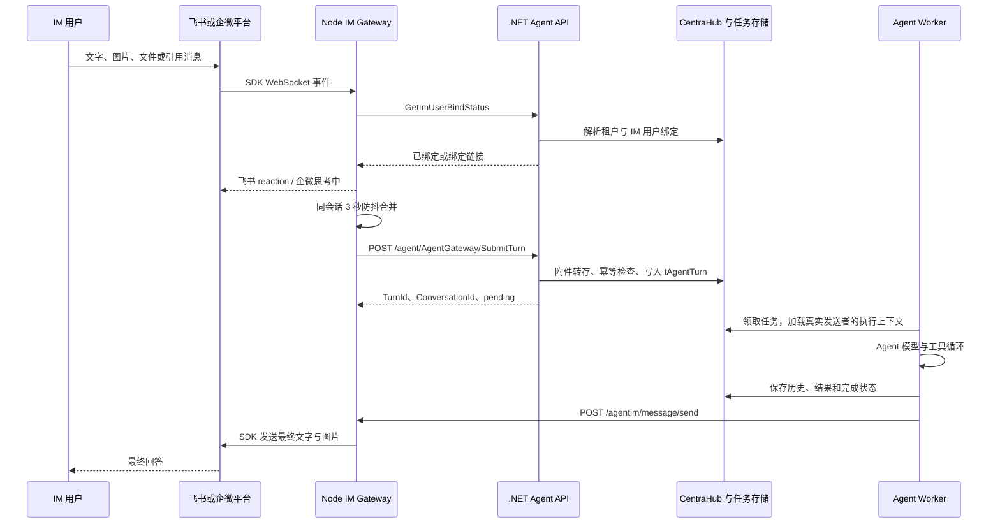

# 飞书与企业微信机器人接入

> 提取日期：2026-10-29。本文描述当前工作区源码，未连接生产环境、未导出机器人凭据、未实际发送 IM 消息。`代码事实` 是可从所列源码直接核验的行为；`复刻建议` 是重建时应补齐的工程约束；`待确认` 表示仓库不能证明外部环境已经完成配置。所有凭据示例都是占位符。

## 1. 一句话说明设计

AIRA 把 IM 平台协议放在独立的 Node.js/TypeScript 进程 `WTwo.AgentIM.GateWay` 中。飞书使用官方 Lark SDK 的 WebSocket 客户端，企业微信使用智能机器人官方 Node SDK 的 WebSocket 客户端；二者把平台消息转换成统一消息，通过 HTTP 提交给 .NET Agent 服务。Agent 将任务写入 `tAgentTurn`，后台 Worker 执行模型和工具，完成后通过 HTTP 调回 IM 网关，网关再通过平台 SDK 发消息。

这里的企业微信接入是**智能机器人长连接**。这条业务链没有使用传统群机器人 webhook，也没有实现自建应用的 XML 回调验签、URL 验证和 EncodingAESKey 消息解密。飞书长连接同样没有要求为消息接收部署公网 webhook。机器人能否接收群消息、可见成员范围及应用权限仍由平台管理端决定。

本文源码路径采用以下简称，均相对于 `D:/code/Wtwo-project`：

| 简称 | 实际目录 |
|---|---|
| `IM/` | `wtwo-server/WTwo.AgentIM.Web/WTwo.AgentIM.GateWay/` |
| `API/` | `wtwo-server/WTwo.Agent.Web/WTwo.Agent.Webapi/` |
| `SVC/` | `wtwo-server/WTwo.Agent.Web/WTwo.Agent.Service/` |
| `ENTITY/` | `wtwo-server/WTwo.Bus.Common/WTwo.Bus.Common.Model/DBEntity/CentraHub/` |

## 2. 服务拓扑和完整时序



核心调用关系：

1. `IM/src/index.ts:124` 初始化配置、日志、服务发现、机器人清单和 HTTP 服务。
2. `IM/src/agent/client.ts:37` 调用 `/agent/user/GetBindBot`，取得机器人和租户信息。
3. `IM/src/adapter-manager.ts:114` 按 `channel` 创建飞书、企微或钉钉适配器。
4. `IM/src/core/router.ts:133` 处理去重、身份检查、绑定码、新会话命令和防抖。
5. `API/Controllers/AgentGatewayController.cs:47` 接收消息；同文件 `:59` 起重新解析真实 IM 发送者，`:123` 起入队。
6. `SVC/Framework/Turn/AgentTurnService.cs:162` 负责持久任务与幂等；`AgentTurnCompletionCoordinator.cs:137` 标记完成并按渠道投递。
7. `SVC/Workbench/Push/ImMessageDeliveryClient.cs:119` 发回网关；`IM/src/api/message-delivery.ts:49` 按机器人找到适配器。

**代码事实：这条链路的异步队列是数据库中的 Turn，不是 Node 与 .NET 之间的 RabbitMQ/Kafka，也不是一直等待模型完成的同步 HTTP 请求。** HTTP 的 60 秒超时用于提交请求，不代表模型只能执行 60 秒。

## 3. 依赖及版本

以下版本来自 `IM/package.json` 和当前 `IM/package-lock.json`；复刻应保留 lockfile，并使用 `npm ci`。

| 组件 | manifest 声明 | lockfile 实际版本 | 用途 |
|---|---|---|---|
| `@larksuiteoapi/node-sdk` | `^1.24.0` | `1.66.1` | 飞书长连接、消息 API、令牌处理 |
| `@wecom/aibot-node-sdk` | `latest` | `1.0.7` | 企微认证、长连接、回复、附件下载解密 |
| `axios` | `^1.6.0` | `1.17.0` | 调用 Agent HTTP API |
| `express` | `^4.18.0` | `4.22.2` | 网关投递、刷新和健康接口 |
| `nacos` | `^2.6.2` | `2.6.2` | 配置订阅、注册和服务发现 |
| `typescript` | `^5.0.0` | `5.9.3` | 类型检查与编译 |
| `tsx` | `^4.22.4` | `4.22.4` | 生产容器直接运行 TS |
| `@opentelemetry/sdk-node` | `^0.219.0` | `0.219.0` | HTTP 自动追踪、传播 traceparent |

其他依赖包括 Winston、阿里云 SLS 日志 SDK、dotenv、钉钉 `dingtalk-stream`。`package.json` 要求 Node ≥18，实际 Dockerfile 使用 Node 20 Alpine。`form-data` 在飞书图片上传方法里通过 `require` 使用，属于当前依赖树中的间接依赖；独立重建这一模块时应显式核对依赖是否仍存在。

## 4. 机器人怎么创建、怎么进入网关

### 4.1 工作台扫码开通

工作台调用 `POST /agent/ImBinding/StartBotProvision`，请求包含 `PlatformType`、`BotName`、`AgentName`。平台枚举为飞书 `1`、企微 `2`、钉钉 `3`，扫码入口只允许前两者。指定 Agent 时还检查它是否在当前公司的 IM 可选名单中。

后端实现为 `SVC/Workbench/Push/ImBotProvisionService.cs`：

| 流程 | 代码事实 |
|---|---|
| 飞书初始化 | `:142` 先向 `https://accounts.feishu.cn/oauth/v1/app/registration` 发 `action=init`，确认支持 `client_secret` |
| 飞书开始注册 | 发 `action=begin`、`archetype=PersonalAgent`、`auth_method=client_secret`、`request_user_info=open_id` |
| 飞书返回二维码 | 读取 `device_code`、`verification_uri_complete`、`user_code`、`expire_in`，二维码附带 `from=oc_onboard&tp=ob_cli_app` |
| 飞书轮询 | `:263` 发 `action=poll`、`device_code`、`tp`；收到 `client_id/client_secret` 即完成；若用户品牌为 Lark，下次改为 accounts.larksuite.com |
| 企微开始注册 | `:206` GET `https://work.weixin.qq.com/ai/qc/generate?source=wecom-cli&plat=2`，读取 `data.scode/auth_url` |
| 企微轮询 | `:307` GET `/ai/qc/query_result?scode=...`，成功时读取 `data.bot_info.botid/secret` |
| 完成保存 | `:458` `CompleteProvisionAsync` 新增或更新机器人绑定；状态设为 `Processing=0`，生成 4 位绑定码 |

注册会话放在分布式缓存，key 为 `agent:botProvision:{key}`；同时保存当前用户最近会话指针。企微二维码按代码记为 5 分钟有效，缓存保留 30 分钟以便查询迟到的完成结果；飞书按返回过期秒数保存。4 位配对码存 `agent:botPair:{botBindingId}`，有效 30 分钟。这里的秒数是当前实现参数，不能据此断言平台将永久维持相同有效期。

`GetProvisionStatus` 查到创建完成后通知 `/agentim/bots/refresh`。即使通知失败，网关默认每 300000 ms 拉取一次机器人列表。创建服务不把 AppSecret 返回给工作台，网关通过内部机器人清单读取凭据。

**待确认：上述扫码注册端点是当前源码的集成方式，本次没有核验账号对这些端点的实际资格或稳定性。它们不能被当成所有飞书/企微租户均可用的通用部署前提。** 手动创建应用后接入属于重建时的替代方案，当前飞书/企微 UI 主路径是扫码；不要误写成现有项目已有统一手填凭据入口。

### 4.2 两张绑定表承担不同职责

| 表 | 核心字段 | 职责 |
|---|---|---|
| `tClawUserBotBind` | `cID/cCompanyID/cUserID/cUserName/cBotName/cPlatformType/cAppID/cAppSecret/cIMUserID/cAgentName/cStatus` | 一个机器人及其创建者、平台凭据、默认收件身份、挂载 Agent |
| `tAgentUserImBind` | `cID/cCompanyID/cUserID/cPlatformType/cIMUserID/cSourceBotID` | 将真正发消息的 IM 人映射为业务用户；SourceBotID 仅追溯来源 |

实体来源：`ENTITY/ClawUserBotBindDO.cs:11`、`ENTITY/AgentUserImBindDO.cs:14`。业务字段用 `c` 前缀，代码实体开启 `DisableSyncStructure`，不能指望启动时自动建表。

机器人状态：`0` 开通中、`1` 已连接、`2` 错误、`-1` 请求解绑、`-2` 已解绑。网关保留活跃和待连接机器人，遇 `-1` 停止适配器并回调为 `-2`，遇 `2` 停止适配器。**飞书/企微适配器启动返回 `ready: Promise.resolve()`，因此当前状态 1 只能证明网关完成了启动注册流程，不能单凭它证明平台认证成功。** 真正连通要看 SDK 认证日志和一条实际回环消息。见 `IM/src/adapter-manager.ts:114`。

### 4.3 凭据和租户身份怎么传递

`API/Controllers/UserController.cs:225` 的 `GetBindBot` 查询所有未完全解绑的机器人，返回 AppId/AppSecret、CompanyId/UserId、AgentName、状态和内部 Token。该 Token 是项目已有 `Tools.EncryptToBase64` 处理业务身份 JSON 的结果，不是飞书的 `tenant_access_token`，也不是企微 Secret。本文不复制其密钥参数或实际值。

网关访问 Agent 时设置：

```http
WTwo-CompanyID: <租户GUID>
WTwo-AuthToken: <内部机器人身份令牌>
X-Channel: feishu
X-BotBindingId: <绑定记录GUID>
X-ConversationId: <本轮会话GUID>
X-ChannelChatId: <平台会话ID>
X-ConversationType: private
X-Request-ID: <追踪GUID>
```

这些头建立请求上下文，但**业务执行用户会在 SubmitTurn 再按真实发送者解析**，不能直接沿用机器人创建者。`AgentAmbientMiddleware` 把验证后的用户及渠道信息装进 Agent 上下文，后台 Worker 再建立该用户的租户执行作用域。

## 5. 飞书接入细节

### 5.1 SDK、认证和事件

`IM/src/channels/feishu/ws-adapter.ts:24` 使用同一组 `appId/appSecret` 创建 `Lark.Client` 与 `Lark.WSClient`；`:43` 注册 `im.message.receive_v1`，调用 `wsClient.start({ eventDispatcher })`。传输和平台认证由 SDK 处理，项目没有自己实现飞书 webhook 签名校验或消息解密。

接收事件核心字段如下，这是按本项目所读字段裁剪的说明性样例：

```json
{
  "sender": { "sender_id": { "open_id": "ou_example" } },
  "message": {
    "message_id": "om_example",
    "chat_id": "oc_example",
    "chat_type": "p2p",
    "message_type": "text",
    "content": "{\"text\":\"查询本周排课\"}",
    "create_time": "1793220000000"
  }
}
```

支持 `text/image/file/post`；`post` 提取 text/a/md 的文本以及 img 的 image_key。其他类型发出“不支持”提示。`message.chat_type === 'p2p'` 为单聊，其余按群聊。发送者使用 `open_id`；去重键是 `feishu:{message_id}`。

### 5.2 图片、文件和引用

- `downloadResource`（`:409`）调用 `GET /open-apis/im/v1/messages/{messageId}/resources/{fileKey}?type=image|file`，以数组缓冲读取并转换为 `data:{mime};base64,...`。
- 文件名、MIME、来源渠道与 data URL 一起传给 .NET；文件内容解析属于 .NET 能力，网关只负责取回平台资源。
- 有 `parent_id` 时，`:363` 的 `fetchQuoteBlock` 用 `im.message.get` 查询原消息，并设置 `card_msg_content_type=user_card_content`；再把引用块拼到当前输入前面。合并转发会展开子消息。
- 引用读取失败时保留“内容获取失败”的引用占位，避免模型以为根本没有引用。网关没有从引用文本中推导新的执行权限。

### 5.3 回答怎么发回飞书

收到输入后，通过消息 reaction API 加 `OK` 表情，最终消息主动投递时尝试清理缓存中的表情。最终正文先规范 Markdown 和链接：存在 Markdown 表格时转 `interactive` 卡片，否则发送 `post`，内容为 `zh_cn.content` 内的 `md` 节点。没有把模型 token 逐个流式写入飞书卡片的代码。

`sendMessageStrict`（`:528`）以目标前缀判断寻址：`ou_` → `receive_id_type=open_id`，其他 → `chat_id`。Agent 对飞书群聊把 `DeliveryImUserId` 换为 `channelChatId`，因此最终回答返回原群；单聊发给 open_id。

图片输出先把 base64 PNG 上传到 `/open-apis/im/v1/images`，取 `image_key` 后发图片消息。上传实现为原生 `https` + `form-data`，并单独获取 `tenant_access_token`，用于绕过该代码注释记录的 SDK multipart 问题。见 `:610` 起。正文与图片分开发送，属于多步投递，并非事务。

## 6. 企业微信接入细节

### 6.1 机器人类型和长连接

`IM/src/channels/wecom/ws-adapter.ts:71`：

```ts
const wsClient = new WSClient({
  botId: '<智能机器人BotID>',
  secret: '<长连接Secret>',
  logger: sdkLogger,
});
wsClient.on('message.text', onText);
wsClient.on('message.image', onImage);
wsClient.on('message.file', onFile);
wsClient.connect();
```

以上是提炼示意，回调和 logger 需由实现提供。数据库统一使用 `AppID/AppSecret` 字段保存企微 `botId/secret`，在 `adapter-manager.ts` 创建适配器时转换名称。

官方 SDK 负责连接后的认证、心跳、重连及附件 AES 解密。当前源码只配置 botId/secret/logger，没有自行设置 WebSocket URL；重建私有部署时，不能假设项目现有配置已支持覆盖 SDK 的连接地址。企微官方 SDK 对这些能力的说明见[官方 Node SDK](https://github.com/WecomTeam/aibot-node-sdk/blob/main/README.md)。

本项目监听 `connected/authenticated/disconnected/reconnecting/error`；识别错误字符串 `853000` 为认证错误，连续 3 次后停止适配器并将机器人置为状态 2。认证成功重置计数。普通网络断线交由 SDK 重连，不自行实现另一套重连队列。

### 6.2 消息归一化与附件解密

说明性事件样例：

```json
{
  "headers": { "req_id": "request_example" },
  "body": {
    "msgid": "message_example",
    "from": { "userid": "user_example" },
    "chattype": "group",
    "chatid": "group_example",
    "text": { "content": "总结这个月的情况" }
  }
}
```

- 文本读 `body.text.content`；图片读 `body.image.url/aeskey`；文件读 `body.file.url/aeskey`，文件名兼容多个位置。
- 混排消息遍历 `body.mixed.msg_item` 提取文字和图片。语音使用平台事件中现成的 `body.voice.content` 转写文字；没有在网关里另跑 ASR 模型。
- 视频不处理，回复不支持提示。`event.enter_chat` 发欢迎语。
- 下载调用 `wsClient.downloadFile(url, aesKey)`，获得解密后的 buffer 和文件名，再转 data URL；项目没有重复实现 AES 算法。
- 群聊会话 ID 用 `body.chatid`，单聊用 `from.userid`；去重键为 `wecom:{msgid}`。引用读取 `body.quote`，渲染为文字块。

源码：`ws-adapter.ts:185` 文本、`:207` 图片、`:248` 文件、`:300` 混排、`:352` 语音、`:395` 下载、`:419` 归一化。

### 6.3 “流式”在当前项目里具体指什么

当前 IM Turn 链路并不把模型 token 连续推到企微。首次收到消息调用 `replyStream(frame, streamId, '⏳ 思考中...', false)`；Agent 完成以后，把最终内容用同一 streamId、`finish=true` 替换这条消息。`frame` 持有原始 req_id，SDK 负责回复协议。

`createStreamReplyHandlers`（`:505`）缓存 `pendingStreams`，key 为发送者 userid。9 分钟时主动结束占位流，并提示稍后另行通知；之后结果通过主动 `sendMessage` 发出。9 分钟是本项目的保守定时值，代码注释以平台 10 分钟窗口为设计依据。

企微群聊的普通对话结果仍以发送者 userid 投递，目的是命中这个 pending stream，用原始 frame 回原群。显式群推送则可以把群 chatid 作为目标，SDK 直接发群。**若占位流过期或进程重启，普通对话的回退目标仍是 userid，因此不能保证回退结果仍出现在原群。**

图片通过 `uploadMedia(..., { type:'image', filename:'chart.png' })` 获取 media_id，再 `sendMediaMessage`。`sendDirectMessage` 专门用于给群发送者私发绑定链接，不允许通过收尾原群 stream 的方法发送这些链接。

## 7. 通用消息、会话、防抖与幂等

### 7.1 统一输入契约

`IM/src/types.ts` 定义 `UnifiedMessage`、`Attachment`、`AgentRequest`。传到 Agent 的消息主体示例：

```json
{
  "message": "请识别附件里的课程安排",
  "conversationId": "11111111-1111-4111-8111-111111111111",
  "botBindingId": "22222222-2222-4222-8222-222222222222",
  "channel": "feishu",
  "channelChatId": "oc_example",
  "conversationType": "group",
  "imUserId": "ou_example",
  "dedupeKey": "feishu:om_example",
  "hasMultimodalContent": true,
  "attachments": [{
    "type": "file",
    "url": "data:application/pdf;base64,<BASE64_CONTENT>",
    "filename": "schedule.pdf",
    "mimeType": "application/pdf",
    "channel": "feishu"
  }],
  "requestId": "33333333-3333-4333-8333-333333333333",
  "agentName": "<数据库已发布的Agent实例名>"
}
```

示例展示字段结构，不可原样调用。`agentName` 由网关缓存的机器人配置添加，空值使用后端通用主助手。入队前 .NET 把附件搬到 OSS；失败时保留原 data URL，见 `AgentTurnService.cs:177`，因此“绝不存 base64”不是当前绝对保证。

### 7.2 路由器状态

| 机制 | 当前实现 |
|---|---|
| 会话映射 key | `${channel}:${channelChatId}:${senderUserId}`，源码未包含 botBindingId |
| 会话 ID | 内存 Map 保存 randomUUID；默认闲置 24 小时后自动新建 |
| 手动新会话 | `/新对话`、`/新会话`、`/new`，同时清空该 key 的防抖缓存 |
| 防抖 | 默认 3000 ms，同 key 的新消息重置计时器，正文换行合并、附件合并 |
| 内存去重 | Set 保存渠道 messageId，超过 1000 个时删除最早 500 个 |
| 数据库去重 | `EnqueueAsync` 按 DedupeKey 查询已有 Turn；插入异常再查一次，配合数据库唯一约束处理并发 |
| 合并后的幂等键 | 使用合并缓冲中第一条消息的 DedupeKey |

这些是进程内状态，不具备 Redis 持久会话映射或跨网关一致性。IM 网关滚动更新、多个副本或平台重复投递会影响上下文与占位流。数据库去重并不能自动恢复已经丢失的 Node 会话映射。复刻的第一版宜采用一个 IM 网关实例，扩容前再明确机器人归属、会话共享及回投路由，不能只把副本数调大。

## 8. 用户身份绑定与权限边界

普通同事首次发消息时，网关先问 `GetImUserBindStatus`。未绑定则生成 30 分钟有效的绑定链接，指向：

```text
<机构门户>/wtwo/workbench.html?view=im-bind&token=<一次性会话令牌>&companyId=<租户GUID>
```

用户可通过账号登录确认，也可通过既有微信服务中转页扫码确认。后者由 `AppSettings:WXServerUrl` 的 `/Jump/OpenClawBindUser` 引导，回调 `/agent/ImBinding/ImBindCallback`。身份对应关系写入 `tAgentUserImBind`。`AppSettings:WTwoDomainUrl` 是 API 根地址，绑定页优先用机构门户地址；不能把含 `/api` 的地址直接当页面地址。见 `ImUserBindingService.cs:213/247/287/338`。

已绑定结果只做正向内存缓存，机器人列表刷新时清空；GetImUserBindStatus 请求异常会暂时放行到 SubmitTurn，由后端再次检查。群聊中的绑定链接采用私发；私发失败提示用户私聊机器人。

有一个必须保留在技术说明里的现状：`ImUserBindingService.ResolveSenderAsync:155` 对非钉钉机器人，如果 `bot.IMUserID` 仍为空，则把**第一位发送者默认认作机器人创建者**，直接建立绑定。飞书扫码拿到 open_id 时会预先登记创建者；企微扫码不回传创建人 IM 身份，因此通常会走首条消息规则。这是一项业务信任假设，不能描述为已完成强身份认证。若重建系统要求所有人均经可验证身份确认，应单独改变这一规则并测试，不能仅凭一句“有租户鉴权”认为它已消除风险。

4 位 `/bind XXXX` 配对也是现有能力，但 `TryPairBinding` 当前主要更新机器人行的 `IMUserID/Status`，并不等价于同事完整的 `tAgentUserImBind` 身份确认流程；router 的身份检查还发生在配对判断之前。不要将这两条链路混为同一套身份系统。

## 9. IM 支持哪些 Agent 交互

| 能力 | 飞书 / 企微当前实现 |
|---|---|
| 文字、多模态输入、引用背景 | 支持，渠道差异见前文 |
| 普通工具调用、结果文本和图表图片 | 复用 .NET Agent 执行，结果由网关投递 |
| 模型 token 持续流式显示 | 当前链路没有实现；企微为占位流到最终结果的替换 |
| 结构化选择题 | 不支持；`AskUserChoiceTools.cs:67` 检查仅 workbench 可用，其他渠道要求普通文字追问 |
| 审批卡片 | 不支持；`Framework/ChatClients/ApprovalRequiredAIFunction.cs:105` 阻止需要审批的工具，并提示到系统内确认 |
| Workbench OP RPC / 直接操作浏览器窗口 | IM 无对应前端连接，不能默认复用 |
| 定时任务和报告推送 | 通过同一个 `/agentim/message/send`，调度完成回调另行管理目标与投递记录 |
| 云文档编辑授权 | 与 Bot 消息凭据分开，详见工具系统章节中的 CloudDoc/OAuth/CLI 链路 |

官方 SDK 支持模板卡片，不代表 AIRA 已把审批/选择题协议映射到这些卡片。本次没有发现这样的实现，不应在演示或复刻要求中声称已支持。

## 10. 后端与网关的配置模板

### 10.1 Nacos 引导配置

`IM/src/config/index.ts:40` 读取环境名：`APPLICATION_ENV` 优先，其次 `NODE_ENV`，默认 `dev`。优先读取 `config/nacos.{env}.json`，缺少时才尝试环境变量 `NACOS_SERVER_ADDR/NACOS_NAMESPACE/...`。

```json
{
  "serverAddr": "<NACOS_HOST>:8848",
  "namespace": "<ENV_NAMESPACE_ID>",
  "dataId": "wtwo-agent-im-gateway-dev.json",
  "group": "DEFAULT_GROUP",
  "serviceName": "<IM_GATEWAY_NACOS_SERVICE_NAME>",
  "servicePort": 3100,
  "serviceIp": "<网关容器可被其他服务访问的IP>"
}
```

`serverAddr/namespace` 是启动所需的引导信息。默认 DataId 为 `wtwo-agent-im-gateway-{env}.json`。环境变量回退还支持 `NACOS_DATA_ID/NACOS_GROUP/NACOS_SERVICE_NAME/NACOS_SERVICE_PORT/GATEWAY_SERVICE_IP`。

### 10.2 远程业务配置

```json
{
  "AGENT_SERVICE_NAME": "business-agent-service-dotnet",
  "AGENT_SERVICE_URL": "http://127.0.0.1:5000",
  "AGENT_SERVICE_TIMEOUT": "60000",
  "BOT_REFRESH_INTERVAL": "300000",
  "GATEWAY_HTTP_PORT": "3100",
  "CONVERSATION_TIMEOUT_HOURS": "24",
  "DEBOUNCE_WINDOW_MS": "3000",
  "BOT_APPID_WHITELIST": ["<仅本环境负责的AppID或BotID>"]
}
```

| 配置 | 行为 |
|---|---|
| `AGENT_SERVICE_NAME` | Nacos 查询健康 Agent 实例；默认 `business-agent-service-dotnet` |
| `AGENT_SERVICE_URL` | 无法服务发现时的静态地址；必须是能直接拼接 `/agent/...` 的地址 |
| `AGENT_SERVICE_TIMEOUT` | Axios 超时，默认 60000 ms |
| `BOT_REFRESH_INTERVAL` | 机器人清单刷新，默认 300000 ms，值 ≤0 时不启动定时刷新 |
| `GATEWAY_HTTP_PORT` | Express 监听端口，默认 3100 |
| `CONVERSATION_TIMEOUT_HOURS` | router 每次读取，支持小数小时，非法或非正数回到 24 |
| `DEBOUNCE_WINDOW_MS` | router 每次读取，非法或非正数回到 3000 |
| `BOT_APPID_WHITELIST` | 数组或逗号分隔字符串；限制当前实例接管哪些机器人 |
| `SlsLoggerOptions` | 日志配置对象或 JSON 字符串，具体凭据需经配置中心提供 |

启动时 Nacos 成功后用非空环境变量覆盖远程配置；Nacos 失败则采用环境变量。**不能宣称所有配置都实时热更新**：订阅回调直接用新 Nacos JSON 替换内存配置，未重新覆盖环境变量；router 的 getter 会读到变化，而 index.ts 捕获的端口、Agent URL、timeout 和 refresh interval 并不会由那个仅记录日志的 onChange 回调自动重建。部署时这些值宜重启验证。

### 10.3 反向投递配置

.NET `ImMessageDeliveryClient` 使用 `AppSettings:WTwoDomainUrl` 拼接 `/agentim/message/send` 与 `/agentim/bots/refresh`。例如 API 根地址是 `https://example.invalid/api`，对外投递 URL 就是 `https://example.invalid/api/agentim/message/send`；外围网关需要剥离 `/api` 后路由到 Node 的 `/agentim/message/send`。此例是地址结构示意。

Node API：

| 方法与路径 | 请求 / 响应 |
|---|---|
| `GET /agentim/public/health` | `{ status:'ok', timestamp }`，仅说明 HTTP 进程存活 |
| `POST /agentim/bots/refresh` | 立即刷新机器人，返回 `{ ok:true }` |
| `POST /agentim/message/send` | `{ botId, channel, imUserId, content, images?, targetType? }`；成功 `{ success:true }` |

`botId` 可以是平台 AppID，也可以是 tClawUserBotBind 的 GUID，适配器注册了两个索引。`images` 为不含 data URL 前缀的 base64 图片数组。`targetType` 默认为 user，group 时调用方应把群 ID 填到 imUserId；实际适配器仍以目标值和缓存判断发送方式，不能只改 targetType 而不改目标 ID。

投递接口缺字段返回 400，找不到适配器返回 404，发送异常返回 500 和平台错误信息。.NET 将 429/5xx/网络异常记为可重试失败，但普通聊天的完成协调器目前只记录投递失败日志，并不在此处实现重发循环。`tAgentTurn` 会先标为 completed，再投递 IM，所以任务完成不等于用户已收到。

## 11. 重建步骤和最小验收

以下是基于现有实现的复刻顺序，不是本次已经执行的部署动作。

1. 准备 .NET Agent 的租户/用户认证、CentraHub 机器人与身份表、Turn 表及其幂等唯一约束、Redis/分布式缓存、模型配置、OSS 附件配置。先保证 HTTP SubmitTurn 能持久入队并完成。
2. 依照当前实体和迁移资产初始化表结构；不要依赖 FreeSql 自动同步。为机器人配置与消息业务数据分开管理访问权限。
3. 保留 `IM/package-lock.json`，执行 `npm ci`、`npm run build`、`npm test -- --runInBand`。运行时用 `npm start` 或现有 Dockerfile 的 tsx 命令；不应删掉 tsx 所在的开发依赖后还沿用当前启动方式。
4. 配好 Nacos 引导信息及 API 回投地址。单实例启动 Node 网关，先验 health，再验拉取机器人配置和平台认证日志。
5. 从工作台扫码开通机器人，或在独立复刻系统中实现等价且受保护的管理入口保存合法凭据。飞书应用需要开启机器人能力、长连接事件订阅和 `im.message.receive_v1`，并配置收发消息、资源读取、reaction 等实际用到的权限；发布版本与可见范围由管理员确认。
6. 企业微信创建“智能机器人”，选择 API 模式及长连接，获取 BotID/Secret。不能用群 webhook URL 替代这两个字段。首次连接后由创建者先完成可验证的身份绑定，再允许其他人使用。
7. 验证单聊/群聊、图片/文件/引用、连续多条合并、重复事件、未绑定用户、账号权限隔离、禁用机器人、新会话命令。
8. 模拟 Agent 返回错误、平台拒绝发送、超过占位流时间、网关重启和滚动更新；确认任务结果、消息送达记录、用户提示与日志一致。

现有测试入口可参考：`IM/src/adapter-manager.test.ts`、`IM/src/utils/markdown.test.ts`、`IM/src/utils/links.test.ts`、`wtwo-server/tests/WTwo.Agent.Tests/BotProvisionPollFallbackTests.cs`、`DingTalkUserBindingTests.cs`。测试名称不能代替真实飞书/企微的端到端验证；本次仅做静态提取，没有运行这些测试或发送平台消息。

### 平台操作的官方核验边界

飞书官方事件订阅说明确认长连接由 SDK 提供，服务只需具备公网出站能力，并指出回调应快速处理、失败会重试。因此将模型任务入队后尽快结束事件处理是必要设计；当前下载附件、查询引用仍发生在进入 router 之前，附件特别慢时需实测平台重试行为。参见[飞书事件订阅概述](https://open.feishu.cn/document/uAjLw4CM/ukTMukTMukTM/event-subscription-guide/event-subscriptions)。

企微官方 SDK 说明使用 botId/secret 建立 WebSocket，支持流式回复、主动发送和文件解密；这些与当前适配器调用相符。平台创建入口及长连接选项也可参考腾讯官方的[智能机器人接入说明](https://intl.cloud.tencent.com/zh/document/product/1316/84454)。该页面的环境变量是 CodeBuddy 示例，本项目仍使用本文的数据库和网关配置，不能照搬变量名。

企业微信开发文档的[长连接接口](https://developer.work.weixin.qq.com/document/path/101463)和[群机器人接口](https://developer.work.weixin.qq.com/document/path/91770)本次抓取失败；仅作为后续人工核对入口。没有基于未读取页面推断本项目能力。飞书[接收消息事件](https://open.feishu.cn/document/server-docs/im-v1/message/events/receive)也需以实际应用控制台当时要求核对权限清单。

## 12. 复刻时必须看见的现状限制

这些限制来自源码审查，不代表已经在生产复现故障，也不等于本次进行了安全修复。

| 项目 | 代码事实与实际含义 |
|---|---|
| 内部 HTTP 保护 | Express 三个路由没有本地身份校验中间件；GetBindBot 返回所有未解绑机器人的凭据。外围网关、内网 ACL、服务认证是必须确认的部署条件，不能直接把这些接口公开到互联网 |
| 创建者身份 | 非钉钉机器人存在首位发送者默认绑定创建者的规则；复刻时需明确接受还是改变该假设 |
| 跨应用 IM 身份 | tAgentUserImBind 按 company/platform/imUserId 查询，不含 appId；不同应用用户标识的作用域需要实际平台数据验证 |
| 会话共享 | Node 的会话、去重、防抖、reaction 和 stream 缓存都在内存；其中会话 key 不含 botBindingId |
| 企微群并发 | pendingStreams 仅按 userid 保存，同一人同时在多群/单聊发消息可能覆盖等待结果的 stream，不能声称按群完全隔离 |
| 企微发送回执 | strict 主动发送会等待 SDK 回执，但 `replyStream` 自身捕获异常后不抛出，stream 完成分支存在上层无法感知失败的边界 |
| 飞书停止 | `stopAdapter` 仅实际 disconnect 企微/钉钉，飞书移除内存配置后仍可能接收旧连接事件，router 再返回已解绑提示 |
| 连通状态 | 飞书/企微 adapter ready 立即 resolve；不能以状态 1 和 health 代替平台认证证据 |
| 凭据轮换 | 刷新列表会重建配置缓存，但已存在 botId 不会自动重建飞书/企微 SDK 客户端；轮换 Secret 后需核验重连过程 |
| 空清单 | 存在活跃适配器时，空机器人列表会被认为后端可能异常而跳过刷新，防止后端短暂故障断开所有机器人 |
| 发送可靠性 | 入库完成和平台送达是两个阶段；普通聊天没有在此处实现持久出站队列、Exactly-once 发送或自动重试承诺 |
| 现有部署文件 | README 列出了独立 deployment-agentim-gateway.yaml，但当前目录不存在；实际 CI 使用 `.deploy/deployment.yaml`，默认单副本、滚动 maxSurge=1 |
| Lark 国际版 | 扫码轮询能切换 accounts 域名；消息适配器资源和上传 API 仍写死 open.feishu.cn，不能据此断言国际版链路完整可用 |

这些项目应进入复刻验收清单，尤其是身份确认、内部 API 保护、群并发与滚动更新。完整模型/工具编排不在 Node 网关中实现，继续阅读《模型接入与 Agent 编排》和《Skill 提示词与工具系统》。

