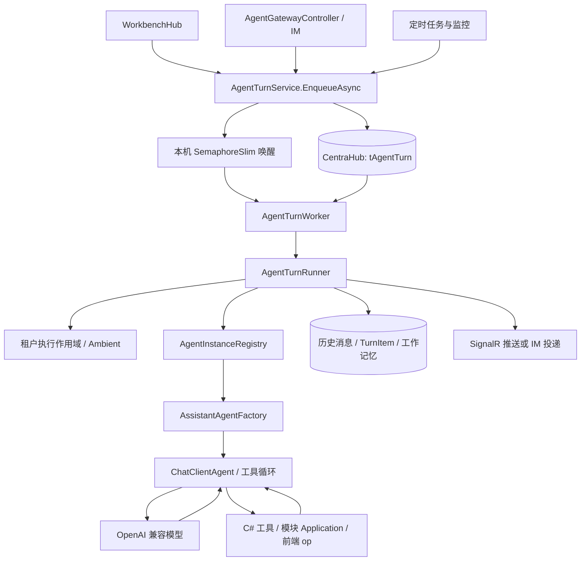
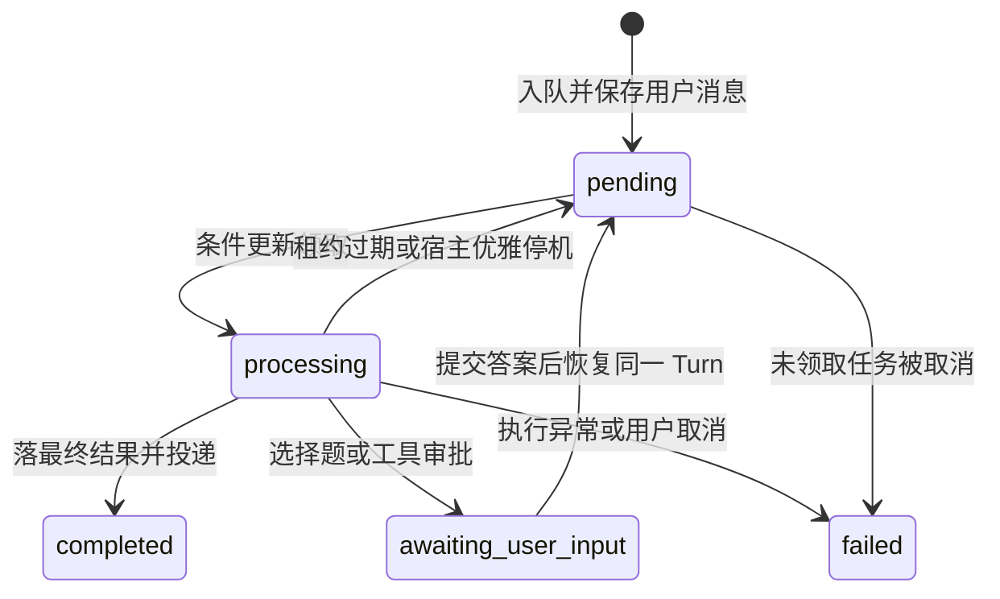

# 模型接入与 Agent 编排

> 提取日期：2026-10-29。依据当前工作区源码（包含尚未提交的修改），没有读取生产 Nacos、生产数据库或线上调用记录。本章“代码事实”指本地实现，不代表某环境已发布或已启用。源码路径均相对于 `D:/code/Wtwo-project`；文末提供主要定位点。

## 1. 框架实际采用的编排方式

AIRA 采用 **ASP.NET Core 后台 Worker + 数据库持久化 Turn + Microsoft Agent Framework 的函数调用循环**。Workbench、IM、定时任务先转成统一 Turn，再由 Worker 执行；模型选择下一项工具，工具结果回给模型，直到得到最终回答或遇到审批、提问、取消。

它不是前端直接调用模型，也不是在仓库中定义一个固定的 LangGraph/Dify 工作流。`Skill` 主要是模型可按需加载的 Markdown 操作说明；真正执行由 C# 工具、业务模块和前端 op 承担。Agent 实例列表来自数据库，不能沿用旧说明里“Program 固定注册 7 个 Agent”的说法。



编排有三层，复刻时不要混在一个函数里：

| 层 | 职责 | 实现 |
|---|---|---|
| 任务调度 | 入队、去重、实例分配、租约、停机恢复 | `AgentTurnService`、`AgentTurnWorker` |
| 单轮执行 | 建上下文、读历史、恢复审批、执行 Agent、落库和投递 | `AgentTurnRunner` 与三个 Coordinator/Composer |
| 模型循环 | 发 completion、解析工具调用、执行工具、继续 completion | `Microsoft.Agents.AI` 的 `ChatClientAgent`；业务工具通过 `AIFunction` 挂载 |

## 2. 依赖与接口层

以下为项目声明版本，不是对外最新版本：

| 依赖 | 声明版本 | 在此项目的用途 |
|---|---|---|
| .NET | `net8.0` | Web 宿主与 Service |
| `Microsoft.Agents.AI` / `.Abstractions` / `.OpenAI` | `1.15.0` | Agent、Session、Skill provider、OpenAI 适配 |
| `Microsoft.Agents.AI.Hosting` / `.DevUI` | `1.15.0-preview.260722.1` | 宿主集成和开发调试 UI |
| `Microsoft.Extensions.AI` | `10.6.0` | `IChatClient`、`ChatOptions`、工具与上下文抽象 |
| `ModelContextProtocol.AspNetCore` | `1.4.0` | 对外暴露业务工具的 MCP Server |
| `FreeSql.Provider.MySqlConnector` | `3.5.307` | 项目 NuGet 声明之一；不能据此断定所有库都是 MySQL |
| `Microsoft.SqlServer.TransactSql.ScriptDom` | `170.191.0` | SQL 语法分析、安全校验 |
| `DuckDB.NET.Data.Full` | `1.5.5` | 数据集分析 |
| OpenTelemetry exporter/hosting/instrumentation | `1.12.0` | 模型、工具和 HTTP 的可观测性 |

`OpenAIClient` 来自 OpenAI .NET SDK，代码用 `GetChatClient(deployment).AsIChatClient()` 转为统一接口。`Endpoint + ApiKey + Deployment` 是兼容 Chat Completions 接口的通道配置；这里的 Deployment 实际是发给通道的模型名，不要求 Azure 部署。主 SDK 的最终传递依赖版本应由锁文件或 restore 结果确认，本章不臆造版本。

## 3. 模型配置与优先级

### 3.1 通道与模型是分开的

`Program.cs` 注册主 `OpenAIClient` 单例；`AssistantAgentFactory` 按 Agent 数据库版本选择模型。主、视觉、辅助模型通常共用主通道。备用模型可使用第二通道。

| 配置键 | 作用 / 缺省行为 |
|---|---|
| `AppSettings:OpenAI:Endpoint` | 主通道基址；必须配置 |
| `AppSettings:OpenAI:ApiKey` | 主通道密钥；必须由部署秘密配置提供 |
| `AppSettings:OpenAI:Deployment` | Agent 默认模型；Agent `model.deployment` 非空时覆盖 |
| `AppSettings:OpenAI:MultimodalDeployment` | 图片模型；Agent `model.multimodalDeployment` 优先 |
| `AppSettings:OpenAI:FallbackDeployment` | 备用模型；Agent `model.fallbackDeployment` 优先，再回退全局 AuxiliaryDeployment |
| `AppSettings:OpenAI:AuxiliaryDeployment` | 标题、记忆、压缩等辅助调用；未配时取 Deployment |
| `AppSettings:OpenAI:Backup:Endpoint` / `ApiKey` | 备用供应商通道；见下述实现注意项 |
| `AppSettings:OpenAI:MaxConcurrentCalls` | 单进程共享 completion 许可数，默认 8 |
| `AppSettings:OpenAI:GateWaitSeconds` | 等许可超时，默认 60 秒 |
| `AppSettings:AgentTurn:ReasoningReplayOverrides` | 模型是否需要重传 reasoning 的覆盖策略 |
| `OpenTelemetry:CaptureMessageContent` | 字符串等于 `false` 时不记录消息正文；代码缺省为开启 |
| `OpenTelemetry:MeaiSourceName` | 缺省 `Experimental.Microsoft.Extensions.AI` |

“全局并发”在这里指当前进程内主调用和辅助调用共享 `LlmConcurrencyGate`，不是跨整个 Kubernetes 集群的分布式总限额。副本数量增加后，供应商侧实际并发还会增加。

脱敏示例（仅说明结构，实际值由部署方配置）：

```json
{
  "AppSettings": {
    "OpenAI": {
      "Endpoint": "https://model-provider.example/v1",
      "ApiKey": "<从秘密配置注入>",
      "Deployment": "<支持工具调用的主模型名>",
      "MultimodalDeployment": "<支持图片和工具的模型名>",
      "FallbackDeployment": "<备用模型名>",
      "AuxiliaryDeployment": "<辅助模型名>",
      "Backup": {
        "Endpoint": "https://backup-provider.example/v1",
        "ApiKey": "<备用通道秘密>"
      },
      "MaxConcurrentCalls": 8,
      "GateWaitSeconds": 60
    }
  }
}
```

**当前实现注意项：**主、备用客户端的网络超时均是 5 分钟。备用通道注释称可选，但 `Program.cs:417` 无条件注册 keyed client，缺 Endpoint/ApiKey 时该工厂抛异常；Factory 取 `GetKeyedService` 时会触发工厂，不保证得到 null。因此若配置了不同备用模型又没有备用通道，不能仅凭注释认定会自动回到主供应商。复刻与部署需实测此组合；本次只提取文档，没有修改该逻辑。

### 3.2 主模型的装饰器顺序

下图按一次模型调用从外到内展开，`AsAIAgent` 的工具调用循环在整个 ChatClient 管道外面：

```text
ChatClientAgent（会话、历史、Skills、函数调用循环）
  → SkillToolTelemetryChatClient
  → ConcurrencyLimitChatClient
  → AIContextProviders（每次 completion 都注入）
  → VisionAwareChatClient（按当前用户消息是否含图片选分支）
      ├─ 视觉分支 → 视觉模型通道
      └─ 文本分支 → RateLimitFallbackChatClient
                       ├─ 主模型通道
                       └─ 备用模型通道

每个模型通道：
OpenTelemetry
  → ControlledCancellationChatClient
  → GenAiUserContextChatClient
  → NormalizeOutputPartsChatClient
  → OpenAiSpecToolNameChatClient
  → ReasoningContentWireChatClient
  → AiUsageMeteringChatClient
  → OpenAI SDK IChatClient
  → HTTP transport（ReasoningContentRewritePolicy 在发出前处理）
```

关键行为：

- `OpenAiSpecToolNameChatClient` 处理内部工具名与 OpenAI 协议合法工具名的对应，不能简单把带点的内部 op 名直接发给所有供应商。
- reasoning 的收集和 HTTP 重写配合，用于要求历史 assistant 重传 `reasoning_content` 的模型。换供应商时不仅换模型名，还必须核验历史工具回合的协议兼容。
- 文本主模型限流才切备用。`IsRateLimited` 匹配 429 或 rate-limit/TPM/RPM 等消息；代码没有通用 5xx 熔断策略。
- 流式备用只包住第一次 `MoveNextAsync()`；首块发出后出现错误不会拼接另一模型回答，避免把两段不同输出接起来。
- 外层并发装饰器对限流采用 2 秒、5 秒退避。定时任务等待许可超时按有限次数重新等待；交互任务等待超时立即抛错。默认定时任务共 3 个等待窗口（通常约 3 分钟），不是无限等待。
- `VisionAwareChatClient` 检查最后一条 user 消息。当前消息有图才走视觉；文本轮会清理历史图片，使旧图片不让所有后续轮持续走视觉。视觉分支直接调用视觉客户端，没有再经过文本备用分支。
- 默认 `ChatOptions.Reasoning` 为 `ExtraHigh / Full`。是否支持和是否返回由实际模型决定。
- 非 workbench Agent 仅在适合的百炼通道上添加 web-search 扩展；workbench 不默认开启联网搜索，以避免内部经营问题被公开新闻干扰。不能描述成所有供应商都接受该扩展。

`SkillToolTelemetryChatClient` 必须位于并发装饰器外侧：后者会克隆 ChatOptions，放错层会导致只包装克隆列表，框架实际执行的原始 Skill 函数不被记录。

### 3.3 辅助调用

`AuxiliaryChatClientFactory` 用于上下文整理等短任务。外到内顺序是 JSON 输出兼容 → 按供应商关闭 thinking → OTel/用户/输出规整 → 并发许可 → 工具名兼容 → reasoning wire → 用量计量 → SDK。它与主模型共享许可池，但不经过主模型的 `RateLimitFallbackChatClient`。

辅助 `CreateOptions` 清除默认 Reasoning，并写入机构、用户、用途、会话关联的内部计量字段；故意不设置遥测 `ConversationId`，以免辅助调用在观测平台成为额外用户会话。JSON 结构化输出会根据通道做 `json_schema` / `json_object` 兼容处理。

## 4. Agent 构建与热更新

数据库是配置正本。启动读取 `tAgentCfgInstance` 启用实例并注册工厂，`AgentInstanceRegistry.GetOrCreate` 使用 Lazy 缓存构建结果。**但不是所有实例都等首个用户请求才构建**：`Program.cs:594` 启动时立即调用 `GetOrCreate(AppConstSetting.AssistantAgentKey)`，常量值为 `gclaw`。因此必须预先有启用且能够构建的 gclaw（激活版本、模型配置、提示词/Skill 物化目录），否则服务会在后续管理路由挂载之前启动失败。工作台的 gclaw-workbench 配置要另行准备，不能代替 gclaw。构建前 `MaterializeAgent` 将激活版本生成到运行目录：

```text
Instances/<agentName>/
  agent.json
  Prompts/global.md
  Prompts/<systemPrompts 声明文件>
  Skills/<skillKey>/SKILL.md
  Skills/<skillKey>/<资源文件>
  <版本 FilesJson 中的辅助文件>
```

`agent.json` 包含 `name/displayName/description/model/tools/residentTools/approvalTools/skills/systemPrompts`。全局提示词先加入，再按 `systemPrompts` 顺序拼接本 Agent 文件。Skill 挂在 `ChatClientAgentOptions.AIContextProviders` 上，运行上下文挂在 ChatClient 管道上，两者位置不能交换。

管理页 SaveVersion 会保存新版本并激活；ActivateVersion 用于切换到已有版本。两者随后都需要重新加载。`AgentInstanceRegistry.ReloadAll` 清掉已构建缓存，下一次使用重新物化和构建。源代码中没有可作为现网完整配置的 `Instances` 种子目录；`EnsureBootstrapped` 虽保留空库导入逻辑，但不能指望克隆仓库就自动得到生产 Agent、提示词和 Skill 绑定。

## 5. Turn 的数据和状态

`EnqueueTurnRequest` 必需字段：`CompanyId/UserId/Channel/ConversationId/Message`。其余包括 AgentName、BotBindingId、ChannelChatId、ConversationType、DeliveryImUserId、Attachments、DedupeKey、UiContextJson、EntryInstance、RefId、ConversationTitle、EntryContext。

`tAgentTurn` 主要字段：

| 分类 | 字段 |
|---|---|
| 所属与渠道 | `cID/cCompanyID/cUserID/cConversationId/cAgentName/cChannel` |
| IM 返回路由 | `cBotBindingId/cChannelChatId/cConversationType/cDeliveryImUserId` |
| 输入 | `cMessage/cAttachmentsJson/cCurrentUserMessageId/cUiContextJson/cEntryContextJson` |
| 隔离与任务关联 | `cEnv/cEntryInstance/cRefId/cDedupeKey` |
| 执行租约 | `cStatus/cOwnerInstance/cStartedAt/cHeartbeatAt` |
| 结果 | `cResult/cImageAttachmentsJson/cErrorCode/cErrorMessage/cTraceId/cCompletedAt/cDurationMs` |



图中是语义名称；数据库 `cStatus` 为 int，实际枚举以 `AgentTurnStatus` 为准。取消记录为失败状态加 `CANCELLED`，不要新增一个并不存在的取消状态值。模型 completion 的短重试与 Turn 回收重跑是两种机制；看到 `RetryCount/MaxRetries` 字段不能推断已实现无限任务重试。

### 5.1 入队与领取

1. `EnqueueAsync` 按 DedupeKey 去重，生成 Turn，写当前环境，尽早落真实用户消息并保存其 ID。
2. 使用本机 `IAgentTurnKick` 唤醒空闲消费者；数据库仍是任务事实来源。
3. 每实例默认 2 个固定消费者，空闲时最多隔 1.5 秒扫库。
4. `TryClaimNextPendingAsync` 按同环境筛选 pending；旧记录 `cEnv` 为空在兼容逻辑中仍可能被任何环境领取。
5. Workbench 入队绑定实例；IM/HTTP 通常不绑定。只领取未绑定、绑定自己或原绑定实例已离线的任务。
6. 数据库用 `WHERE ID = ... AND Status = Pending` 更新为 Processing，受影响行数大于 0 才算领取成功。
7. 默认交互优先。schedule 排队超过 `ScheduleHungerTimeoutSeconds=900` 秒后，与交互公平竞争；空闲时可立即领取未饥饿的 schedule。

实例 Redis 心跳每 10 秒刷新、TTL 30 秒；执行中 Turn 的数据库心跳每 30 秒刷新，超过 90 秒可回收，每 30 秒扫描。**实例离线接管 pending** 与 **过期 processing 租约回收** 是两种不同等待窗口，不能把所有崩溃恢复都写成 30 秒。

Redis 异常时在线实例集合为 null，领取退化为只领未绑定或绑定自己的任务，不抢他人的绑定任务。宿主优雅停止会将本实例 processing 任务交回 pending。

### 5.2 Runner 的执行步骤

`AgentTurnRunner.RunCoreAsync` 按以下顺序工作：

1. `AgentExecutionScopeFactory.CreateAsync` 创建机构库、用户、渠道和会话上下文；整个执行用 `await using` 持有。
2. Workbench 识别当前输入是否续接中断快照，先认领快照，再构造当前消息，避免把审批答案与原目标顺序颠倒。
3. `AgentTurnEventRecorder.BeginAsync` 建立执行 attempt。宿主重跑读取旧 attempt 的明细作为历史依据。
4. `AgentTurnMessageBuilder` 处理文本、附件和入口上下文，解析 Agent 实例。
5. 建立根 invoke-agent span；审批恢复以原参数执行批准的工具，执行结果加入入口 system 消息。
6. 注入 UIContext，构造 `ChatClientAgentRunOptions`（conversation_id、租户用户、恢复快照 ID、批次和 attempt）。
7. 合并工具快照和会话已加载组。Workbench 使用流式循环推 token/工具事件，IM 路径也消费 `RunStreamingAsync` 记录明细，只是在末尾统一交付正文。
8. 同步保存工具开始/结束、TurnItem。成功时结算记录、工作记忆、工作对象来源，完成并投递。
9. 投递后才执行中断快照语义结算；结算失败不能把用户已经收到的成功结果改成失败。

Ambient 使用 `AsyncLocal`。工厂的 `CreateAsync` 有意采用**非 async 同步前缀 + 返回初始化 Task**：先在调用者执行上下文 Push，再异步填租户。复刻时若改成普通 `async` 包装函数，Push 可能无法流回调用者后续 continuation，导致工具失去公司与用户上下文。工具通过 `IAgentRequestContextAccessor` 取当前上下文，不能任意从根 DI 容器取依赖租户的 scoped 服务。

## 6. 历史、工作记忆与压缩

这套上下文没有向量检索的必要依赖。已确认的组成是数据库历史、结构化工作记忆、机构画像、用户偏好、指标口径、Skill 和本轮 UI 信息。

| 注入器（Factory 顺序） | 内容 |
|---|---|
| `RuntimeContextProvider` | 当前时间、用户、公司 ID 和机构名称 |
| `UiContextProvider` | 当前窗口/字段摘要、排课预览确认；标注窗口背景可能过时 |
| `MetricContextProvider` | 当前可用指标及口径信息 |
| `UserPreferenceContextProvider` | 用户偏好 |
| `UserSkillContextProvider` | 用户 Skill 目录，不把全部正文常驻 |
| `ConversationContextProvider` | 基准 SQL、已成功工具、表结构、已读 Skill、中断任务 |
| `CompanyContextProvider` | 公司画像与相关背景 |

`AgentChatHistoryProvider` 在调用方未自行携带 assistant 历史时从数据库取历史。交互缺省 `ChatHistoryTake=10`，schedule 缺省 `ScheduleChatHistoryTake=3`，均限制 0～200，0 为关闭。这些值是经筛选的历史消息数量，不是“10 个 Turn”；具体工具事件重建和预算由 `AgentTurnItemHistoryRebuilder` 处理。当前入口消息/当前 Turn 会被排除以防重复，审批或选择题恢复有专门例外。

历史展示与模型历史不是同一份格式：用户界面使用 `kind=tool` 状态卡，模型需要成对的 tool call/result 与最终回答；不能把工具卡摘要当完整模型结果。`tAgentTurnItem` 保存更细的事件与 attempt 证据，用于重建和诊断。

工作记忆 `AgentConversationContextService` 先规则提取，再可选后台辅助模型润色，避免首响被辅助调用拖慢。润色默认开启，最小间隔 3 代、最少工具 6 个（对应 Phase2PolishEnabled/MinInterval/MinTools）。

压缩参数都在 `AppSettings:AgentTurn`，源码缺省如下：

| 参数 | 默认 |
|---|---:|
| `ChatHistoryTokenBudget` | 48000 |
| `CompactionEnabled` | true |
| `CompactionTriggerTokens` / `CompactionPassTokenBudget` | 100000 / 100000 |
| `CompactionMaxTurnsPerPass` | 40 |
| `CompactionSummaryMaxTokens` | 8000 |
| `CompactionMessageCharLimit` / `CompactionToolResultCharLimit` | 6000 / 2000 |
| `CompactionToolCallArgCharLimit` / `CompactionTimeoutSeconds` | 400 / 180 |

触发依据是预算裁剪后被丢弃的旧内容累计，不是直接检测模型上下文窗口快满。摘要写成 `compaction_summary` TurnItem，携带 CoveredThroughTurnId/CreateTime 和来源轮次；原事件不删除。换成更小上下文模型时必须重新配置预算，不能照搬当前缺省。

## 7. 提问、审批与取消恢复

用户提问和工具审批会终止当前模型循环，保存快照并把同一 Turn 设为 AwaitingUserInput，释放 Worker。用户提交后把原 Turn 重新置 Pending，`ChatTurnAccepted(resumed=true)` 提示前端继续同一气泡。

审批不是仅给模型加一句“用户同意”：

1. `ApprovalRequiredAIFunction` 根据工具组/函数策略拦截，返回 `ApprovalInterruptedSignal` 并设置 `FunctionInvokingChatClient.CurrentContext.Terminate=true`。
2. Runner 捕获信号，落审批卡、快照、未完成正文，结束当前执行。
3. 恢复时从消息库合并最新批准/拒绝结果，不能使用快照里停留在 pending 的旧状态。
4. Runner 在进入 LLM 前用审批时的原工具与原参数执行批准项。
5. `ToolApprovalStateStore` 按工具名和 JSON 语义相等参数记录执行或拒绝结果；模型重复调用相同请求时复用结果或继续拒绝，避免重复写入。
6. 超出当前可复用结果范围、进程中断、外部系统是否已提交等仍须依赖业务工具自身幂等与真实查询，不能承诺任意外部写操作 exactly-once。

用户停止通过 `AgentTurnCancellationService` 和 Redis `AgentTurnCancelSubscriber` 取消运行 token；未领取 pending 任务直接标记失败/CANCELLED。宿主停止走交还任务，不等同用户取消。WorkBench 中断续接还保留快照关系判定：默认最多 5 份、保留 7 天、恢复置信度 0.75、完成 0.85、放弃 0.90；单结果内联上限 2KB、单快照 128KB，清理超时 30 秒、语义判定超时 15 秒。

## 8. 复刻顺序与验收样例

1. 先建立执行上下文、CentraHub Turn/历史/配置表和业务模块接口，使用可控测试租户；不要从真实生产数据起步。
2. 接入一个支持函数调用的 OpenAI 兼容模型，验证普通回答、一次工具调用、连续工具调用与取消。
3. 实现 Agent DB 版本与物化、注册表缓存；先准备启用且可构建的 gclaw，再启动宿主验证启动期构建，不能计划等服务起来以后再用其管理页创建缺失的 gclaw。然后另备 gclaw-workbench；各实例先放最小工具白名单，再增加 Skill。
4. 接入 Worker、CAS 领取、心跳和优雅停机；用两个实例验证不重复领取，验证 Redis 异常的保守策略。
5. 接入事件持久化、历史重建与 SignalR。断线/刷新后应可通过历史和 Turn 状态恢复，而不是依赖连接残留数据。
6. 接入审批和选择题。同一 Turn 恢复，已批准原参数执行一次，拒绝项不执行，重复提交不产生重复业务动作。
7. 再增加视觉路由、备用通道、辅助调用、工作记忆与压缩，逐项测试缺配置、429、流中断与小窗口预算。

最小验收场景：纯文本无工具、跨轮追问、图片后再发纯文本、工具 429 首块前切备用、首块后失败不拼接备用文本、并发许可饱和、选择题恢复、审批原参执行、用户取消、实例退出恢复、历史回放工具卡完整、AI 用量与租户对应。

上述是基于实现推导的复刻/验收路线，本次没有启动服务或访问实际模型，不能据此宣称已通过集成测试。

## 9. 主要源码证据

| 事实 | 源码定位 |
|---|---|
| 模型依赖版本 | `wtwo-server/WTwo.Agent.Web/WTwo.Agent.Service/WTwo.Agent.Service.csproj:48`；`wtwo-server/WTwo.Agent.Web/WTwo.Agent.Webapi/WTwo.Agent.Webapi.csproj:14` |
| SDK 主/备用通道、许可注册 | `wtwo-server/WTwo.Agent.Web/WTwo.Agent.Webapi/Program.cs:388` |
| 数据库实例注册表 | `wtwo-server/WTwo.Agent.Web/WTwo.Agent.Webapi/Program.cs:545`；`wtwo-server/WTwo.Agent.Web/WTwo.Agent.Service/Framework/Manage/AgentInstanceRegistry.cs:28` |
| 主模型完整装配 | `wtwo-server/WTwo.Agent.Web/WTwo.Agent.Service/Framework/Assembly/AssistantAgentFactory.cs:39` |
| telemetry 内层顺序 | `wtwo-server/WTwo.Agent.Web/WTwo.Agent.Service/Framework/Telemetry/GenAiUserContextChatClient.cs:116` |
| 辅助模型装配 | `wtwo-server/WTwo.Agent.Web/WTwo.Agent.Service/Framework/Assembly/AuxiliaryChatClientFactory.cs:30` |
| 429 与首块前切换 | `wtwo-server/WTwo.Agent.Web/WTwo.Agent.Service/Framework/ChatClients/RateLimitFallbackChatClient.cs:63` |
| 当前用户图片判断 | `wtwo-server/WTwo.Agent.Web/WTwo.Agent.Service/Framework/ChatClients/VisionAwareChatClient.cs:62` |
| Worker 并发与心跳 | `wtwo-server/WTwo.Agent.Web/WTwo.Agent.Service/Framework/Turn/AgentTurnWorker.cs:28` |
| 入队 / CAS 与交互优先 | `wtwo-server/WTwo.Agent.Web/WTwo.Agent.Service/Framework/Turn/AgentTurnService.cs:162`；同文件 `:305` |
| Runner 流程 / 动态工具 | `wtwo-server/WTwo.Agent.Web/WTwo.Agent.Service/Framework/Turn/AgentTurnRunner.cs:101`；同文件 `:623` |
| 历史读取 | `wtwo-server/WTwo.Agent.Web/WTwo.Agent.Service/Framework/Providers/AgentChatHistoryProvider.cs:41` |
| 压缩缺省参数 | `wtwo-server/WTwo.Agent.Web/WTwo.Agent.Service/Framework/History/AgentConversationCompactionService.cs:56` |
| 中断配置 | `wtwo-server/WTwo.Agent.Web/WTwo.Agent.Service/Framework/Turn/AgentInterruptionOptions.cs:6` |
| 审批状态 | `wtwo-server/WTwo.Agent.Web/WTwo.Agent.Service/Framework/ToolApprovalPolicy.cs:13` |
| Turn 数据契约 | `wtwo-server/WTwo.Bus.Common/WTwo.Bus.Common.Model/DBEntity/CentraHub/AgentTurnDO.cs:16` |

