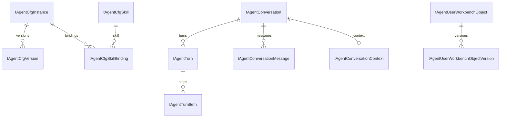

# 后端配置、数据、服务依赖与部署

本章面向“拿到源码后如何补齐运行条件”。路径未加前缀时均相对于 `wtwo-server/`。所有配置示例使用占位值；没有复制真实凭证、连接串、租户或用户数据。

## 1. 配置分为四层

| 层 | 位置 | 内容 | 生效方式 |
|---|---|---|---|
| 启动配置 | `WTwo.Agent.Web/WTwo.Agent.Webapi/appsettings*.json` | Kestrel、Nacos 地址/命名空间/DataId | 启动读取，按实际 environment 加载 |
| 远端环境配置 | Nacos 对应 JSON | Redis、数据库、中台、模型、可观测等 | 合并到 IConfiguration；部分组件捕获初始值，须重建/重启才能完全生效 |
| Agent 版本配置 | CentraHub `tAgentCfg*` | Agent 定义、模型选项、Prompt、工具组、Skill 绑定 | 管理接口保存/激活，Reload 后重建实例 |
| 会话与用户配置 | CentraHub 运行表、租户业务表 | 会话上下文、产物、偏好、机构画像、权限、IM 绑定 | 按业务接口和当前身份读取 |

源码 `Program.cs:743` 的 NacosInit：无 Listeners 时直接 return；有配置时 AddNacosV2Configuration，再绑定 AppSetting/AgentAppSetting。**因此“删除 Nacos 节即可完整本地运行”不成立**：options 绑定也在该方法内。单机适配需要显式保留等价的 options 注册，或给独立开发 Nacos 配置，不能默认为未配置就无损降级。

环境名还参与 Turn 领取隔离。`prd`、`Production`、`test`、`Development` 不应随意混用；实际取 `IHostEnvironment.EnvironmentName` 后转小写，不会自动把 prd 等同 production。容器入口使用 `--environment=${APPLICATION_ENV}`。

## 2. 关键配置字典

| 配置路径 | 用途 / 是否必要 | 依据 |
|---|---|---|
| `Redis:ConnectionString` | 启动必需；缺失直接抛错 | Program:833 |
| `AppSettings:CentraHubConnectionString` | SQL Server 中心库；Agent 配置、历史、Turn 等依赖，完整运行必需 | Program:919 |
| `AppSettings:ADBConnectionString` | MySQL 驱动的 ADB，按能力需要配置；不能替代租户业务库 | Program:866 |
| `AppSettings:TemplateDBConnectionString` | SQL Server 模板库；不配会注册 null，占位不等于相关功能可用 | Program:892 |
| `AppSettings:PublicGateUrl` | 租户数据库路由和机构资料公共网关，业务调用必需 | ExternalHttpService:113 |
| `AppSettings:ZtServerUrl` | 中台服务与文件 STS | OssUploadService:40、:200 |
| `AppSettings:WTwoDomainUrl` | 外部工作台、绑定页、OAuth issuer/回链地址 | ImUserBindingService:115、AgentOAuthOptions |
| `AppSettings:WXServerUrl` | 微信相关网关，绑定和通知等能力使用 | ImUserBindingService:116、Message 模块 |
| `AppSettings:OpenAI:Endpoint/ApiKey/Deployment` | 主模型入口、凭证、模型名 | Program:393；AssistantAgentFactory:60 |
| `AppSettings:OpenAI:Backup:Endpoint/ApiKey` | 备用客户端连接；当前注册方式下缺失可能在工厂解析时抛错 | Program:421；第 03 章 |
| `AppSettings:OpenAI:FallbackDeployment` | 备用模型名，注意不在 Backup 子节内 | AssistantAgentFactory:97 |
| `AppSettings:OpenAI:AuxiliaryDeployment` | 辅助任务模型 | AuxiliaryChatClientFactory；第 03 章 |
| `AppSettings:OpenAI:MultimodalDeployment` | 图片输入路由模型 | AssistantAgentFactory:140 |
| `AppSettings:OpenAI:MaxConcurrentCalls` | 全局模型调用并发，默认 8 | Program:442 |
| `AppSettings:AgentTurn:MaxConcurrentTurnsPerInstance` | Worker 实例并发，默认 2，与模型调用并发不是同一层 | AgentTurnWorker:62 |
| `AppSettings:AgentTurn:ChatHistoryTake` | 默认 10；schedule 历史默认 3（ScheduleChatHistoryTake） | AgentChatHistoryProvider:105 |
| `AppSettings:AgentTurn:ChatHistoryTokenBudget` | 历史预算；两个消费者缺省值不同，应显式配置 | AgentConversationCompactionService:80 为 48000，AgentConversationHistoryService:1374 为 600000 |
| `AppSettings:AgentTurn:Compaction*` | 压缩开关/阈值/摘要预算/超时 | AgentConversationCompactionService:71–80 |
| `AppSettings:AgentInterruption` | 中断/恢复策略 options | Program:249；AgentInterruptionOptions.cs |
| `AppSettings:ReportValidatorUrl` | 报表服务端渲染校验地址 | ReportObjects.cs:334 |
| `OssUpload:BusinessName/BusinessType/EncryptKey/DecryptKey` | STS 业务类型和签名配置 | OssUploadOptions.cs |
| `MQConfig` | MQ4Http topics、consumer；监控收费事件与消息通知按需使用 | Program:120–131 |
| `OpenTelemetry` | OTLP endpoint、协议、服务名、鉴权 headers、内容采集 | GenAiObservabilityOptions.cs |
| `SlsLoggerOptions` | 阿里云日志配置 | Program:811 |
| `AppSettings:AgentOAuth` | MCP 外部授权参数 | AgentOAuthOptions.cs:10 |
| `AgentManage:PublicationOrigins` | Skill 发布管理的跨域来源 | Program:477 |
| `AppSettings:ScheduleMaster:Url/User/Secret/Password` | 老调度服务迁移客户端；新任务主引擎不依赖此链路 | Capabilities/ScheduleTask/IScheduleMasterClient.cs:220 |

这里的源码短名均可在[源码导航](./附录-源码导航.md)查到完整路径。更多本地 bootstrap 字段见[配置字段附录](./附录-配置字段索引.md)。它只记录字段结构，没有把本地 bootstrap 误称为全部远端配置。

## 3. 数据库分工与租户隔离

### 3.1 实际连接类型

| 数据库 | 实际驱动 | 注册 / 选择方式 | 典型数据 |
|---|---|---|---|
| 机构业务库 | SQL Server | ITenantDbResolver.GetAsync(companyId) | 学员、线索、班级、课次、收费、员工、权限、机构配置 |
| CentraHub | SQL Server | keyed `CentraHubFreeSql` | Agent 配置/Skill、Turn、消息、产物、监控、IM/OAuth、调度 |
| TemplateDB | SQL Server | keyed `TemplateDBFreeSql` | 模板及相关查询能力 |
| ADB | MySQL | keyed `ADBFreesql`（拼写以代码为准） | ADB 专属查询 |
| 作业打卡库 | MySQL | HomeworkDaka 模块注册 | 云学辅作业打卡只读查询 |

租户数据库不是一个全局 connection string。`WTwo.Bus.Common/.../Service/TenantDbResolver.cs:78` 调 IExternalHttpService，后者请求公共网关 `/api/getcustomerdbinfo.ashx`，带 companyId、时间戳和签名取得连接信息；随后为机构缓存固定的 IFreeSql。`TenantDbResolver.cs:85` 明确使用 DataType.SqlServer。

后台任务也必须有正确身份：`AgentExecutionScopeFactory.CreateAsync` 同步设置 AsyncLocal Ambient 后返回异步初始化任务；不要包进额外 async 方法而丢失调用方上下文。请求路径则由 AgentAmbientMiddleware 注入。这里需要隔离的至少包括 companyId、userId、可操作校区、当前会话和渠道。

### 3.2 中心库核心关系

这是逻辑关系图，不声称数据库已创建对应外键。SkillBinding 的键为 cAgentName/cSkillKey，不是 versionId；版本内容与当前 Skill 正文/发布修订共同影响物化结果。具体表名、列名、可空类型见[40 个中心库实体字段附录](./附录-数据库实体字段.md)。生产迁移目录和实体存在不代表空库可自动补齐；很多实体 DisableSyncStructure=true，必须审查 DDL。

需要同时理解三类 ID：conversationId 表示持续会话，turnId 表示一次提交的执行任务，messageId 表示一条持久消息。一个 Turn 可以包含多个工具步骤和消息，但前端历史通常合成一个 Agent 气泡。产物再拥有 objectId/version/messageId，不要把这些编号相互替代。

### 3.3 SQL 与数据集

安全 SQL 工具只接受单条 SELECT，借助 ScriptDom 分析和过滤，禁止写关键字，检查机构与校区约束，剔除敏感列和手机号打码。返回模型通常最多 200 行，通过第 201 行判断截断；大结果可存成数据集，返回 datasetId、样本和总数。

数据集正本为 CSV 上传 OSS，CentraHub 存台账；普通查询数据集上限 50,000 行、上传来源上限 200,000 行、TTL 默认 48 小时。后续导出基于 datasetId，不让模型分页抄写全量行。证据：`Tools/Sql/SqlQueryTools.cs:134`、`:158`；`Framework/Dataset/AgentDatasetService.cs:104`、`:113`、`:122`、`:257`。

## 4. 身份、权限与管理面

HTTP 业务管道顺序：OAuthBearerMiddleware → ClawAgentIdMiddleware → FreeSqlTenantMiddleware → AuthMiddleware → AgentAmbientMiddleware → WorkbenchAccessGateMiddleware（Program:681–700）。

- 常规 API 使用 WTwo-AuthToken 和 WTwo-CompanyID；SignalR 的 access_token query 由 AuthMiddleware 兼容解析。老 token 为加密 JSON 路径，不能直接按 JWT 实现替身。
- 工作台开通判断要求该机构 `tSysInfo` 配置行的 `cName='IsOpenGClaw'`、`cValue='2'`，用户拥有 `UseAiraWorkbench` 权限；IsOpenGClaw 是配置项名，不是数据表列名。机构状态缓存 5 分钟。拒绝为 403，身份失败为 401。
- Hub 入会话组还要检查 companyId/userId 归属，不能只做前端会话过滤。
- 管理面 `/agent/AgentManage/*` 有 NoAuth/NoTenant，但额外应用 AgentManageAuth，登录后用 `X-Agent-Manage-Token`。当前账号/密码定义仍在代码常量中；本包不导出。独立复刻必须改成自己的凭证来源并限制管理入口。
- 外部 MCP OAuth 与本系统普通登录、机器人平台 appSecret 是三套不同凭证，不能共用。MCP 支持访问令牌、刷新、授权码、同意页、动态客户端注册；默认访问令牌 3600 秒、刷新令牌 30 天、授权码 90 秒。

这些是当前实现说明，不构成安全审核结论。网关内部鉴权和 IM 首次用户绑定的实际边界见第 02 章。

## 5. 文件、报表与通知

### 文件上传

OssUploadService 先向中台 `/file/getStsInfoV3` 请求临时凭证，解密后构造 OssClient，再调用 `/file/getFileId` 登记文件，设置回调元数据并 PutObject。复制这部分必须连同“签名 → 文件登记 → OSS 对象 → 可访问 URL”的完整契约，不能只替换一个 bucket 名。

源码含部分历史签名常量。本次不将其复制到文档；从零复刻应重建自己的签名/STS 契约，已有系统复用则使用获授权的配置。证据：`OssUploadService.cs:134`、`:180`、`:247`、`:268`。

### 报表校验

`wtwo-web/report-validator` 是独立 Node 服务，复用前端渲染源码，happy-dom 建 DOM，ECharts 逐图试画。默认端口 9210，GET `/healthz`，POST `/validate`，请求 `{"payload":{...}}`，结果必须有布尔 `valid` 和可选 `error`。

Agent 的调用超时 8 秒。真实渲染错误拒绝保存；服务未配置、超时、非 2xx、响应损坏时当前实现会记日志并跳过此层校验，**成功保存不一定说明渲染校验已执行**。结构校验、权限校验等仍由各自代码负责。证据：`Workbench/Objects/ReportRenderValidator.cs:21`、`:33`、`:42`；`wtwo-web/report-validator/src/server.ts:9`、`:67`。

### 微信通知与企微 bot 分开

Message 模块的家校微信模板消息经 MQ 交老消息服务投递，AgentIM 的企微智能机器人经官方 WebSocket SDK 投递。两者账号类型、消息模板、协议和配置不同；不能把 WXServerUrl 当企微 bot SDK endpoint。

## 6. Redis、分布式任务与调度

Redis 同时服务缓存、实例心跳、取消广播、App manifest、跨实例 Workbench push，以及 Op RPC 回执等功能。Turn 本身存在 SQL Server，Redis 重启不应被理解为任务历史消失。

Workbench Turn 记录 EntryInstance，优先由入队实例执行；领取同时检查 Env（旧数据 Env 为空仍允许兼容领取，不能保证历史空值记录跨环境隔离）。实例心跳 TTL 30 秒、Worker 周期续期；实例掉线后同环境其他实例按领取规则接管 pending。processing 的数据库租约回收另有约 90 秒窗口。Redis 不可用时保守限制领取，不抢其他在线归属。接管时间还受轮询/领取条件影响，不能把 TTL 说成严格完成 SLA。详见第 03 章。

调度引擎 AddScheduleEngine 需要 CentraHub connection string，注册 MonitorScheduleTask 与 ReminderScheduleTask。调度库仓储、分布式锁、执行日志和 HostedService 一起注册，不能只 new 一个 Quartz scheduler 而省掉持久化和恢复。

## 7. 构建与部署

当前仓库证据：GitLab CI 使用 dotnet publish 产生 `publish-agent`，Kaniko 用 `.deploy/Dockerfile.agent` 构建镜像，后续任务按服务名发布；IM 独立构建镜像。实际目标 Kubernetes/Ingress/Nacos 路由仍在部署环境，不在本包中验证。

Agent 镜像要求 .NET 8 + Node 22 + canvas 原生依赖/中文字体。`.deploy/agent-scripts/package.json` 在 `/publish/node_modules` 安装 ECharts、canvas、ExcelJS、飞书 CLI 和企微 CLI；DB 物化的脚本逐级向上解析到这些依赖。容器 EXPOSE 5000，Kestrel 实际监听仍以配置为准。

需要为运行时 Instances、工作目录、临时文件提供可写空间，配置/脚本从数据库物化，不应修改运行时生成文件作为发布方式。多实例需共享配置正本并分别 Reload；不能假设更新一台进程内 registry 就同步更新所有实例。

常见独立运行条件：

1. .NET 8 SDK、Node 22；项目声明的依赖源可访问。
2. 自己的 Nacos、Redis、SQL Server；可用的租户数据库路由服务。
3. 当前结构的 CentraHub 与必要业务表，已启用的 Agent 配置版本和 Skill 绑定；尤其 `gclaw` 必须已可构建，Program:594 在启动时强制取得它，不能期待启动后再通过管理接口补上。Workbench 默认 `gclaw-workbench` 另外准备。
4. 可用模型主/备用端点；工具调用能力与 vision 能力按实际模型核验。
5. 需要文件、IM、云文档、MQ、监控时再补对应能力依赖。
6. `/api/agent/*`、SignalR 升级、OAuth/MCP 等网关规则匹配服务内路由，浏览器可访问的公网 URL 正确。

完整复刻顺序和验收矩阵见第 06 章。

## 8. 日志与排障线索

按 conversationId → turnId → traceId → tool callId 查链路。SLS 是日志，OpenTelemetry 是调用 span；二者通过上下文关联但不是同一份数据。GenAI 默认 CaptureMessageContent=true、ContentMaxLength=8000（options 默认），实际采集应以远端配置为准。

| 现象 | 首先核查 |
|---|---|
| 启动直接失败 | Redis、CentraHub、Nacos DataId、NuGet/程序集版本、主备模型配置 |
| API 401 / 403 | token、机构、用户权限、IsOpenGClaw、访问闸元数据 |
| Turn 一直 pending | Env 是否相同、EntryInstance 心跳、Worker 并发、领取租约 |
| 工具说没有租户 | 后台 scope/AsyncLocal 注入位置、用户绑定和租户路由 |
| IM 收到但不回复 | 平台连接、SubmitTurn、Turn 终态、delivery 记录、网关反向连通 |
| 修改 prompt 不生效 | 保存的是哪个实例版本、激活/发布修订、是否 Reload 所有副本 |
| 刷新后工具步骤不完整 | 消息落库、turnId、历史合并规则，不能用残留会话组代替恢复 |
| 报表成功保存但显示异常 | report-validator 是否实际调用，是否走 SkipValidation；前后端渲染版本是否一致 |
