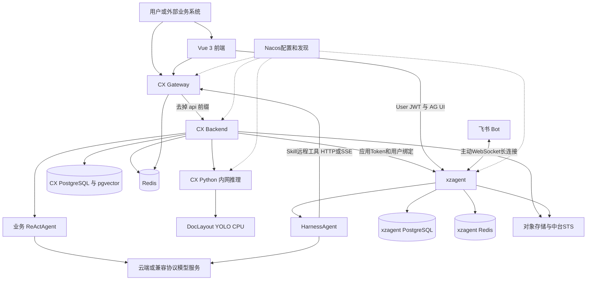

# CX 与 xzagent 架构总览及功能地图

## 项目定位

CX 是面向接入方的教育内容与测评能力平台。它把大模型生成能力落到题目、试卷、知识点、录题任务、答卷、批改与导出等业务对象上，并提供开放接口及 Vue 管理体验页面。xzagent 则提供可配置的对话运行时，使用户能够在网页或飞书中通过自然语言调用这些能力。

业务实现已明显超出 README 中“脚手架、零业务”的阶段。判断现状优先看 Controller、Service、依赖清单和 DDL，而不是沿用初始化时期的描述。

## 部署及调用结构

图中数据库表示逻辑数据域，是否共用物理实例需按部署决定。CX Gateway 和 CX Backend 的凭据缓存必须指向同一 Redis 数据库及键空间；xzagent 的会话 Redis 是另一套业务语义。

## 仓库责任边界

| 仓库或目录 | 责任 | 不应误解为 |
|---|---|---|
| cx-backend | 教育业务 API、持久化、业务 Agent、任务调度、模型与 Python 调用 | 纯转发层 |
| cx-gateway | CX 路由、Token/API Key 校验、私有路径拒绝、CORS、服务发现 | xzagent 所有接口的现成网关 |
| cx-frontend | 业务页面、题目编辑、对话、A2UI、渠道管理、用户授权 | 无鉴权静态展示站 |
| cx-py | 图片增强、文档题内图检测、模型就绪与容量控制 | 本地聊天大模型服务 |
| cx-agent-skills-workspace | 导入 xzagent 的 CX Skill、Meta、Catalog、环境绑定 | xzagent 自动扫描的运行时目录 |
| xzagent | 对话运行时、模型配置、Skill管理、工具授权、会话、渠道、A2A | 题库与试卷业务数据库 |
| db/schema.sql | CX 全量业务 DDL | xzagent 完整 DDL |
| specs 与 docs | 设计背景、契约和迁移记录 | 所有需求都已实现的证明 |
| reference-projects | 历史参考 | 当前用户指定的 xzagent 实现 |

## 已核验技术栈

| 层 | 版本或技术 | 当前证据 |
|---|---|---|
| CX Java | Java 17、Spring Boot 3.5.8、WebFlux/Reactor | cx-backend/pom.xml:18 |
| CX Agent | AgentScope 2.0.0，OpenAI、Anthropic、DashScope 独立扩展 | cx-backend/pom.xml:42 |
| 通用运行时 | Spring Boot 3.5.8、AgentScope 2.0.4、HarnessAgent | xzagent/pom.xml:10；05章 |
| 网关 | Spring Boot 3.2.0、Spring Cloud 2023.0.0、Gateway与LoadBalancer | cx-gateway/pom.xml:20 |
| 数据访问 | PostgreSQL、MyBatis-Plus；CX版本3.5.7，xzagent版本3.5.12 | 两仓pom.xml |
| 检索 | pgvector + OpenAI兼容Embedding + 受控模型选择 | db/schema.sql:23；04章 |
| 缓存/协调 | Spring Data Redis、Redis Stream、CX Redisson 3.45.1 | cx-backend/pom.xml:39；02章 |
| 配置发现 | 原生 nacos-client 1.4.7，自定义加载与注册 | 两Java业务仓与网关pom.xml |
| 前端 | Vue ^3.5.13、TypeScript ^5.7.3、Vite ^6.4.0、Pinia ^2.3.1、Router ^4.5.0 | cx-frontend/package.json |
| UI | Element Plus、Naive UI、Markdown-it、KaTeX、MathLive | cx-frontend/package.json |
| Python | Python 3.11、FastAPI 0.139.0、Uvicorn 0.51.0 | cx-py/pyproject.toml:16 |
| 本地视觉 | DocLayout-YOLO 0.0.4、PyTorch 2.4.1+cpu、Torchvision 0.19.1+cpu、OpenCV headless | cx-py/Dockerfile |
| 飞书 | Lark SDK 2.8.2，与运行时Channel适配 | xzagent/pom.xml:180；03章 |
| 运维 | Docker/Kubernetes制品，SLS日志，可选OpenTelemetry、Langfuse、AgentScope Studio | Dockerfile、模板、observability目录 |

`^` 是 package.json 声明的允许范围，不是声称现场 node_modules 的精确安装版本。网关与业务后端的 Spring Boot 版本不同，两个 AgentScope 版本也不同，复刻应分别沿用各仓锁定版本。

## 功能地图

| 功能 | 前端入口 | 后端主入口 | 核心设计 |
|---|---|---|---|
| 单题、整卷生成 | /assessment/create | ExamController | 请求级Agent、结构化工具提交、任务与SSE |
| 原卷/图片变式 | /variant-exam/create | VariantExamController | 提取原卷约束后生成新的试卷 |
| 单题文字/图片变式 | /question-variant/create | VariantQuestionController | 区分文字与多模态任务路由 |
| 批量材料录题 | /question-capture | QuestionCaptureTaskController | 可恢复阶段任务、识别/答案/图检测/草稿 |
| 单张图片录题 | /question-capture/single | 同上 single/create | 一次产出草稿与答案，人工复核确认 |
| 题目与试卷查询 | /questions、/papers | QuestionController、ExamController | 租户过滤与稳定的试卷题目关联ID |
| 在线答题、拍照交卷 | /exam/:id | SubmissionController | 提交、识别、批改与答卷持久化 |
| 答卷复核 | /submissions/:id | SubmissionController | 原卷结构、答案、得分和反馈 |
| 知识点导入与索引 | /knowledge-tree/admin | KnowledgeTreeAdminController | 应用权限、批量Embedding与索引任务 |
| 知识点识别 | /knowledge-recognition | KnowledgePointRecognitionController | 召回候选，受控选择有效知识点 |
| 难度、解析 | 开放API | QuestionAnalysisController | 独立模型任务、并发与资源限制 |
| PDF、Word导出 | 试卷详情 | ExamExportController、DocumentExportController | 专用导出管线与资源边界 |
| Token与图像用量 | /usage | OpenUsageController | 按appId及操作人等维度归因 |
| 自然语言出卷 | /ai-agent/create | enter-chat + xzagent AG-UI | 对话工具调用CX已有业务API |
| 飞书渠道管理 | /ai-agent/channels | xzagent渠道API | 扫码注册、绑定、长连接、统一Run |

前端依据 `cx-frontend/src/router.ts:24`；接口实际映射位置见10章。页面存在不等于所有环境已经配置好模型、渠道或存储。

## 为什么这样拆分

**业务约束留在 CX。** 题型、知识点合法性、试卷结构、租户隔离、持久化与导出是确定性规则，不能只靠 Prompt。模型只生成候选内容，结构化工具和业务服务负责验证与落库。

**对话能力集中在 xzagent。** 一个 Runtime 可复用模型路由、会话状态、Skill、远程工具授权、A2UI和飞书渠道，避免业务系统重复实现通用聊天平台。

**视觉检测拆到 Python。** Java 通过明确的内网 HTTP 契约调用 YOLO，Python 处理模型加载、CPU依赖、预热和容量；服务可独立扩缩容。

**长任务状态与连接分离。** SSE 是进度出口，任务状态与业务结果需持久化。录题公共运行时使用数据库+Outbox+Redis Streams，普通生成链路和xzagent Run还有各自状态机制，不能混成一套“全自动恢复”。

## 必须讲清的现状

1. 当前确认的是飞书 Bot；企业微信适配未发现。
2. CX 内嵌 ReActAgent，xzagent 当前装配 HarnessAgent，两者不要混称。
3. 本地模型是文档图检测模型；云端模型名称在配置模板中是示例，线上实际需查有效配置。
4. CX 的知识点检索不是通用“上传文档知识库问答”产品；应按当前业务描述。
5. 后端身份过滤器读取网关注入的 X-App-Id，没有独立重验同一Bearer凭据的证据，部署必须维护网关到后端的信任边界。
6. 不应凭代码中的旧类名 MySQL 或旧 AGENTS 文字判断数据库，当前两仓依赖均指向PostgreSQL。
