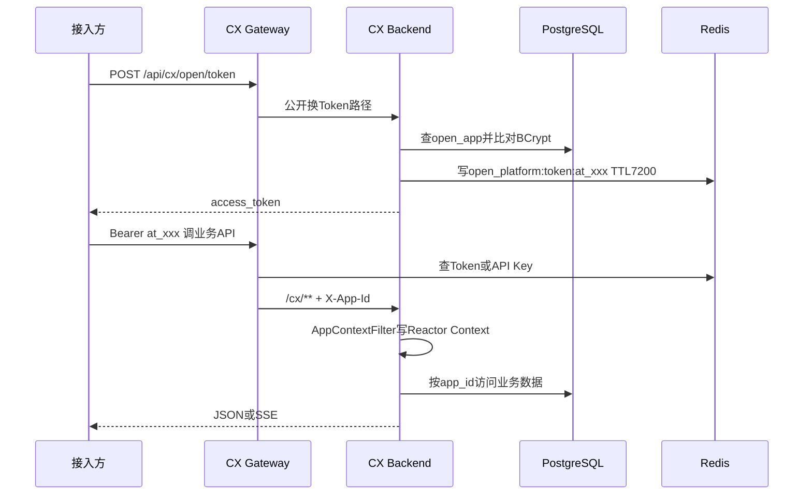
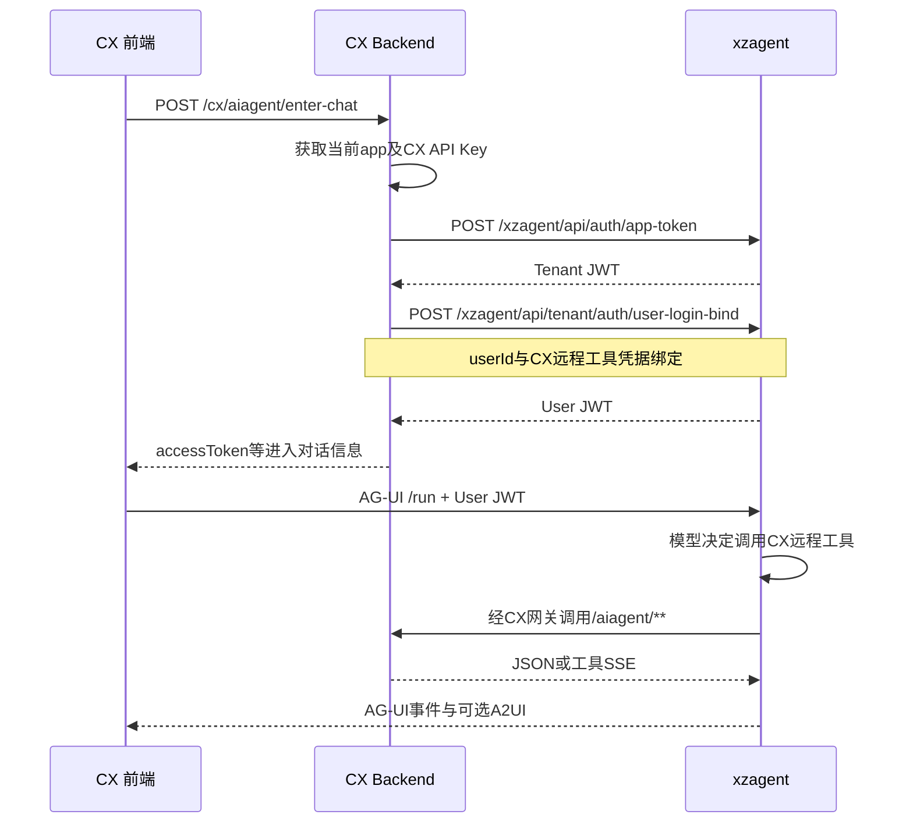
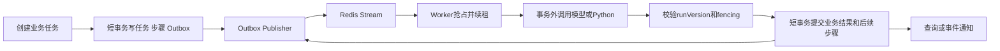

# 服务调用 身份契约与业务实现

## 请求路径如何组合

CX Backend 配置 `spring.webflux.base-path=/cx`。Controller 的 `/exam` 在后端直连时是 `/cx/exam`，经过网关变成 `/api/cx/exam`。网关 `StripPrefix=1` 只移除 `/api`，再通过 `lb://cx-backend` 查Nacos实例。

源码：`cx-backend/src/main/resources/application.yml:17`，`cx-gateway/src/main/resources/application-template.yml:24`。

| 调用方 → 被调方 | 路径或协议 | 身份/路由 |
|---|---|---|
| 前端/第三方 → CX网关 | /api/cx/**，JSON或SSE | Bearer at_ Token 或 ak_ API Key |
| CX网关 → CX Backend | /cx/** | Nacos发现，注入X-App-Id |
| CX Backend → cx-py | POST /py/private/diagram-detect、/py/private/image-enhance | direct-base-url优先，否则Nacos健康实例 |
| CX Backend → xzagent | app-token、user-login-bind | 应用凭证换Tenant JWT，再换User JWT |
| 浏览器 → xzagent | /xzagent/api/user/agui/**；外部通常另有/api前缀 | User JWT；直连地址由前端环境决定 |
| xzagent → CX | /api/cx/aiagent/** | 用户绑定的CX凭据或OAuth凭据 |
| CX/xzagent → 模型 | Chat Completions、Responses、Anthropic、DashScope等 | 服务侧模型凭据，不下发浏览器 |
| CX/xzagent → 对象存储 | STS换临时凭据、上传/签名下载 | 中台或OSS配置，按启用provider选择 |

cx-gateway 当前模板只有 CX 路由，不应想当然认为它也代理 `/api/xzagent/**`。本地复刻可先浏览器直连xzagent，线上另配相应入口和CORS。

## CX 身份如何流动



换Token请求体是 `{"grant_type":"client_credentials","app_id":"<APP_ID>","app_secret":"<APP_SECRET>"}`。appSecret存BCrypt哈希；Token是32随机字节编码后的不透明字符串，前缀 `at_`，Redis TTL 7200秒，并非JWT。`ak_` 是CX长期API Key，网关查另一键前缀 `open_platform:apikey:`。

源码：`OpenTokenService.java:49`、`:107`，`web/dto/OpenTokenRequest.java:29`，`cx-gateway/.../filter/TokenAuthGlobalFilter.java:66`、`:177`。本章短文件名均位于 `cx-backend/src/main/java/com/xiaogj/cx/backend` 下，除非另标仓库。

后端 `SecurityConfig` 实际 `permitAll`；实质身份入口是 `filter/AppContextFilter.java:91`，检查 `X-App-Id` 是否非空并写入 Reactor Context。**这不是后端再次验证Bearer签名或Redis凭据**。复刻时必须禁止不可信客户端绕过网关直接提供此Header；可通过内网隔离和入口访问控制维持现有设计边界。

业务顶层实体以 `app_id` 隔离。`external_user_id/name` 是接入方提供的操作人信息，`external_org_id` 是记录维度，不能替代租户隔离键。Long/雪花ID由全局序列化配置输出为字符串，前端不应转Number。

## 从 CX 登录到 xzagent 对话



对应代码：`service/AiagentEnterChatService.java:51`，`client/xzagent/XzagentClient.java`，`cx-frontend/src/api/aiagentApi.ts`，`cx-frontend/src/api/xzagentHttp.ts:20`。

前端缓存User JWT，根据exp提前60秒视为失效并重取。这里的本地解码只判断过期时间，真正的JWT校验由xzagent完成。`VITE_XZAGENT_BASE_URL` 优先于按域名猜测的测试/生产地址，复刻应显式设置。

## 三种流式协议不要混用

| 流 | 作用 | 处理方式 |
|---|---|---|
| CX业务SSE | 出题、出卷、批改、录题的进度与结果 | event: task/progress/result/error |
| xzagent工具SSE | 将远程业务进度映射为工具执行事件 | 由AiagentSseSupport等适配，详见05/06章 |
| AG-UI | 对话文本、工具调用、Run生命周期、状态与自定义事件 | 前端按AG-UI事件循环处理 |

业务SSE示意：

```text
event: task
data: {"taskId":"100000000000000001"}

event: progress
data: {"message":"正在生成题目"}

event: result
data: {"examId":"100000000000000002"}
```

`result` 的具体字段取决于接口DTO，以上仅展示帧结构。`SseTransport.java:48` 每20秒加comment心跳，使用共享上游避免为了心跳重复执行模型调用。前端必须保留taskId并处理断线后的状态查询，不能因为HTTP200就判定生成成功。

## 整卷生成

`service/ExamAgentService.java:307` 先校验题型分布，构建用户Prompt，从Reactor Context取得appId，再创建 `generation_task`。`doGenerateExamEvents` 创建请求级 `ExamGenerationStore`，调用 `ExamChutiAgentV2`。

V2通过工具逐步提交大纲和题目，而不是让模型最后吐一个无限大的整卷JSON。工具参数、题型、数量、结果完整性由代码约束。每次请求创建独立Agent、工具和暂存器，避免不同用户并发互相污染。

`StreamingTaskExecutor` 对producer独立订阅，把执行与SSE连接解耦。结束后落试卷、更新任务；主动取消走任务取消句柄。**连接断开继续执行不等于进程崩溃后自动恢复每个模型调用**。

题目重生成以 `exam_section_question.id` 作为稳定定位键，替换其中的question_id，原试卷题位不变。对应 `ExamAgentService.java:432` 附近逻辑。

## 录题的可恢复任务

录题涉及文档预处理、分页识别、题内图检测、答案、草稿装配、知识点与确认入库。源码中的 `service/questioncapture` 通过 `AsyncTaskHandler` 接入公共运行时。



数据库三表 `async_task`、`async_task_step`、`async_task_outbox` 是状态真相；Redis Streams/PEL负责分发与存活信号，Pub/Sub用于通知。重试、恢复与陈旧执行隔离由runtime处理，不允许业务Handler自行ACK或任意更新公共状态。

关键约束：耗时模型/OCR/存储调用在事务外；提交前检查fencing与runVersion；步骤有确定性stepKey；外部副作用可用 `taskId:runVersion:stepKey` 作幂等键。目标Redis 5.0，不依赖XAUTOCLAIM。

源码：`service/asynctask/package-info.java:3`、`AsyncTaskSubmissionService.java:35`；表定义 `db/schema.sql:977`。已接入的具体Handler以 `service/questioncapture` 为准，不能把普通整卷生成也描述成相同恢复机制。

## Python 内网能力调用

`DefaultInternalServiceInstanceResolver.java:106` 先取服务配置中的 `direct-base-url`，未配才创建Nacos客户端并选健康实例；发现调用切到boundedElastic。业务层通过 `DiagramDetectionClient` 或 `ImageEnhancementClient` 使用统一invoker，不拼接Nacos细节。

`WebClientInternalServiceInvoker.java:60` 每次尝试重新解析实例。默认连接超时3秒、总体响应超时65秒、最多额外重试1次。当前实现按异常类型 `WebClientRequestException` 允许重试，HTTP错误和外层TimeoutException不重试。不要把这种异常分类描述成严格证明下游“从未收到请求”。

`/py/private/**` 不应暴露公网；CX网关禁止private路径，且没有 `/api/py/**` 通配公开路由。Python服务应只供业务后端在受控网络访问。模型加载、请求容量和健康检查详见04章。

## 数据模型分组

| 数据域 | 主要表 | 复刻时要保留的关系 |
|---|---|---|
| 题目 | question、question_diagram、question_knowledge | 正文、题内图与知识点分离 |
| 知识体系 | knowledge_tree、knowledge_point、knowledge_point_embedding、knowledge_point_unmatched_log | 树与节点、向量版本/索引状态、未匹配记录 |
| 试卷 | exam、exam_section、exam_section_question | 大题结构与稳定题位关联 |
| 生成/变式 | generation_task、variant_exam_source、variant_question_source | 任务结果与来源追踪 |
| 作答批改 | exam_submission、exam_submission_answer、两类image表、exam_grading_task | 答卷和逐题答案/图片/批改任务 |
| 开放平台 | open_app、open_api_key、open_app_trusted_host | 应用凭据、长期Key、可信资源域 |
| 录题 | question_capture_task、question_capture_task_item | 中间草稿与人工确认状态 |
| 公共任务 | async_task、async_task_step、async_task_outbox | 持久状态、执行版本、阶段、分发一致性 |
| 用量 | token_usage、image_usage、agent_image_generate_record | 模型消耗、图像张数及业务归因 |

当前CX schema共29个CREATE TABLE，定义与注释完整附在 `assets/database/cx-schema.sql`。雪花主键、逻辑删除和时间字段按原DDL保留。复杂JOIN在MyBatis XML中；WebFlux并不使JDBC自动非阻塞，源码通过线程调度隔离阻塞操作。

## 导出与外部依赖

试卷导出和通用文档导出分别有Controller；相关实现使用PDF/Word处理库以及受控资源下载，几何图路径还涉及TeX渲染。CX Docker基础镜像带TeX并补poppler-data，不能只替换成最小JRE镜像就声称导出功能齐全。

中台STS/OSS、模型API、Nacos、Redis和PostgreSQL均是部署依赖；Git仓库拥有客户端代码不等于具备这些外部服务。配置及验收顺序见07和08章。
