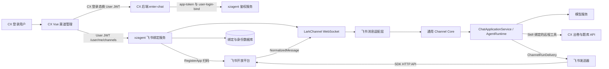
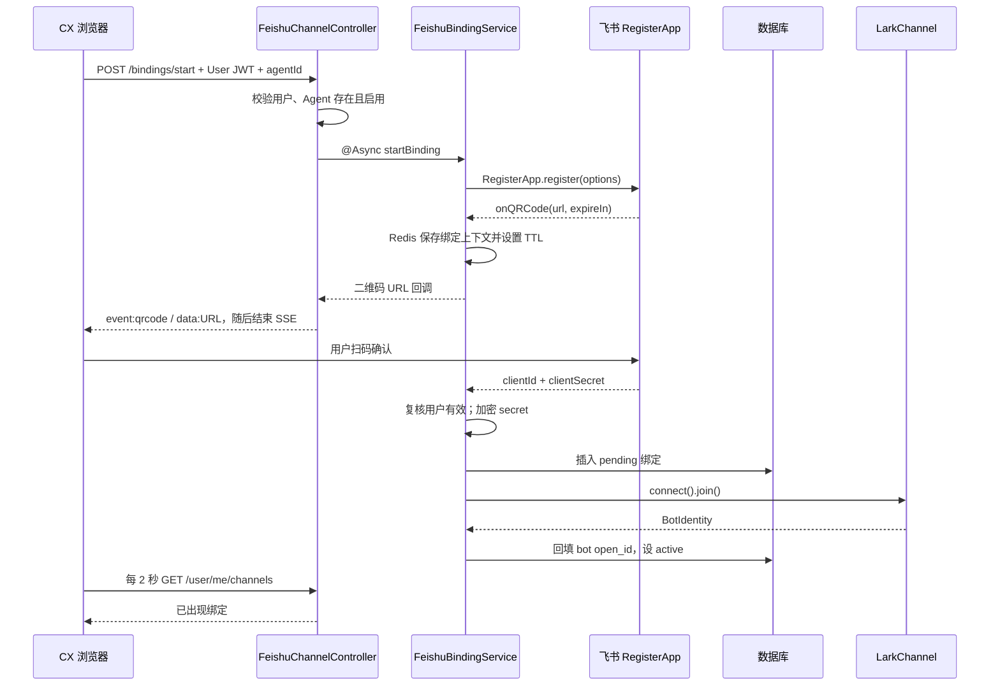
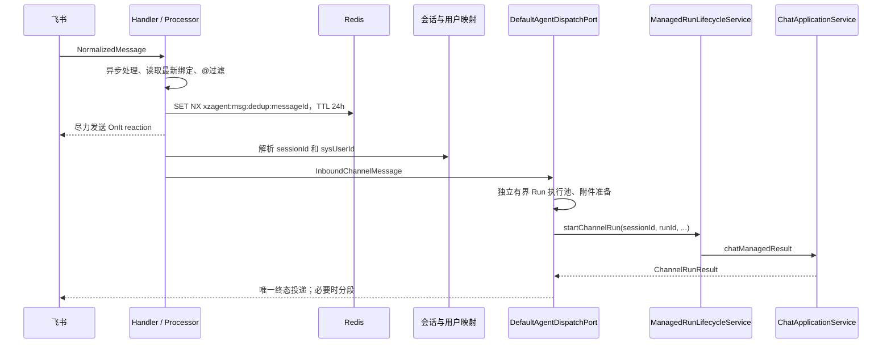

# Bot 接入与消息链路

本章说明 CX 如何把对话 Agent 接入飞书，以及与企业微信相关的真实实现边界。源码快照日期为 2026-10-29。路径前缀 `cx-ai-doc/` 对应 `D:\cx\cx-ai-doc`，`xzagent/` 对应 `D:\cx\xzagent`；文末列出可定位到行的主要证据。

## 1. 当前实际实现

| 能力 | 当前状态 | 承载位置 |
|---|---|---|
| 飞书自建应用扫码绑定 | 已有 Java 实现和 Vue 管理页面 | xzagent `channel/feishu`；CX `ChannelManagementPage.vue` |
| 飞书消息接收 | 主动 WebSocket 长连接 | `FeishuWsConnectionManager` |
| 飞书私聊、群聊与 @ 过滤 | 已实现 | `FeishuMessageProcessor`、`FeishuGroupMentionFilter` |
| 飞书图片、文档输入 | 已实现适配，需打开附件功能并配置存储 | `FeishuMessageContentParser`、统一附件处理层 |
| 飞书富文本输出 | `post` + `md` 标签；失败降级 `text` | `FeishuMessageSender` |
| 飞书 A2UI 输出 | 转成文本摘要；没有交互卡片完整渲染 | `composeA2uiAwareText` |
| 企业微信 Bot | 当前两个仓库未发现可运行实现 | 未找到企微 Channel、回调 Controller、SDK 或配置 |
| 通用渠道扩展接口 | 已有 | `channel/spi`、`channel/core` |

**技术表述：CX 前端负责发起绑定和展示状态，xzagent 负责飞书厂商协议、身份映射、会话与 Agent 运行；CX 业务后端再通过远程工具提供出卷、题目查询等业务能力。**

不能把“通用渠道抽象可以扩展”说成“企业微信已经接入”。`MessageChannel` 当前只定义 `ag_ui`、`a2a`、`feishu`；前端渠道管理也明确限定飞书。证据见 [B01]、[B02]。

## 2. 模块与调用关系



这里的 WebSocket 是 **xzagent 到飞书的出站连接**。浏览器扫码绑定接口使用的是 HTTP POST + SSE，不能与 Bot 消息连接混为一谈。本仓库没有为这一飞书链路实现公网事件回调 URL，也没有自行处理飞书 HTTP 回调验签/解密；连接、标准化事件与厂商鉴权依托 `com.larksuite.oapi:oapi-sdk:2.8.2`。证据见 [B03]、[B04]。

## 3. 用户怎样开通飞书

### 3.1 浏览器鉴权与目标 Agent

1. CX 用户先登录业务系统。
2. 前端 `getXzagentToken()` 复用或获取 xzagent User JWT。
3. CX 后端通过 `app-token` 获取 Tenant JWT，再调用 `user-login-bind` 换取 User JWT 并绑定该用户的业务凭据。
4. 前端请求 xzagent 的 `/xzagent/api/user/me/channels` 路由，携带 `Authorization: Bearer <USER_JWT>`。
5. CX 渠道管理页将目标 Agent 固定为 `cx`，只展示 `channelType=feishu && agentId=cx` 的绑定。

`VITE_XZAGENT_BASE_URL` 控制浏览器直连的基地址；复刻时应显式指定自己的 xzagent 入口，不能依赖代码中的原环境域名推断。源码 `xzagentHttp.ts` 会直接拼接 `/xzagent/api/...`，若外层反向代理增加 `/api` 前缀，该前缀必须包含在基地址中。证据见 [B05]。

### 3.2 绑定接口契约

以下路径是 xzagent Controller 的应用路径，外层网关前缀需按部署配置另行拼接。

| 方法 | 路径 | 请求/返回 |
|---|---|---|
| GET | `/xzagent/api/user/me/channels` | 聚合查询本人所有已开通渠道，返回 `ChannelBindingInfo[]` |
| POST | `/xzagent/api/user/me/channels/feishu/bindings/start` | Body `{ "agentId": "cx" }`；返回 `text/event-stream` |
| GET | `/xzagent/api/user/me/channels/feishu/bindings` | 查询本人飞书绑定 |
| PATCH | `/xzagent/api/user/me/channels/feishu/bindings/{bindingId}` | Body `{ "requireMentionInGroup": true }`；返回脱敏绑定信息 |
| DELETE | `/xzagent/api/user/me/channels/feishu/bindings/{bindingId}` | 解除本人绑定，成功为 HTTP 204 |

飞书专用 Controller 仅在 `xzagent.feishu.enabled=true` 时装配。所有 `/xzagent/api/user/**` 接口要求 `ROLE_USER`，只持有 App/Tenant JWT 不满足要求。`appId`、`ownerUserId` 从当前认证用户解析，不能由请求体代填。绑定不存在或不属于本人时，更新/删除统一返回 404。证据见 [B06]。

脱敏响应形状为：

```json
{
  "bindingId": "<雪花ID字符串>",
  "channelType": "feishu",
  "appId": "<xzagent应用ID>",
  "agentId": "cx",
  "displayName": "<飞书应用ID>",
  "status": "active"
}
```

响应没有 `appSecret`，当前 `ChannelBindingInfo` 也不返回 `requireMentionInGroup`，因此不能假定 GET 列表能直接回显这一开关。证据见 [B07]。

### 3.3 扫码绑定时序



SSE 仅传一个二维码事件，内容示意：

```text
event: qrcode
data: https://<厂商返回的扫码地址>

```

关键实现细节：

- `RegisterApp.register()` 在异步线程等待用户扫码；扫码过程中由 SDK 负责轮询。
- Redis 临时键为 `feishu:binding:<appId>:<agentId>:<时间戳>`，Hash 保存 `appId`、`agentId`、`ownerUserId`，TTL 使用 SDK 的 `expireIn`。
- Redis 临时键用于保存上下文；当前完成回调仍依赖本进程闭包，不能据此宣称支持扫码流程跨进程恢复。
- 扫码结果返回 `clientId/clientSecret`，分别作为飞书 appId/appSecret；用户无需在前端粘贴应用密钥。
- 写库前再次检查绑定发起用户仍有效，避免扫码期间用户被禁用后继续写入。
- 初始状态 `pending`、群聊必须 @ 默认 `true`；WS 握手成功后变为 `active`。
- 首条消息从原始 `P2MessageReceiveV1` 提取 `tenant_key` 并回填；它不由浏览器输入。
- 前端默认等候 120 秒，每 2 秒查询渠道列表；发现对应绑定就显示成功，**没有再要求 status=active**。
- 关闭弹窗只停止浏览器轮询和读取，不会取消后台厂商扫码流程。

证据见 [B08]、[B09]。因此上线验收不能只看“扫码成功”，还应检查绑定 active、真实 WS 已连接并完成一次消息往返。

## 4. 密钥存储与连接配置

飞书 `appSecret` 不明文落库。`FeishuAppSecretCryptoService` 使用 `AES/GCM/NoPadding`、12 字节随机 IV、128 位认证 Tag，最终保存 `Base64(IV || ciphertext+tag)`。系统级加密密钥从 `xzagent.feishu.secret-key` 获取，预期使用 Base64 编码的 32 字节随机密钥。配置开启但密钥缺失或非 Base64 时会启动失败；实际 AES 密钥长度还须符合加密算法要求。证据见 [B10]。

```yaml
# 示例仅展示配置结构；值必须从自己环境的受控配置/密钥系统注入。
xzagent:
  feishu:
    enabled: ${XZAGENT_FEISHU_ENABLED:false}
    secret-key: ${XZAGENT_FEISHU_SECRET_KEY:}
    connect-timeout-seconds: ${XZAGENT_FEISHU_CONNECT_TIMEOUT_SECONDS:30}
    async-thread-pool-size: ${XZAGENT_FEISHU_ASYNC_THREAD_POOL_SIZE:8}
    ack-reaction-emoji: ${XZAGENT_FEISHU_ACK_REACTION_EMOJI:OnIt}
```

| 参数 | 代码中的作用 | 复刻注意 |
|---|---|---|
| `enabled` | 条件装配飞书管理、加解密、连接及消息组件 | 默认关闭，先准备 DB、Redis、Agent 和密钥 |
| `secret-key` | 加解密数据库中的飞书 secret | 多实例必须一致；换密钥前必须重加密已有数据 |
| `async-thread-pool-size` | 入站短任务固定线程数，队列为 `poolSize*50` | 模板默认 8，即 400 队列容量 |
| `ack-reaction-emoji` | 去重通过后给原消息贴 reaction | 默认 `OnIt`；失败只记录，不阻断运行 |
| `connect-timeout-seconds` | 已声明属性及模板默认值 | 当前连接实现未消费此字段，不应声称调它能改变握手超时 |

`FeishuWsConnectionManager` 创建 `LarkChannelOptions` 时指定 `transport("websocket")`、`includeRawEvent(true)`，并关闭 SDK 自带的 `requireMention`，由业务层动态决定是否必须 @。一个进程为每个飞书 appId 维护一个连接，重复 connect 先断开旧连接。启动后 `FeishuStartupConnector` 查询所有 `active` 绑定并恢复连接。证据见 [B04]、[B11]。

这里没有发现项目自建的连接所有权分片或 Leader 选举。多实例依赖后续 Redis 消息去重和 Run 协调；不要将单进程连接表理解成集群全局唯一连接。对于首次握手失败留下的 `pending` 记录，启动恢复器不会自动选择它，当前管理 Controller 也没有独立 reconnect 接口。

## 5. 一条消息怎样进入 Agent



处理顺序与约束如下：

1. SDK message 回调只提交异步任务，避免把长 Agent 执行放在 SDK 事件线程。
2. 每条消息重新从 DB 查询绑定，而不是永久使用连接建立时的配置快照。
3. `chatType=p2p` 视为单聊，其余视为群聊；单聊总是允许，群聊按 `requireMentionInGroup` 和 `mentionedBot` 判断。
4. 去重采用 Redis `SET NX`，键为 `xzagent:msg:dedup:<messageId>`，有效期 24 小时。
5. 去重通过后尝试 reaction，然后解析会话、身份和附件。
6. 群聊文本包装为 `[展示名]: 原始文本`，帮助模型区分发言人。
7. 填充 `InboundChannelMessage`，携带渠道、appId、agentId、sessionId、tenantKey、真实发言人、源消息 ID、附件及投递回调。
8. `DefaultAgentDispatchPort` 生成 runId，交给独立 `ChannelRunExecutor`，生产路径进入 `ManagedRunLifecycleService`。
9. 新普通消息先处理旧可恢复 Run 的 supersede，再准备附件、取得运行执行权并调用 `chatManagedResult`。
10. 执行池繁忙回复“当前任务较多，请稍后重试”；同一会话无法获得执行权则回复“当前会话正在处理中，请稍后重试”。

通用 Run 执行池默认 core=8、max=32、queue=100，使用 `AbortPolicy`；与飞书短任务池分开。证据见 [B12]、[B13]。

## 6. 用户、租户和会话映射

| 概念 | 来源 | 用途 |
|---|---|---|
| xzagent `appId` | 飞书绑定记录 | 决定接入应用及 Agent 定义的作用域 |
| `ownerUserId` | 发起扫码的 User JWT | 决定谁可查看、修改、解除该绑定 |
| `feishuAppId` | SDK 注册结果 `clientId` | 飞书应用和连接标识 |
| `feishuTenantKey` | 原始消息事件 | 飞书企业命名空间 |
| `feishuOpenId` | 每条消息的 senderId | 真实发言人身份 |
| `sysUserId` | 身份映射服务 | 运行用户、授权凭据和会话身份 |
| `conversationKey` | 私聊 senderId；群聊 chatId | 持久会话映射键 |

会话表以 `(channel_type, channel_app_id, conversation_key)` 定位 `sessionId`。同一飞书应用下，私聊按人隔离，群聊按群共享。新会话生成雪花 ID；并发插入遇到唯一约束冲突时重新读取已经存在的映射。证据见 [B14]。

真实用户映射通过 `(feishuAppId, feishuTenantKey, openId)` 查找 `feishu_user_profile`；需要时创建 `sys_user`，其用户名使用 openId、tenantKey 使用飞书企业标识，密码是随机 UUID 的哈希，角色为普通用户。群聊展示名通过 SDK 联系人接口取名并缓存；权限不足或网络失败降级为 `用户_<openId末6位>`，不中断消息派发。证据见 [B15]。

**绑定的管理者不等于所有发言人的业务授权身份。** 飞书成员是按真实发送者解析的，不能假定扫码管理者在 CX 的 API Key 会被自动授予群里其他成员。飞书用户需要的远程业务工具凭据必须按 xzagent 的用户凭据/OAuth 流程建立；具备 OAuth 配置的远程工具在授权缺失时生成链接，飞书以文本链接兜底，用户授权后再发新消息重试。证据见 [B16]。

## 7. 图片与文档如何处理

飞书适配层仅接受 SDK 资源类型 `image` 和 `file`，分别归一为 `AttachmentType.IMAGE`、`DOCUMENT`。其他资源类型或缺少 fileKey 会报附件错误，不能声称当前支持语音或视频转写。每个资源生成 `<messageId>:<序号>` 作为入站标识。

下载流程：

```text
NormalizedMessage.resources
  → FeishuMessageContentParser
  → FeishuMessageResourceSource(feishuAppId, messageId, resourceKey, type)
  → InboundMessagePreparationService
  → FeishuMessageResourceSourceResolver
  → SDK im().messageResource().get(messageId, fileKey, type)
  → 内容校验/统一附件存储
  → attachmentId 与模型可见的安全描述
```

下载用户发来的附件必须使用“获取消息资源”接口，不能误用仅适用于应用自上传资源的下载接口。SDK 返回 `ByteArrayOutputStream`，源码直接取字节，再验证非空、文件大小与响应类型；resourceKey、Token、受保护下载地址不能塞进模型上下文。证据见 [B17]。

开启附件需要额外配置 `xzagent.attachments.enabled=true` 及实际存储 Provider。模板给出的默认限制：一次最多 5 个附件，单文件 20 MiB，总计 50 MiB，提取文本最多 20000 字符，记录保留 7 天。支持官方私有阿里云 OSS 与中台 STS OSS 两种存储 Provider。这里仅列配置约束，具体存储权限、附件解析和工具参见运行时文档。

附件层未启用时，带附件消息无法按完整附件路径执行；纯文本飞书对话不依赖 OSS。证据见 [B18]。

## 8. 回复、长文本、A2UI 与失败语义

- 私聊回复使用 `receiveIdType=open_id`、接收人 `senderId`；群聊使用 `receiveIdType=chat_id`、接收群 `chatId`。
- 正常回复走 SDK `im().message().create()`，`msgType=post`，内容结构为 `zh_cn.content` 中的 `md` 标签。
- 每段按 JSON 转义后字节数控制在 `30*1024-512` 预算内，优先按 Markdown 段落分块；超大块再硬切，维护代码围栏开合。
- 单段 `post` 发送失败改发 `text`，兜底按 140 KiB 文本字节预算截断并附提示；继续处理其他段。
- `ChannelRunDelivery` 以 `AtomicBoolean` 防止成功、失败等竞争造成重复终态投递；一个终态可能因分段产生多条飞书消息。
- `progress()` 当前不向飞书推送高频中间进度；不是 Web AG-UI 的 token 流镜像。
- Run 更新 A2UI 时，通过 `A2uiSurfaceTextRenderer` 把 surface 转成文本摘要。遇到 `SUSPENDED` 时提示当前渠道不支持界面交互，可以直接回复。
- 飞书发送失败只记录日志，不反向修改已完成的 Run。

证据见 [B19]、[B20]。这里实现了终态去重和发送格式降级，但未发现持久化发送 outbox、补发后台任务或指数退避发送重试，不能对外承诺每条回复必达。

同样，入站去重发生在身份/附件/Agent 执行之前，当前 `MessageDeduplicator` 没有失败后释放 key 的方法。某条消息中途失败后，同一个 messageId 的重复推送会在 24 小时内被去重；用户重新发送会产生新消息。复刻时必须保留这个现状说明，不把它描述为事务级 exactly-once。

## 9. 持久化结构与复刻前置资料

| 表 | 关键字段 | 约束/作用 |
|---|---|---|
| `feishu_app_binding` | `id, app_id, owner_user_id, agent_id, feishu_app_id, feishu_app_secret_encrypted, feishu_tenant_key, feishu_bot_open_id, require_mention_in_group, status, created_by, created_at, updated_at` | 飞书 appId 唯一；管理归属按 app+owner 查询 |
| `feishu_user_profile` | `id, feishu_app_id, feishu_tenant_key, feishu_open_id, sys_user_id, feishu_display_name, created_at, updated_at` | 应用+企业+openId 唯一，映射真实用户 |
| `agent_channel_session` | `channel_type, channel_app_id, conversation_key, session_id, created_at` | 前三项构成复合主键，跨重启复用会话 |
| `sys_user` | 用户身份及应用/租户信息 | 承载渠道发言人的平台身份 |
| Agent 会话/Run/历史表 | sessionId、runId、channel 等 | 与 Web、A2A 复用运行时持久化 |

前两张 DO 的 ID 策略为 `IdType.ASSIGN_ID`。`FeishuBindingService` 中“自增主键”注释与 DO 不一致，复刻应以实际 ID 策略为准，不照抄该旧注释。证据见 [B21]。

**DDL 缺口：** xzagent 的 AGENTS.md 指向 `../db/schema.sql`，对应 `D:\cx\db\schema.sql`，本次该文件不存在；CX 的 `db/schema.sql` 未包含上述飞书表。xzagent 测试目录虽有表结构快照，但 PostgreSQL 快照部分包含 `timestamptztz` 及尾随逗号，不能直接拿来初始化生产数据库。必须取得对应版本的正式 xzagent Schema/迁移文件，并核对这些字段与唯一键。这里的表结构表足够指导设计核对，不伪装为已验证可执行 DDL。证据见 [B22]。

## 10. 按源码复刻的执行顺序

1. 准备 xzagent 所需数据库、Redis、模型服务，导入与代码版本匹配的正式 Schema。
2. 创建接入应用及有效用户，创建并启用 `agentId=cx`，绑定所需 Skill、模型与业务工具。
3. 配置 CX 到 xzagent 的鉴权接口及凭据，确保 enter-chat 能返回 User JWT。
4. 显式设置前端 `VITE_XZAGENT_BASE_URL`，确认浏览器能访问 xzagent 并通过 CORS/网关。
5. 在 xzagent 生效配置中打开飞书开关，注入持久且各实例一致的加密密钥，重启服务使条件 Bean 装配。
6. 保证运行节点能访问飞书 SDK 使用的 HTTPS API 与 WebSocket 服务；入站公网回调不是当前实现的要求。
7. 用 CX 渠道管理页扫码绑定，检查 DB 从 pending 到 active、连接状态与日志。
8. 私聊发送文本，验证身份、sessionId、runId、模型调用和最终回复。
9. 群聊验证默认不 @ 不响应，@ 后响应；核对同群不同发言人共享会话但保留真实身份。
10. 要使用图片/文档，再启用附件和私有存储，分别测试 image/file、超限和不支持类型。
11. 要调用 CX 业务工具，验证当前飞书发言人拥有正确业务授权；不要用绑定管理员的身份替代全部用户。
12. 最后测试服务重启恢复、重复消息、长回复分段、工具失败、并发繁忙和解除绑定。

这是基于源码的部署步骤；本次未对真实飞书租户发起扫码、发布应用或发送消息，也未验证厂商侧权限审批状态。厂商权限应按实际 SDK 调用逐项开通：接收消息、发送消息、reaction、资源下载；联系人取名属于可降级增强能力。不能从项目代码推断租户已经具备这些权限。

## 11. 企业微信的准确回答与后续扩展边界

可直接回答：“当前版本集成了飞书，采用官方 SDK 的扫码注册和 WebSocket 长连接；企业微信在当前两个源码仓库里尚未找到实现。项目已经有通用渠道 SPI，新增企微可以复用 Agent、会话、附件及执行生命周期，但仍须实现企微自己的协议适配。”

可复用的接口是 `ChannelBindingProvider`、`ChannelRegistry`、`InboundChannelMessage`、`AgentDispatchPort`、`ChannelRunDelivery`、`ChannelSessionResolver`。真正新增企业微信时至少要补齐厂商凭据和管理接口、接收协议与验签、用户/群映射、消息去重、媒体下载、结果投递及授权隔离。**这是扩展边界说明，不是本项目已有企微实现，也不是已经确认的企微产品接入方案。**

项目中没有证据可据以确定用户所说的企微 Bot 是群机器人、自建应用还是其他机器人形态，因此本章不编造 CorpID、AgentId、Token、EncodingAESKey 等字段在现有系统中的配置路径。

## 12. 验证与排障入口

| 现象 | 优先检查 |
|---|---|
| 飞书专用管理接口 404 | `xzagent.feishu.enabled` 是否在最终生效配置中为 true；外层路径前缀是否重复 |
| 403 | 是否 User JWT；用户是否启用，是否属于当前应用 |
| 扫码后 pending | 加密是否成功、WS 握手日志、飞书出站网络；当前启动恢复只加载 active |
| 群里没有回复 | 是否 @、requireMentionInGroup、Redis 去重、短任务拒绝指标 |
| 只有 OnIt 没有最终消息 | 身份解析、附件、Agent Run、模型/工具异常、最终飞书发送日志 |
| 图片处理失败 | 附件开关、活跃连接、messageResource API、存储配置及大小限制 |
| 重启后不能恢复 | 密钥是否变化，DB 绑定是否 active，数据库与 Redis 是否就绪 |
| 前端成功但实际不可用 | 前端以“绑定出现”为成功，另查 active 与真实消息往返 |

相关自动化测试已存在：`FeishuBindingServiceTest`、`FeishuGroupMentionFilterTest`、`FeishuMessageSenderTest`、`FeishuMessageResourceSourceResolverTest`、`FeishuConditionalOnPropertySmokeTest`、`UserChannelSecurityTest`、`FeishuGroupSessionIdentityIntegrationTest`、`InboundAttachmentChannelParityTest`。这些名称表示可用的验证入口，本次文档提取未运行测试，不能据此宣称当前构建通过。

## 13. 主要源码证据

以下省略 `xzagent/src/main/java/xiaogj/xzagent/` 为 `X/`，省略 `cx-ai-doc/cx-frontend/src/` 为 `F/`，省略 `cx-ai-doc/cx-backend/src/main/java/com/xiaogj/cx/backend/` 为 `C/`。

| 编号 | 位置 | 支持的结论 |
|---|---|---|
| B01 | `X/model/MessageChannel.java:6`；`X/channel/spi/InboundChannelMessage.java:36` | 当前渠道常量和通用入站契约 |
| B02 | `F/pages/ai-agent/ChannelManagementPage.vue:5`、`:26`、`:36` | 页面只支持飞书，绑定 Agent 为 cx |
| B03 | `xzagent/pom.xml:176` | 飞书官方 SDK 2.8.2 |
| B04 | `X/channel/feishu/FeishuWsConnectionManager.java:77`、`:93`、`:105` | WS 配置、关闭 SDK @ 过滤、消息回调 |
| B05 | `F/api/xzagentHttp.ts:18`；`C/service/AiagentEnterChatService.java:44` | 前端地址和 CX 用户换取 xzagent JWT |
| B06 | `X/web/FeishuChannelController.java:61`、`:100`、`:152`、`:174`、`:201`；`X/config/SecurityConfig.java:245` | API 路径、方法与用户权限 |
| B07 | `X/channel/feishu/FeishuBindingService.java:314`、`:446` | 绑定所有者校验和脱敏 DTO |
| B08 | `X/channel/feishu/FeishuBindingService.java:139`、`:345`、`:377`；`X/web/FeishuChannelController.java:126` | 扫码、Redis、加密落库和单事件 SSE |
| B09 | `F/components/ai-agent/FeishuBindingDialog.vue:31`、`:62`、`:82` | 两秒轮询、120 秒等待、成功判断 |
| B10 | `X/channel/feishu/FeishuAppSecretCryptoService.java:35`、`:50`、`:72` | AES-GCM 和密钥校验 |
| B11 | `xzagent/src/main/resources/application-template.yml:264`；`X/channel/feishu/FeishuStartupConnector.java:58` | 飞书参数、恢复 active 连接 |
| B12 | `X/channel/feishu/FeishuMessageProcessor.java:121`；`X/channel/core/MessageDeduplicator.java:24` | 入站顺序与 24h 去重 |
| B13 | `X/channel/core/DefaultAgentDispatchPort.java:109`、`:209`；`X/config/ChannelRunExecutionConfig.java:20`；`X/config/FeishuAsyncConfig.java:46` | 通用 Run 派发与线程池 |
| B14 | `X/channel/core/ChannelSessionResolver.java:55` | 私聊/群聊会话映射和并发冲突处理 |
| B15 | `X/channel/feishu/FeishuIdentityResolver.java:73`、`:118`、`:171` | 用户映射、联系人名称及降级 |
| B16 | `X/tool/RemoteHttpAgentTool.java:275` | OAuth 授权链接和飞书文本兜底 |
| B17 | `X/channel/feishu/FeishuMessageContentParser.java:17`；`X/channel/feishu/FeishuMessageResourceSourceResolver.java:35` | 图片/文件归一与消息资源下载 |
| B18 | `xzagent/src/main/resources/application-template.yml:55`；`X/channel/core/DefaultAgentDispatchPort.java:250` | 附件开关、限制和 Run 级附件上下文 |
| B19 | `X/channel/feishu/FeishuMessageSender.java:122`、`:179`、`:267` | Markdown post、分段与 text 降级 |
| B20 | `X/channel/feishu/FeishuMessageProcessor.java:247`、`:313` | 终态去重、A2UI 文本化 |
| B21 | `X/repository/po/FeishuAppBindingDO.java:16`；`X/repository/po/FeishuUserProfileDO.java:16`；`X/repository/po/AgentChannelSessionDO.java:14` | 表字段和 ID 策略 |
| B22 | `xzagent/src/test/resources/db/app-resource-isolation-pre-feature-schema.pg16.sql:638`、`:672`、`:786`；`xzagent/AGENTS.md` | 测试快照和正式 DDL 路径缺口 |
