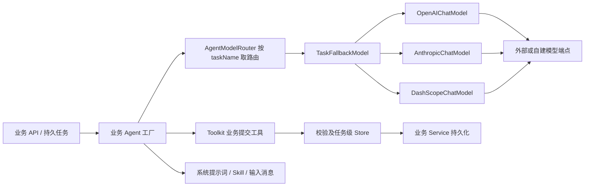
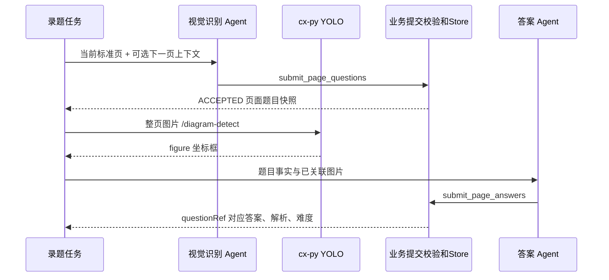

# CX 模型接入与本地推理

本文说明 CX 业务 Agent 如何调用模型、如何选择备用端点、如何生成与解析题目，以及真正落在本机或容器中的视觉模型。基线为 2026-10-29 的本地源码；配置模板只说明可配置的示例，不能代表线上 Nacos 的实际模型或参数。

## 1 模型能力边界

CX 的业务推理直接运行在 `cx-backend` 内嵌的 AgentScope 2.0.0 中。`xzagent` 是另一个通用 Agent 服务，当前使用 AgentScope 2.0.4，并采用自己的数据库模型资源和路由机制。两者复用 Agent 技术思想，但不能把它们的配置表、提示词存储方式和协议能力混用。

| 能力 | 当前实现位置 | 模型或算法 | 是否本地运行 |
|---|---|---|---|
| 单题、整卷生成，变式，批改，难度和解析 | cx-backend AgentScope | 配置的聊天模型 | 应用本地编排，推理访问配置端点 |
| 图片录题、拍照答卷识别 | cx-backend 视觉 Agent | 支持图像的聊天端点 | 没有独立 OCR 引擎部署证据 |
| 知识点向量化 | cx-backend OpenAI 兼容 Embedding 客户端 | 模板为 `text-embedding-v4` | 访问配置端点 |
| 知识点召回与选择 | PostgreSQL pgvector + 知识点 Agent | 余弦距离 Top30 + LLM 受控选择 | 向量检索在数据库，选择访问模型 |
| 非结构化图片生成 | cx-backend `image_generate` 工具 | 模板为 `wan2.7-image`、`dall-e-3` | 供应商 API |
| 几何图、坐标图 | TikZ 相关工具链 | 结构化绘图 | 与生图模型分开，详见服务与部署文档 |
| 题内插图边界框检测 | cx-py | DocLayout-YOLO / YOLOv10 | **已实现 CPU 本地推理** |
| 扫描图片增强 | cx-py | OpenCV 固定处理管线 | 本地运行，不是生成模型 |

没有从这两个业务目录发现可据以声明“已经部署本地通用大语言模型”的权重、推理容器或服务编排。`LlmModelFactory` 注释提到 vLLM 兼容服务，表示可以接入 OpenAI 兼容端点，不等于已经安装 vLLM。当前源码也未显示独立的 rerank 模型服务。

证据：`cx-backend/pom.xml:35`；`cx-backend/src/main/java/com/xiaogj/cx/backend/config/LlmModelFactory.java:59`；`cx-py/app/infrastructure/detector/doclayout_detector.py:323`。xzagent 的数据库模型配置详见同目录 xzagent 章节。

## 2 聊天模型接入结构



`AgentLlmProperties` 绑定 `cx.agent.llm`；`AgentScopeConfig` 启动时遍历命名端点创建模型，校验路由引用，然后构造 `AgentModelRouter`。模型实例可共享；包含本次 fallback 事实的路由对象在每次 Agent 运行内新建，不能跨并发运行共享其可变观测状态。

### 2.1 配置字段

| 配置路径 | 含义与生效方式 |
|---|---|
| `cx.agent.llm.endpoints.<name>.protocol` | `openai`、`anthropic`、`dashscope` |
| `...base-url` | 原样交给相应 AgentScope 模型 Builder；缺省使用 SDK 默认值 |
| `...api-key` | 必填；环境变量或 Nacos 注入 |
| `...model` | 提交给服务商的模型名，必填 |
| `...timeout` | 单次候选模型请求的外层 Reactor 超时 |
| `...options` | 显式映射到 `GenerateOptions` 的参数字典 |
| `cx.agent.llm.default-endpoint` | 未配置业务路由时使用；缺省取端点字典第一项 |
| `cx.agent.llm.tasks.<task>.endpoints` | 有序候选，去重后依次尝试 |
| `...max-iters` | ReAct 最大轮数；未配置或无效时为 20 |
| `...timeout` | 覆盖端点超时；业务硬上限只会进一步缩短 |

启动阶段检查所有配置的端点，而不只是当前默认端点。没有 API Key 的备用示例同样会让启动失败。不存在的路由端点和默认端点也会失败。

证据：`cx-backend/src/main/java/com/xiaogj/cx/backend/config/AgentScopeConfig.java:75`；`cx-backend/src/main/java/com/xiaogj/cx/backend/config/AgentModelRouter.java:195`。

### 2.2 模板中的具体模型

| 模板端点 | 协议 | 模型名 | 模板地址/超时 | 解释 |
|---|---|---|---|---|
| `openai-main` | openai | `gpt-4o-mini` | `https://api.openai.com/v1`；60s | 模板默认端点 |
| `claude-main` | anthropic | `claude-sonnet-4-5-20250929` | 不填地址，由 SDK 默认；120s | 备用配置示例，并未自动参与所有路由 |
| `qwen-main` | dashscope | `qwen-max` | 模板写 `https://dashscope.aliyuncs.com/compatible-mode/v1`；60s | 协议和 URL 组合须按所锁 SDK 验证 |
| embedding | OpenAI 兼容 | `text-embedding-v4` | `https://dashscope.aliyuncs.com/compatible-mode/v1` | 输出 1024 维 |
| `dashscope-image` | dashscope 图片 API | `wan2.7-image` | Provider 使用固定原生地址 | 默认关闭生图功能 |
| `openai-image` | OpenAI Images | `dall-e-3` | `https://api.openai.com` | 模板示例，当前 `size=auto` 实现需实际验证兼容性 |

上述名称来自 `cx-backend/src/main/resources/application-template.yml:202`、`:224`、`:357`。注释中出现的 DeepSeek、GLM、Kimi、MiniMax、其他 Qwen 名称只是在解释私有参数，不能据此列为已经使用的模型。

**模板存在一个直接复刻阻碍**：`question-variant` 路由引用 `xiaogj-ali-nothink` 与 `xiaogj-aliflash-nothink`，但该模板的端点字典未定义它们。启动前必须在有效配置中补充定义，或把该路由改为已配置的端点。这里保留源码事实，不替用户猜测这两个别名背后的模型。

证据：`cx-backend/src/main/resources/application-template.yml:317`；`cx-backend/src/main/java/com/xiaogj/cx/backend/config/AgentScopeConfig.java:123`。

### 2.3 协议适配细节

OpenAI 工厂创建 `OpenAIChatModel`，默认 `.stream(false)`，关闭 `nativeStructuredOutput` 和 `nativeStructuredOutputWithTools`。理由写在代码中：部分兼容端点接收 `response_format` 后仍输出 Markdown JSON，或者跳过业务工具，因此交给 AgentScope 的合成工具 fallback。复刻时不能只接一个 HTTP 文本返回再用正则取 JSON。

Anthropic 工厂创建 `AnthropicChatModel`，默认非流式，使用本仓库 `AnthropicToolCallFormatter` 修补 AgentScope 2.0.0 非流式工具调用参数丢失问题。

DashScope 工厂创建 `DashScopeChatModel`，使用 `DashScopeCachedTokenTransport` 捕获原始 usage，再由 formatter 回填缓存命中 token。`enable-thinking`、`endpoint-type` 是 Builder 参数，其中后者支持 `text`、`multimodal`、`auto`。模板关闭 thinking；源码仍保留开启配置入口，不能称为代码强制禁用。

聊天路径拼接由 AgentScope 扩展实现，本仓库不手工追加 `/v1/chat/completions`。尤其 DashScope 工厂是原生 `DashScopeChatModel`，模板却写 compatible-mode 地址，不能仅凭模板承诺这个组合可直接运行。若选择 OpenAI 兼容服务，应配置 `protocol: openai`，并验证其图像、工具调用和用量字段；若选择原生 DashScope，则须使用与当前 SDK 匹配的地址配置。

证据：`cx-backend/src/main/java/com/xiaogj/cx/backend/config/LlmModelFactory.java:59`、`:83`、`:107`。

支持的生成选项包括 `temperature`、`max-tokens`、`max-completion-tokens`、`top-p`、`top-k`、`seed`、`frequency-penalty`、`presence-penalty`、`thinking-budget`、`reasoning-effort`、`additional-body-params`。未知键会被忽略并记录 DEBUG。私有参数是否被模型接受，要按端点实测，不能用协议名字替代能力判断。

证据：`cx-backend/src/main/java/com/xiaogj/cx/backend/config/LlmModelFactory.java:192`。

### 2.4 可复用的最小配置片段

下列是**合并进有效配置的片段**，不是完整可启动配置；数据库、Redis、Nacos 和业务依赖仍需按配置章节准备。示例仅声明一个端点，避免保留缺少凭证的其他端点。

```yaml
cx:
  agent:
    embedding:
      base-url: ${CX_AGENT_EMBEDDING_BASE_URL}
      api-key: ${CX_AGENT_EMBEDDING_KEY}
      model: ${CX_AGENT_EMBEDDING_MODEL}
      dimensions: 1024
    llm:
      endpoints:
        vision-main:
          protocol: openai
          base-url: ${CX_LLM_BASE_URL}
          api-key: ${CX_LLM_KEY}
          model: ${CX_LLM_MODEL}
          timeout: 120s
      default-endpoint: vision-main
      tasks:
        chuti-exam:
          endpoints: [vision-main]
          max-iters: 100
        question-capture-parse:
          endpoints: [vision-main]
          max-iters: 100
        question-ai-answer:
          endpoints: [vision-main]
          max-iters: 3
        question-variant:
          endpoints: [vision-main]
          max-iters: 100
```

模型需要支持该任务用到的图像和工具调用。这里的 `${...}` 是 Spring 配置占位符，不要把同样语法搬入 cx-py YAML。若有效配置仍合并了旧端点或旧路由，必须同时清理或补全，不能假定仅覆盖 default 即可启动。

## 3 业务路由与受控编排

| taskName | 业务用途 | 模板最大轮数 | 关键实现 |
|---|---|---:|---|
| `chuti-question` | 单题生成 | 15 | `QuestionChutiAgent` + chuti Skill |
| `chuti-exam` | 整卷生成 | 100 | `ExamChutiAgentV2`，大纲/逐题提交工具 |
| `pijiao` | 答卷批改 | 15 | `ExamGradingAgent` + pijiao Skill |
| `photo-submission-parse` | 拍照答卷识别 | 8 | `ExamPhotoRecognitionAgent` |
| `question-capture-parse` | 图片录题 | 100 | `QuestionCaptureRecognitionAgentV2` |
| `question-ai-answer` | 逐页补全答案 | 3 | `QuestionAiAnswerAgentV2` |
| `knowledge-point-match` | 从召回候选中选知识点 | 3 | `KnowledgePointMatchAgent` |
| `question-difficulty` | 独立难度分析 | 1 | `QuestionDifficultyAgent` |
| `question-explanation` | 独立答案解析 | 1 | `QuestionExplanationAgent` |
| `bianshi` | 整卷变式 | 100 | `ExamVariantAgent` |
| `question-variant` | 单题变式，含图像分支 | 100 | `QuestionVariantAgent` / `QuestionVariantImageAgent` |

证据：`cx-backend/src/main/resources/application-template.yml:281`。Agent 类名是定位入口，实际调用方应以对应 Service 和任务 Handler 为准，仓库保留 V1/V2 类并不代表两者都在每条链路执行。

### 3.1 fallback 与预算是两层机制

候选端点按列表顺序去重；首个候选在**第一个响应信号之前**失败，并被判定可 fallback，才切换下一端点。收到任意 `ChatResponse` 后的异常直接传播，避免把两家模型输出拼接或者重复执行工具。

限流、服务端错误、网络错误、超时、一般 `ModelException` 及未识别异常允许 fallback。已识别的 OpenAI 鉴权、权限、参数错误类不允许 fallback；分类沿 cause 链最多检查 16 层。这是实现层的异常分类，不应扩大承诺为“所有供应商的任意 HTTP 400 都自动被统一分类”。

每个物理端点调用前执行 `ModelAttemptGuard`，所以切换备用端点也消耗业务请求预算。候选超时取任务覆盖或端点值，再受业务硬超时上限限制。流式 SDK 若启用，该 Reactor `timeout(Duration)` 具有信号间隔超时语义，不能一概写成整个任务总时长。

录题 Store 的每页物理模型请求上限是 4；页面答案中间件上限是 3。这两个上限独立于 ReAct `max-iters`，不能靠提高 max-iters 绕开。V2 Agent 的 `modelExecutionConfig.maxAttempts(1)` 禁止框架内部重复重试，业务和路由负责受控恢复。

证据：`cx-backend/src/main/java/com/xiaogj/cx/backend/config/model/TaskFallbackModel.java:96`、`:115`；`cx-backend/src/main/java/com/xiaogj/cx/backend/config/AgentModelRouter.java:237`；`cx-backend/src/main/java/com/xiaogj/cx/backend/agent/parse/store/QuestionCaptureGenerationStore.java:21`；`cx-backend/src/main/java/com/xiaogj/cx/backend/agent/middleware/QuestionPageAnswerModelBudgetMiddleware.java:21`。

### 3.2 录题、插图检测与答案分工



上图表达数据依赖，不规定所有任务 Handler 的线程调度。V2 顺序协调入口复用一个任务 Agent/session，页面 call 返回后读取有效 Store 快照再投递答案工作项；持久任务也提供单页入口用于检查点恢复。YOLO 负责图框，视觉模型负责题干语义和题目结构，不能拿 YOLO 输出当 OCR 文本。

检测返回用 `clientImageId` 与 `pageIndex` 严格核对，不只依赖数组顺序。旧兼容检测入口对 503 做当前页退避重试（3–7 秒，最多 60 次，受 5 分钟总等待限制）；持久单页入口保留错误交由步骤恢复，不能把旧兼容重试直接套到所有新任务。

证据：`cx-backend/src/main/java/com/xiaogj/cx/backend/service/QuestionCaptureRecognitionCoordinatorV2.java:92`、`:135`；`cx-backend/src/main/java/com/xiaogj/cx/backend/service/DiagramDetectionService.java:71`、`:162`。

## 4 内置提示词与 Skill 的复刻方式

`cx-backend` 从 `classpath:skills` 创建一个共享只读 `ClasspathSkillRepository`。出题、批改、变式 Agent 用 `SkillFilter.only(...)` 选择自身技能，Agent/Toolkit 是运行级对象；不要把本仓库开发用 `.agents/skills` 误认为产品运行时技能。

| 资源 | 职责 | 复刻要点 |
|---|---|---|
| `resources/skills/chuti/SKILL.md` | 语数英 1–9 年级出题约束 | 按学科、年级渐进读取参考文件；包括几何 TikZ 规范 |
| `resources/skills/pijiao/SKILL.md` | 主观题评分原则 | 标准答案、步骤分、分数上限、反馈要求 |
| `resources/skills/bianshi/SKILL.md` | 整卷变式 | 复用题型与结构契约，配套输出规范和几何规范 |
| `resources/skills/question-variant/SKILL.md` | 单题变式 | 与整卷变式分开绑定 |
| `prompts/exam-agent/v2-system-prompt.md` | 整卷 V2 行为 | 与 Outline/Question 提交工具和完成协调器配套 |
| `prompts/question-capture-agent-v2/system-prompt.md` | 逐页录题 | 只准通过 `submit_page_questions` 提交 |
| `prompts/question-ai-answer-agent-v2/system-prompt.md` | 逐页答案 | 只准通过 `submit_page_answers` 提交 |
| `prompts/knowledge-point-match/system-prompt.md` | 受控知识点选择 | 只能选择召回候选，不产生新知识点 ID |
| `prompts/question-difficulty-agent`、`question-explanation-agent` | 独立分析 | 分别维护系统提示词与提交校验 |

上表 `resources` 为 `cx-backend/src/main/resources`。提示词应随完整资源树打包，不能只复制 system-prompt 而遗漏 Skill 引用。`chuti/SKILL.md` 顶部概要表仍提到不存在的 `references/math.md` 等旧路径，其后逐年级列表才对应当前实际文件；复刻时须检查提示词引用，不能假定所有历史说明都准确。

录题提示词规定数组必须为数组、多选答案拆成多个字符串、坐标为 JSON 数字、LaTeX 反斜杠正确转义；答案提示词规定 `questionRef` 关联、`DONE` 等状态和答案数组。提示词之外还有 Java DTO/工具 validator 与 Store 判定有效提交，因此文本指令不能替代结构校验。

证据：`cx-backend/src/main/java/com/xiaogj/cx/backend/config/AgentScopeConfig.java:207`；`cx-backend/src/main/java/com/xiaogj/cx/backend/agent/chuti/ChutiAgentBase.java:121`；`cx-backend/src/main/java/com/xiaogj/cx/backend/agent/parse/QuestionCaptureRecognitionAgentV2.java:97`；`cx-backend/src/main/java/com/xiaogj/cx/backend/agent/parse/QuestionAiAnswerAgentV2.java:244`。

## 5 Embedding、pgvector 与知识点选择

索引端为叶子知识点构造可复现的文本，调用 Embedding，验证维度，批量写入 `knowledge_point_embedding`。表按 `(knowledge_point_id, embedding_model)` 唯一，模型名是索引版本的一部分。DDL 固定 `vector(1024)`，更换维度必须同步改库并重建向量，不能只改 YAML。

查询端先按接入方、学段、可选学科决定体系。接入方存在私有知识体系时按私有范围匹配，不因目标范围为空悄悄回退公共体系。随后题目向量化，用 pgvector `<=>` 余弦距离召回 Top30，再交给知识点 Agent 受控选择，过滤不在候选集合的 ID、low 置信度和重复项，最多保留 3 个。

数据库定义了 HNSW 索引，但**当前这条业务查询在事务内执行 `SET LOCAL enable_indexscan = off`，采用精确扫描**，原因是跨表体系过滤导致近似索引候选不足。不能据 DDL 存在 HNSW 就宣称线上 Top30 一定走 HNSW。

`UsageAwareOpenAiEmbeddingModel` 实现 AgentScope `EmbeddingModel`，底层用 OpenAI Java SDK `client.embeddings().create`，发送 model、dimensions、float 编码和单项文本数组。成功响应中的 `usage.prompt_tokens` 用于精确计量，没 usage 时不估算。超时重试调用 `EmbeddingUtils` 的默认策略，本仓库未显式给出该 SDK 默认数字。

证据：`db/schema.sql:161`；`cx-backend/src/main/resources/mapper/KnowledgePointEmbeddingMapper.xml:45`；`cx-backend/src/main/java/com/xiaogj/cx/backend/service/knowledge/KnowledgePointMatchService.java:248`、`:323`；`cx-backend/src/main/java/com/xiaogj/cx/backend/config/UsageAwareOpenAiEmbeddingModel.java:91`。

## 6 图片生成接入

工具名是 `image_generate`，入参包括 `prompt`、`negative_prompt`、`images`、`size`、`n`、`seed`。默认功能关闭；启用后按默认端点选一个 Provider，没有聊天路由那样的多供应商自动 fallback。成功图片会下载并上传为平台持久 URL，同一运行完全相同参数命中成功缓存时复用，不再次调用模型。

| 项目 | DashScope 实现 | OpenAI 兼容实现 |
|---|---|---|
| URL | 固定 `https://dashscope.aliyuncs.com/api/v1/services/aigc/multimodal-generation/generation` | `base-url + /v1/images/generations` |
| 授权 | `Authorization: Bearer <KEY>` | 相同 |
| 请求 | `model`、`input.messages[].content`、`parameters` | `model`、`prompt`、`n`、`size` |
| 尺寸 | `宽x高` 转 `宽*高`，调整像素范围 | 实现固定 `size: auto`，宽高比写进 prompt |
| 参考图 | 作为多模态 content 发送 | 当前未实现 multipart 编辑，不发送参考图 |
| 重试 | HTTP 429/500/502/503 或 ResponseTimeout/Throttling，额外 1 次 | HTTP 429/500/502/503 或 400 空错误，额外 3 次，1/2/4s 退避 |
| HTTP 超时 | 代码固定 3 分钟 | 代码固定 5 分钟 |
| 返回 | 提取临时 URL | 提取 URL 或把 b64_json 包为 data URI |

**配置与实现差异**：`ImageGenerateEndpoint.timeout/options` 和工具级 timeout 存在配置属性，但当前工厂没有把端点超时传给 Provider，工具执行链也没有读取配置 timeout 实施总截止时间。不能承诺修改这些 YAML 值即可改变实际超时。模板 `dall-e-3` 与固定 `size=auto` 的组合也需验证，不能作为已通过供应商联调的例子。

存储默认 `type=todo`，是占位而非可用持久存储。要得到稳定可访问结果需改为 OSS，配置中台 STS 凭证提供者和文件中心业务参数。工具说明优先让几何图使用 TikZ，避免把可精确构造的几何关系交给生图模型。

证据：`cx-backend/src/main/java/com/xiaogj/cx/backend/agent/tool/imagegenerate/ImageGenerateTool.java:144`、`:228`；`cx-backend/src/main/java/com/xiaogj/cx/backend/agent/tool/imagegenerate/provider/ImageGenerateProviderFactory.java:118`；`cx-backend/src/main/java/com/xiaogj/cx/backend/agent/tool/imagegenerate/provider/OpenAiImageGenerateProvider.java:139`；`cx-backend/src/main/java/com/xiaogj/cx/backend/agent/tool/imagegenerate/provider/DashScopeImageGenerateProvider.java:43`。

## 7 真正的本地模型 DocLayout YOLO

### 7.1 权重和运行环境

| 项目 | 当前值 |
|---|---|
| 权重来源记录 | `juliozhao/DocLayout-YOLO-DocStructBench` |
| revision | `8c3299a30b8ff29a1503c4431b035b93220f7b11` |
| 文件 | `models/doclayout_yolo_docstructbench_imgsz1024.pt` |
| 文件大小 | 40,709,302 字节 |
| SHA-256 | `9a2ee0220fe3d9ad31b47e1d9f1282f46959a54e4618fce9cffcc9715b8286e2` |
| Python | 3.11；pyproject 要求 `>=3.11,<3.12` |
| 模型与张量库 | `doclayout-yolo==0.0.4`、`torch==2.4.1+cpu`、`torchvision==0.19.1+cpu` |
| 图像库 | `opencv-python-headless==4.13.0.92`、Pillow |
| 服务 | FastAPI 0.139.0、Uvicorn 0.51.0、单 worker |
| 设备与并发 | 仅允许 cpu；推理并发必须为 1 |
| CPU 线程 | intra-op 4，inter-op 1 |
| 部署资源模板 | requests 1 CPU / 1Gi；limits 2 CPU / 2Gi，非性能容量保证 |

2026-10-29 提取时实际读取本地权重大小并计算 SHA-256，与 manifest 完全一致。这证明权重文件存在且完整，不等同于完成真实推理性能测试。模型许可备注记录 DocLayout-YOLO 为 AGPL-3.0、权重许可需单独确认，发布流程依该 manifest 要求处理。

启动加载顺序：读取 manifest → 校验大小和哈希 → 设置 PyTorch 线程 → 加载 YOLOv10 → 用固定白图预热两次 → 标记 ready。容器把权重打进 `/opt/models`，运行时不依赖临时访问 Hugging Face 下载模型。

证据：`cx-py/model-manifest.json:1`；`cx-py/app/infrastructure/detector/doclayout_detector.py:91`、`:263`、`:323`；`cx-py/app/core/config.py:312`；`cx-py/deployment.yaml:33`。

### 7.2 推理和输出契约

接口 `POST /py/private/diagram-detect`，body 的 `images` 支持 1–10 张；每张包含 `type` 为 `url` 或 `base64`，以及互斥的 `url` / `data`。可传 `clientImageId` 和 `pageIndex`；缺省页码按数组下标 +1，填充后必须唯一。

推理使用 `imgsz=1024`、最低置信度 0.20。后处理只保留 `figure` 类，丢弃非法/零面积框，裁剪到图片边界并归一化到 0–1，保留 6 位小数；IoU 超过 0.85 的重复框优先保留高分项，按 y、x 稳定排序。置信度 high≥0.70，medium≥0.40，其余通过最低阈值的为 low。

```json
{
  "images": [{
    "clientImageId": "page-1",
    "pageIndex": 1,
    "type": "base64",
    "data": "<PNG_OR_JPEG_BASE64>"
  }]
}
```

成功外层 `code="0"`、`message="ok"`，`data.images[]` 对应输入；每项 `regions[]` 中包含 `pageIndex`、`x`、`y`、`width`、`height`、`description`、`confidence`、可选 `note`。无图为 `regions: []`，不是 null。图框不包含题干 OCR 文本。

单图最大 15MiB / 4000 万像素，批次图片累计最大 30MiB，请求体最大 42MiB。默认最多排队 2 个请求、10 个图片单元，排队等候 2s，请求预算 60s。高并发需增加独立实例并控制 Java 调度，不要把单实例推理并发调大。

证据：`cx-py/app/api/schemas/diagram_detection.py:66`；`cx-py/app/infrastructure/detector/postprocess.py:280`；`cx-py/config/application-template.yml:12`。

### 7.3 本地启动和最小验证

先使用 Python 3.11 创建虚拟环境。仓库 README 给出锁文件安装路径，但 Dockerfile 还包含 CPU wheel 分源安装和 doclayout wheel 修补；可复刻安装应对齐该流程，避免普通 PyPI 找不到 `+cpu` 包，或同时引入 GUI OpenCV。

```powershell
Set-Location D:\cx\cx-ai-doc\cx-py
python -m venv .venv
.\.venv\Scripts\Activate.ps1
python -m pip install --upgrade pip
python -m pip install --no-deps --no-index --find-links https://mirrors.aliyun.com/pytorch-wheels/cpu torch==2.4.1+cpu torchvision==0.19.1+cpu
python -m pip download --only-binary=:all: --no-deps --dest .model-wheels doclayout-yolo==0.0.4
python scripts/patch_doclayout_yolo_wheel.py .model-wheels/doclayout_yolo-0.0.4-py3-none-any.whl .model-wheels/patched
python -m pip install --no-deps .model-wheels/patched/doclayout_yolo-0.0.4-py3-none-any.whl
python -m pip install --only-binary=:all: --no-deps -r requirements-cpu.lock
python -m pip check
python scripts/verify_model.py models/doclayout_yolo_docstructbench_imgsz1024.pt
$env:NACOS_CONFIG_ENABLED = "false"
$env:NACOS_REGISTER_ENABLED = "false"
$env:CX_DETECTOR_MODEL_PATH = "D:\cx\cx-ai-doc\cx-py\models\doclayout_yolo_docstructbench_imgsz1024.pt"
uvicorn app.main:app --host 127.0.0.1 --port 9514 --workers 1
```

安装命令来自 Dockerfile 的等价本地过程，依赖包仍须有当前操作系统的匹配 wheel；本次文档提取没有执行联网安装。生产 Dockerfile 使用公司私有基础镜像，外部复刻需要镜像读取权限或自行建立等价 Python 3.11 基础镜像。

另一个终端运行：

```powershell
Invoke-RestMethod http://127.0.0.1:9514/py/health/readiness
$imageBytes = [IO.File]::ReadAllBytes('D:\samples\exam-page.png')
$payload = @{ images = @(@{
  clientImageId = 'page-1'; pageIndex = 1; type = 'base64'
  data = [Convert]::ToBase64String($imageBytes)
}) } | ConvertTo-Json -Depth 5
Invoke-RestMethod -Method Post -Uri http://127.0.0.1:9514/py/private/diagram-detect -ContentType 'application/json' -Body $payload
```

样本路径需要替换为实际图片。检查返回 code、页码、坐标边界和 regions；有无图框取决于样本，不能以“必须非空”作为所有样本的成功标准。private 接口没有应用层服务凭证，依赖部署网络隔离；公网网关阻断 private 路径，不能将 Uvicorn 端口无保护暴露公网。

Java 联调通过 `InternalServiceInvoker` 调用 `service-key=cx-py`、路径 `/py/private/diagram-detect`，可用 Nacos 发现或配置 `cx.internal-services.services.cx-py.direct-base-url`。具体配置结构需以配置章节和 `InternalServiceClientProperties` 为准。

证据：`cx-py/Dockerfile:19`；`cx-py/README.md:9`；`cx-backend/src/main/java/com/xiaogj/cx/backend/client/diagram/WebClientDiagramDetectionClient.java:39`；`cx-backend/src/main/java/com/xiaogj/cx/backend/config/DiagramDetectionClientProperties.java:15`。

## 8 复刻验收与已知边界

1. 校验所有 LLM 端点和路由都能启动，未定义别名、空 Key 和 embedding 维度不匹配必须明确失败。
2. 用支持 tool calling 的模型完成一次业务提交，确认 Java validator 接受并持久化；纯文本生成成功不是完整业务成功。
3. 用假的首帧失败和首帧后失败分别验证 fallback 行为，确保后者不切换重放工具；对应测试 `AgentModelRouterTest`、`TaskFallbackModelTest` 已存在。
4. 分别测试多页识别、答案预算耗尽、知识点 Top30 白名单选择；LLM 输出不是可信数据库记录。
5. 执行本地权重哈希检查、readiness 和真实图片推理，再做限定样本容量测试；当前提取仅完成哈希校验。
6. 生图单独验收供应商能力与持久 URL，尤其 OpenAI `size=auto`、参考图不支持、todo 存储、配置超时未接线四个边界。
7. 若新增本地 LLM，先由外部推理服务提供兼容接口，再新增 endpoint 与任务路由并验证视觉、工具、上下文和 usage；这属于扩展方案，不是当前部署事实。

可用测试证据入口：`cx-backend/src/test/java/com/xiaogj/cx/backend/config/LlmModelFactoryTest.java`、`config/UsageAwareOpenAiEmbeddingModelTest.java`、`config/model/TaskFallbackModelTest.java`、`service/DiagramDetectionBusyRetryTest.java`、`agent/middleware/QuestionCaptureModelBudgetMiddlewareTest.java`，以及 `cx-py/tests/unit/test_detection_capacity_lifecycle.py`。本次为源码提取，未启动业务服务、未调用付费模型、未执行数据库写入。
