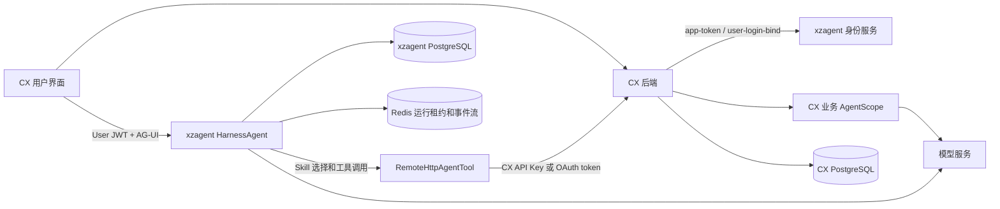
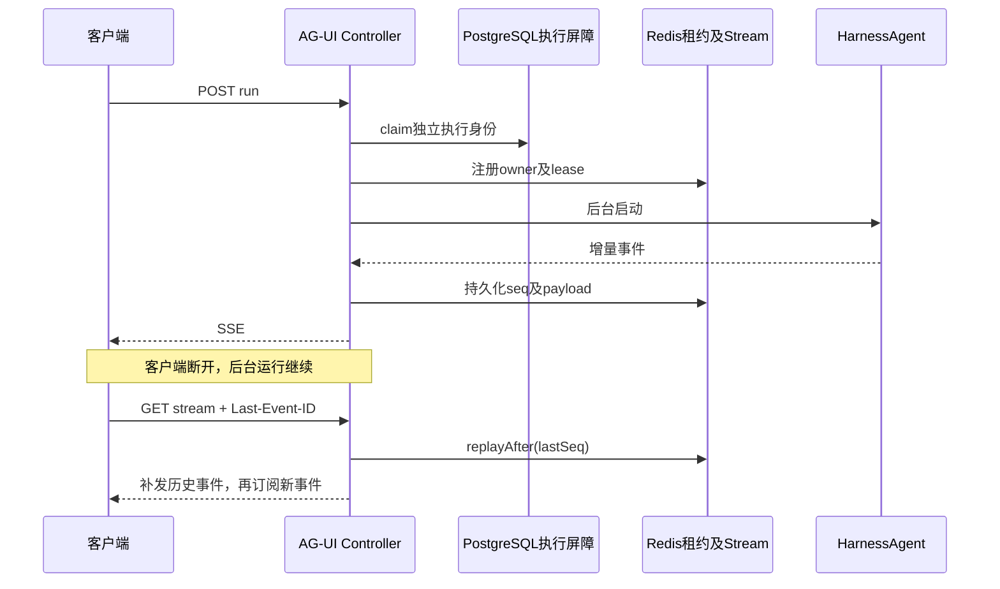

# xzagent 运行时与编排

本文描述 2026 年 10 月 29 日本机 `D:/cx/xzagent` 与 `D:/cx/cx-ai-doc` 的代码现状。下文 `xzagent/` 表示前一仓库，`cx-ai-doc/` 表示后一仓库；源码定位均相对这些根目录。代码能力、配置默认值、真实线上启用状态分别陈述。

## 1 两层 Agent 的职责

CX 是出卷、题库、录题、变式和考试业务系统；xzagent 是通用对话、工具装配、渠道接入、用户授权和长任务运行时。二者是独立 Spring Boot 服务，CX 自身也嵌入 AgentScope 来执行出卷等业务任务。

因此，“CX 依赖 xzagent”具体包括两条方向相反的调用：

1. CX 为用户进入对话调用 xzagent 的公开身份接口，取得 User JWT。
2. xzagent 中的 CX Skill 通过远程工具调用 CX 的业务接口，CX 继续在自身进程内执行任务。

这不是把所有 CX 的模型请求统一代理给 xzagent，也不是两个服务共享一个 Agent 实例。



证据：`cx-ai-doc/cx-backend/src/main/java/com/xiaogj/cx/backend/client/xzagent/XzagentClient.java:19`；`cx-ai-doc/cx-backend/src/main/java/com/xiaogj/cx/backend/service/AiagentEnterChatService.java:14`；`cx-ai-doc/cx-backend/pom.xml:39`。

## 2 技术依赖和版本

| 项目 | 当前代码版本或实现 | 用途 |
|---|---|---|
| JDK | Java 17，Maven Enforcer 限制 `[17,18)` | 编译和运行 |
| Maven | Enforcer 要求 3.9 以上 | 构建 |
| Spring Boot | 3.5.8 | 依赖管理、配置、应用生命周期 |
| WebFlux、Reactor | Boot 管理版本 | HTTP、SSE、WebSocket、异步模型流 |
| AgentScope | 2.0.4 BOM | core、harness、OpenAI、Anthropic、A2A、AG-UI |
| MyBatis-Plus | 3.5.12 | 持久化，复杂查询 XML |
| PostgreSQL | JDBC，具体服务器版本不由 POM 证明 | 状态、会话、Skill、模型、凭证 |
| Redis | Spring Data Redis | 租约、事件补流、OAuth state、缓存协调 |
| Nacos client | 1.4.7 原生客户端 | 配置与服务发现 |
| JJWT | 0.12.7 | App、Tenant、User JWT |
| Springdoc | 2.8.14 | 分受众接口契约 |
| JSON Schema | networknt 2.0.0 | 工具与 A2UI 验证 |
| Playwright | 1.58.0 | HTML 截图等工具能力 |
| 飞书 SDK | oapi-sdk 2.8.2 | 飞书渠道 |
| OSS SDK | 3.18.4 | 附件、图片及工具大结果 |
| OpenTelemetry | BOM 管理版本 | 模型与工具链路观察 |

证据：`xzagent/pom.xml:6`、`:21`、`:45`、`:85`、`:140`、`:155`、`:172`。CX 后端 AgentScope 为 2.0.0，不能把两个服务的库版本统一写成同一版本。

## 3 当前运行时是 HarnessAgent

旧 `AGENTS.md` 仍描述 `ReActAgent + AutoContextMemory + MySQL`。当前源码的装配入口已是 `AgentFactory → AgentRuntimeFactory → HarnessAgent`，状态存储为 PostgreSQL 的 v2 `AgentStateStore`。

Harness 内部仍通过推理和工具执行循环完成任务，但复刻当前项目时必须恢复 v2 Harness 装配、状态初始化、ToolContext 和 SkillHook；不能直接照旧版 ReActAgent 示例搭建。

### 3.1 每次运行的装配顺序

1. 校验 sessionId、执行 claim、发送者身份。sessionId 只能包含字母、数字、下划线、短横线，长度 1 到 128。
2. 从 JWT 的 appId、tenantKey、tenantUserId 解析内部用户 ID。
3. `RuntimeSnapshotRegistry.getSnapshot(appId, agentId)` 读取 App 私有 Agent、Skill、绑定和远程 meta。
4. `CurrentModelRuntimeConfig.resolve()` 解析数据库中 CHAT 全局主备模型路由。
5. 合并本轮与同会话仍有效附件白名单，形成服务端 `ToolExecutionContext`。
6. 为本次运行新建 Toolkit 和 SkillBox，只注册 Agent 选中的 Skill。
7. 注册 Skill 加载工具，装配 local tool、MCP、remote HTTP tool；再注册受附件上下文限制的附件工具。
8. 注入中间件、状态存储、工作目录资格与工具超时，构建 HarnessAgent。
9. 校验恢复状态是否能被当前模型格式化，记录会话归属、Agent 绑定和 run。
10. 将运行资源交给本次执行句柄，正常结束、取消、失败后释放。

证据：`xzagent/src/main/java/xiaogj/xzagent/service/AgentFactory.java:300`、`:360`、`:375`、`:422`、`:472`、`:510`。

### 3.2 默认能力边界

| Harness 能力 | 当前默认 |
|---|---|
| TaskList / todo_write | 开启，用于任务清单 |
| pending tool recovery | 工厂显式开启 |
| Web 工具 | 工厂显式关闭，防 SDK 升级增加权限 |
| 文件系统工具、Shell、MEMORY | 关闭 |
| workspace context、`@path` | 关闭 |
| 子 Agent、动态子 Agent | 关闭 |
| 动态 Skill、默认 workspace Skill | 关闭 |
| tools.json、Plan Mode | 关闭 |

因此这里的“编排”主要是单个 Harness 内的 Skill 与工具循环、业务任务以及挂起恢复，不应描述为默认启用的多 Agent 自组织平台。

证据：`xzagent/src/main/java/xiaogj/xzagent/service/AgentRuntimeFactory.java:264`；`xzagent/src/main/java/xiaogj/xzagent/config/XzagentAutoContextProperties.java:33`。

### 3.3 中间件为什么有顺序

| 装配位置 | 中间件 | 作用 |
|---|---|---|
| 最外层 | Observability tracing | 覆盖完整运行与后续模型、工具调用 |
| 业务上下文 | XzagentContext、ClientContext、TemporalContext | 注入身份上下文、客户端背景和服务端时间 |
| Skill | SkillToolVisibility、SessionActiveSkillRestore | 保留加载入口、恢复已激活技能 |
| A2UI schema | A2uiCatalogSchemaMiddleware | 根据本轮已激活 Skill 重建可见 catalog |
| A2UI 执行 | SurfaceTracking、A2uiAutoStop | 保存 surface，工具结果落入上下文后停止当前推理 |
| 审计计量 | ToolAudit、TokenUsage | 保存工具调用和实际模型 token 消耗 |
| 生命周期 | RunCancellation、RunCompletion | 取消、结束、失败及资源释放 |

`SkillHook(skillBox)` 仍作为 v2 兼容桥显式注册，构建后重新 `skillBox.bindToolkit(agent.getToolkit())`。原因是 Harness 内部复制 Toolkit；只将数据库 Skill 注册到外部 Toolkit 会让最终 Agent 看不到正确的 Skill 元数据或工具组。

证据：`xzagent/src/main/java/xiaogj/xzagent/service/AgentFactory.java:422`；`xzagent/src/main/java/xiaogj/xzagent/service/AgentRuntimeFactory.java:289`。

## 4 模型路由与状态记忆

### 4.1 当前模型配置来自数据库

运行时读取 provider、model、route 聚合，CHAT 路由按 primaryModelId 与 fallbackModelIds 顺序构造候选。连接密钥通过凭证编码器解密，仅用于模型客户端构建。

| 用途 | 已接入协议 | 暂未接入 |
|---|---|---|
| CHAT | OpenAI Chat Completions、Anthropic Messages | OpenAI Responses、DashScope native |
| IMAGE_GENERATION | OpenAI Images 文生图、DashScope Image 文生图和参考图 | 以协议注册表返回为准 |

枚举存在并不代表支持。具体模型名字来自数据库，不能用旧模板或示例证明线上正在用某个 GPT、Claude 或 Qwen 型号。

管理 API 基路径为 `/xzagent/api/admin/model-config`：`GET` 当前配置，`POST /providers`，`POST /models`，`PUT /routes/{purpose}`，`GET /protocols?purpose=CHAT`，以及候选发现和测试端点。修改要求平台管理员身份和修订检查，不是任意 App 都能写全局路由。

证据：`xzagent/src/main/java/xiaogj/xzagent/service/modelconfig/CurrentModelRuntimeConfig.java:41`；`xzagent/src/main/java/xiaogj/xzagent/model/modelconfig/ModelProtocolRegistry.java:20`；`xzagent/src/main/java/xiaogj/xzagent/web/console/ModelConfigController.java:41`。

### 4.2 Fallback 的边界

每个候选先执行自身重试策略；错误命中路由触发规则且还有候选时，尝试下一个模型。`stopAfterFirstChunk` 启用时，一旦输出可见内容就禁止切换，避免同一回答混用两家模型。仅 usage 的空块不算已输出正文。

失败后切换时可回到 canonical 输入快照，避免沿用上一个候选已经投影、改写过的消息数组。实际成功模型会写入 route context，TokenUsage 中间件据此计量。

证据：`xzagent/src/main/java/xiaogj/xzagent/model/FallbackRoutingModel.java:23`、`:86`、`:151`、`:166`、`:302`。

### 4.3 记忆与历史不是一份数据

`DbAgentStateStore` 以 `user_id + session_id + state_key` 存取 `agent_state_v2`，列表还按 item_index 排序；会话历史索引继续负责向用户展示消息。v2 初始化明确不读取、迁移或覆盖 v1 `agent_session_state`：旧消息可查，不代表旧模型记忆会自动接续。

`AgentStateInitializationPolicy` 为新状态和缺少入口组的旧状态补齐 Skill 加载入口。没有该步骤，工具组过滤可能把加载 Skill 的工具也隐藏。

模板保留 `max-token`、`token-ratio`、`msg-threshold` 等旧 AutoContext 配置字段；本次源码检索没有找到这些阈值被当前 Harness Builder 消费的调用点。因此不能承诺这些参数控制当前压缩行为；实际压缩依赖当前 SDK 行为，应以对应版本和验证结果为准。

证据：`xzagent/src/main/java/xiaogj/xzagent/infrastructure/state/DbAgentStateStore.java:19`；`xzagent/src/main/java/xiaogj/xzagent/service/AgentStateInitializationPolicy.java:11`；`xzagent/src/main/java/xiaogj/xzagent/service/AgentRuntimeFactory.java:264`。

## 5 AG-UI 接口与断线重连

以下路径均为直接访问 xzagent 服务的路径；通过外部网关时可能还需 `/api` 前缀，应按部署路由确认。

| 方法与路径 | 身份 | 用途 |
|---|---|---|
| `POST /xzagent/api/user/agui/run` | User JWT | 启动运行，返回 `text/event-stream` |
| `GET /xzagent/api/user/agui/sessions/{sessionId}/stream` | User JWT | 携 `Last-Event-ID` 重连补流 |
| `POST /xzagent/api/user/agui/sessions/{sessionId}/cancel` | User JWT | 取消当前运行 |
| `WS /xzagent/api/user/agui/ws/sessions/{sessionId}/stream?token=...` | Handler 内验 User JWT | 双向运行或重连 |
| `GET /xzagent/api/user/sessions` | User JWT | 会话列表 |
| `GET /xzagent/api/user/sessions/{sessionId}` | User JWT | 会话详情 |
| `GET /xzagent/api/user/sessions/{sessionId}/runs` | User JWT | 执行历史 |
| `DELETE /xzagent/api/user/sessions/{sessionId}` | User JWT | 重置会话 |

最小运行请求示例，ID 为接入方生成的示例值：

```json
{
  "threadId": "cx_demo_001",
  "runId": "run_001",
  "agentId": "cx",
  "messages": [{"id": "message_001", "role": "user", "content": "给五年级出一份数学试卷"}],
  "tools": [],
  "context": [],
  "state": {},
  "forwardedProps": {}
}
```

`threadId` 映射为 sessionId；同一 session 首次绑定 agentId，后续不得换 Agent。客户端传入 tools 并不取代服务端的应用绑定与权限检查。context 最多 32 项，description/value 长度分别最多 512/16384，总长最多 65536 个 UTF-16 单元，且它是背景资料，不能覆盖系统规则。

证据：`xzagent/src/main/java/xiaogj/xzagent/web/dto/AguiRunRequest.java:25`；`xzagent/src/main/java/xiaogj/xzagent/web/AguiSessionController.java:130`；`xzagent/src/main/java/xiaogj/xzagent/config/WebSocketConfig.java:35`。

### 5.1 流和执行解耦



没有活跃或可补尾运行时返回 `noActiveRun` 信号；挂起等待用户的运行也不要求客户端无限追流。客户端不能把 SSE 断线解释成任务已取消，主动停止应调用 cancel。

证据：`xzagent/src/main/java/xiaogj/xzagent/web/AguiChatController.java:71`、`:328`、`:495`；`xzagent/src/main/java/xiaogj/xzagent/service/RedisRunEventStreamStore.java:88`、`:104`。

### 5.2 多节点一致性

当前方案同时使用 PostgreSQL 执行屏障与 Redis 运行定位。`RunExecutionCoordinator.claim` 为每次执行生成独立身份；PG 取得资格后还要成功认领 Redis，任一冲突均不得执行。

写状态、surface 等必须携带原 claim 身份。恢复同一业务 runId 也会得到新执行身份，旧执行的迟到回调不能覆盖新执行。取消在本机处理或转发到 owner 节点；内部节点地址需能被其他节点访问。

关键配置前缀为 `xzagent.distributed-run`，包括 node-id、internal-base-url、active-lease-seconds、heartbeat-interval-seconds、event-stream-ttl-seconds、replay-batch-size、孤儿扫描与停机宽限。Redis 事件流有数量和字节预算，并预留终止事件空间；事件补流不能替代永久会话历史。

证据：`xzagent/src/main/java/xiaogj/xzagent/service/RunExecutionCoordinator.java:14`、`:82`；`xzagent/src/main/java/xiaogj/xzagent/config/XzagentDistributedRunProperties.java:33`。

## 6 A2UI 挂起与恢复

`render_a2ui` 只看当前有效 catalog。schema 中间件在每轮推理前根据激活技能重建模型可见组件，工具执行再校验同一有效目录快照，不能仅依靠 prompt 约束组件名。

需要交互的工具调用保存 suspended 状态和 surface。前端提交 `POST /xzagent/api/user/a2ui/actions/submit`：

```json
{
  "sessionId": "cx_demo_001",
  "runId": "run_001",
  "toolCallId": "tool_call_from_event",
  "surfaceId": "exam-blueprint",
  "sourceComponentId": "blueprint_component",
  "clientEvent": {"name": "generate_exam", "context": {"subject": "math", "grade": 5}}
}
```

此示例展示请求壳；实际 `clientEvent` 内容应由当前组件及 catalog 生成。必须携带原始会话、运行、工具调用与 surface 身份，不应将点击事件改成一条普通聊天消息重新执行任务。

证据：`xzagent/src/main/java/xiaogj/xzagent/web/A2uiActionController.java:26`；`xzagent/src/main/java/xiaogj/xzagent/web/dto/A2uiActionSubmitRequest.java:17`；`xzagent/src/main/java/xiaogj/xzagent/service/AgentFactory.java:436`。

## 7 身份与 CX 登录桥接

| 身份 | 来源 | 作用域 |
|---|---|---|
| App JWT | appId + appSecret | App 资源；管理员另受 console policy 限制 |
| Tenant JWT | 上述请求增加 tenantKey | 指定 App 下的租户 |
| User JWT | tenantKey + tenantUserId 或 Tenant 身份换取 | 用户会话、工具授权和运行 |
| A2A API Key | 用户创建的 xzagent Key | A2A JSON-RPC 入口 |
| CX API Key | CX 生成的 `ak_` Key | 远程工具回调 CX；不是 xzagent JWT |

CX 的 `cx.xzagent.*` 配置包括 base-url、app-token-path、user-login-bind-path、app-id、app-secret、agent-id、timeout；timeout 默认 5 秒。客户端使用 WebClient 外部基地址直连，不使用 Nacos / InternalServiceInvoker 寻址。

实际调用顺序：

1. CX `getOrCreateActiveKey(appId)` 复用或创建应用 Key。
2. `POST /xzagent/api/auth/app-token`，请求 `{appId: xzagentAppId, appSecret: 部署密钥, tenantKey: cxAppId}`。
3. 持 Tenant JWT 调用 `/xzagent/api/tenant/auth/user-login-bind`，提交 uid、agentId、`thirdPartyCredentialId="oauth2:cx-core"`、`thirdPartyCredentialHeaders.Authorization="Bearer <CX_KEY>"`。
4. xzagent 创建或登录用户，写入第三方凭证并绑定远程来源，返回 User JWT。
5. CX 仅将 User JWT 交给前端进入对话，不持久化，不用它调用 CX 自己的业务接口。

CX 未传 uid 时用 appId 作占位；该兼容行为不等于已经具备每个终端用户的独立映射。正式多用户接入应提供稳定且符合业务身份体系的 uid。

证据：`cx-ai-doc/cx-backend/src/main/java/com/xiaogj/cx/backend/service/AiagentEnterChatService.java:48`；`cx-ai-doc/cx-backend/src/main/java/com/xiaogj/cx/backend/client/xzagent/XzagentClient.java:71`、`:102`；`xzagent/src/main/java/xiaogj/xzagent/web/TenantAuthController.java:40`。

## 8 远程工具与 MCP

远程 HTTP 工具由 meta 描述 inputSchema、method、path、request 模板和 response mapping。`RemoteHttpAgentTool` 负责 GET/POST、模板参数、服务端凭证注入、JSON 或 SSE 消费。CX 出卷等长任务使用 meta 1.1 的 `sse_xzagent_v1`，不是把普通 JSON 接口强行当流。

当前 SSE 默认资源预算：单事件 65536 字节，最终工具结果 262144 字节；业务总时长 900 秒，空闲 60 秒；高频提示合并窗口 200 毫秒或 8192 字节；单工具最多 5000 个合并事件，单 Run 最多 10000 个逻辑事件；外层 Agent 工具超时 960 秒，maxAttempts 为 1。覆盖部署配置时必须维持外层大于内层的关系。

用户无授权时返回 `auth_required` 信封并提供 OAuth 链接；OAuth 使用随机一次性 state、PKCE S256、`client_secret_basic`，授权后按 credentialGroup 绑定凭证。临近过期主动刷新；收到 401 时强制刷新并至多重试一次，失败重新引导授权。

MCP 支持 STDIO、SSE、Streamable HTTP。客户端按应用、服务、用户授权构建，Skill binding 的 enableTools/disableTools 决定暴露面。HTTP 请求凭证由服务端用户授权快照提供；STDIO 会在服务端运行配置的进程，因此配置与启用应只给可信管理者。

证据：`xzagent/src/main/java/xiaogj/xzagent/tool/RemoteHttpAgentTool.java:207`、`:377`、`:448`；`xzagent/src/main/java/xiaogj/xzagent/service/RemoteSourceOAuthService.java:132`、`:165`、`:275`；`xzagent/src/main/java/xiaogj/xzagent/infrastructure/mcp/McpClientRegistry.java:194`；`xzagent/src/main/java/xiaogj/xzagent/config/XzagentRemoteToolStreamProperties.java:25`。

## 9 A2A 的独立入口

`xzagent.a2a.enabled=true` 才装配 A2A Server，模板默认关闭。AgentCard 在 `GET /xzagent/.well-known/agent-card.json`，JSON-RPC 为 `POST /xzagent`，`message/stream` 返回 SSE。

服务手动装配 AgentScopeA2aServer 和 JSON-RPC transport，不使用 starter 默认自动装配。首选请求头为 `X-API-Key`；转换器兼容 Bearer 中携带 API Key。该入口验证的是 xzagent 用户 API Key，不应把 AG-UI 的 JWT 直接混用。

证据：`xzagent/src/main/java/xiaogj/xzagent/config/A2aManualConfiguration.java:29`；`xzagent/src/main/java/xiaogj/xzagent/config/A2aApiKeyAuthenticationConverter.java:24`；`xzagent/src/main/java/xiaogj/xzagent/web/a2a/XzagentA2aJsonRpcController.java:81`。

## 10 复刻与部署顺序

1. 获取 xzagent 源码、匹配版本的 PostgreSQL DDL、Redis、Nacos 配置和模型服务访问权。
2. 建库并执行对应迁移。当前本机 `D:/cx/db` 不存在，`xzagent/AGENTS.md` 指向的 `../db/schema.sql` 无法取得；CX 的 schema 不等于完整 xzagent schema，不能直接替代。
3. 配置 PostgreSQL、`spring.redis.*`、JWT 签名材料、header encryption 与 model encryption 材料；后两者用于已有密文解密，迁移时需按原系统规则管理。
4. 配置 Nacos 加载和注册开关、本机或集群节点身份、内网控制地址；保留附录中脱敏模板的字段结构。
5. 使用管理员入口配置 provider → model → CHAT route，先测试单个候选，再保存主备路由。
6. 导入 CX Bundle，确认 agentId 为 cx、三个 Skill 和来源均激活，配置 CX 公网 API 地址及 OAuth 信息。
7. 配置 CX 的 `cx.xzagent.*`，完成 enter-chat → User JWT → AG-UI → CX 远程工具的闭环。
8. 根据需要启用 Bot、A2A、附件和对象存储；未启用的功能不能列为已验收。

```powershell
# 在源码目录，先准备外部配置与DDL
mvn clean package
mvn spring-boot:run "-Dspring-boot.run.arguments=--server.port=9515"
curl.exe http://localhost:9515/actuator/health

# Dockerfile 默认期待构建上下文中的 app.jar，可显式传JAR路径
docker build --build-arg JAR_FILE=target/xzagent-0.0.1-SNAPSHOT.jar -t xzagent:local .
```

示例显式使用 9515，避免与 CX 后端本地端口冲突；该端口是复刻建议，不是源码默认。Dockerfile 使用私有 JDK17 Alpine 基础镜像；没有该镜像拉取权限时需要准备等价 JDK17 镜像并复核系统依赖。最终 JAR 名称应以当前 Maven 实际产物为准。Playwright 的 Java 依赖不证明镜像已经安装 Chromium，截图工具需要单独验证浏览器可执行环境。

建议验收：身份隔离；新建会话；断网后按事件序号恢复；运行取消；原 runId 的 A2UI 恢复；Skill 可见性；过期 OAuth 刷新；故障模型 fallback；旧执行写入被拒绝；模型/工具失败记录完整上下文；两个节点重连和取消。本文完成的是源码提取，未对真实 Nacos、数据库、付费模型或外部渠道执行联调。

## 11 复刻时最容易误判的点

- 旧 AGENTS 和注释可能保留 MySQL、ReAct v1、十分钟工具超时；当前实现已经变化。
- 模型配置、Skill 与凭证落数据库；复制 Java 源码与 YAML 不会自动得到线上配置和授权。
- xzagent 的数据库 DDL 当前缺失，必须从对应部署源补齐；不能承诺仅用两份仓库即可原样启动。
- Redis 补流是运行中可靠传输机制，PostgreSQL 历史和 v2 模型状态是另外两类数据。
- 稳定节点地址、对象存储、加密材料和数据库修订都是多节点恢复的一部分。
- 当前默认未开子 Agent 和 Shell；不要把“有 Harness”解释为“具备任意代码执行的自治工作站”。
